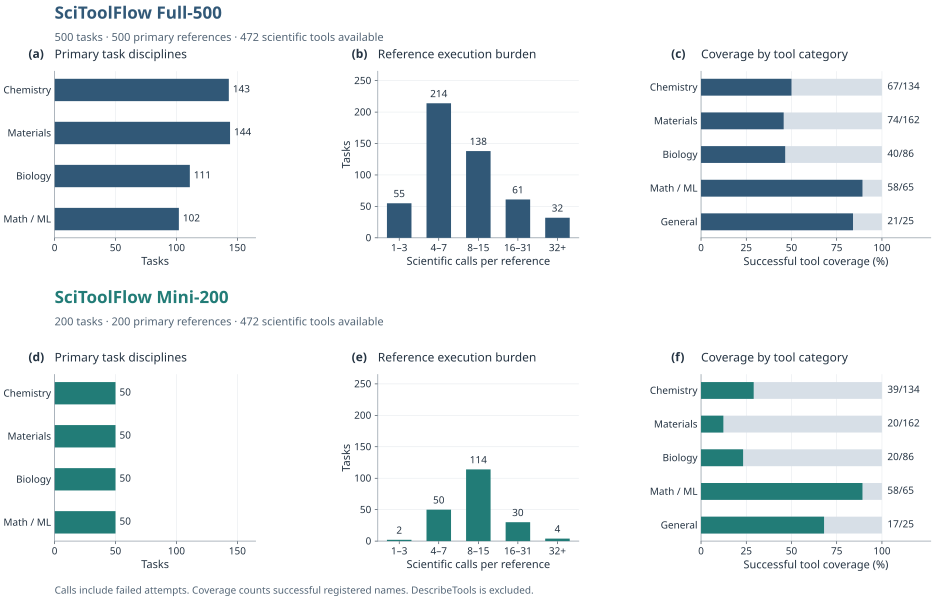
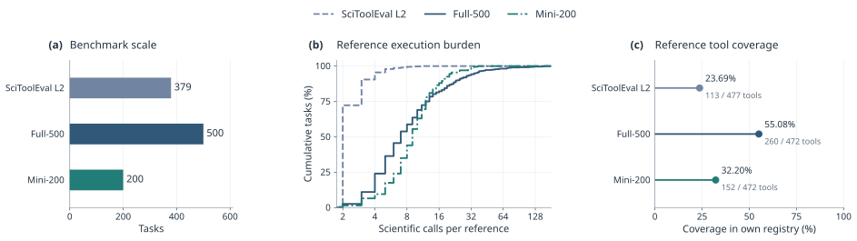

# SciToolFlow

**面向科学工具筛选、编排与证据推理的大语言模型 Benchmark。**

SciToolFlow提供 **Full-500完整题库**与**Mini-200编排题库**，覆盖化学、材料、生物／生态、机器学习／数理计算，共用 **472个科学工具**。模型需要理解研究目标、筛选工具、衔接中间数据，并通过真实执行支撑科学结论。默认运行入口为Mini。

- **科学工作流**：从常规计算、方法比较到有边界的科学探究，考察工具选择、分支组织与证据整合。
- **可执行工具**：实现、输入输出契约、失败反馈、环境路由、知识图谱和功能向量随项目提供。
- **可核验评分**：实际参数、工具输出、金标准与科学判据相互关联，支持追查运行、规划和答案中的错误。
- **统一实验接口**：ReAct、SciToolAgent、SciMas共用工具执行器、模型接口和资源策略，支持API、vLLM及本地权重。

[Full题库](tasks/full/README.md) · [Mini题库](tasks/mini/README.md) · [工具接口](tools/README.md) · [评分细则](evaluation/README.md) · [安装与部署](docs/setup.md)

## 题库与工作流

**Full-500**包含100道高难度科学探究题、50道工具组合题和350道正常题。任务覆盖模型识别、竞争解释、结构与物性分析、统计推断和科学结果验证，提供500条主参考及281条不重复的额外执行轨迹。

**Mini-200**由100道独立设计的编排题与100道Full精选题组成，**四学科各50题**。任务围绕独立科学分支、共享前提和结果汇合展开，例如多条件模型评估、候选结构分析和多来源证据整合。Full精选部分排除Full中标记的100道高难度题；独立编排题保留自身难度层级。



*上排为Full，下排为Mini。左列为任务主学科，中列为参考科学调用数，右列为按工具类别统计的成功覆盖；DescribeTools均不计入。主学科每题只计一次，工具类别可以跨学科使用。*

Mini的评分能力图中，**166题（83%）具有多层依赖**，34题主要表现为并行证据面板；134题的主参考涉及两个及以上工具类别。能力图包含可选与条件节点，其结构不等于实际并发度或加速比。SciMas的相对收益仍需通过独立模型实验检验。

Mini使用**运行完成率、工具规划准确率、答案准确率**；Full报告完整的Completion／Planning／Answer／Joint及部分分。两套题库共享科学判据框架，Full来源的Mini题保留原始参考身份，通过Mini题号运行和评分。[逐题分析与统计口径](docs/benchmark_analysis/README.md) · [映射评分机制](evaluation/README.md#mini与full的映射评分)

## 与 SciToolEval Level2 的对比

**更高的多工具编排负担、更广的非化学工具使用，以及可追溯到真实执行的科学评分。**

SciToolEval是benchmark，SciToolAgent是其agent框架。下表分别展示固定上游公开版本、Full和Mini的统计；任务规模与参考负担不作为模型性能提升。<sup><a id="comparison-cite-1" href="#comparison-note-1">[1]</a></sup>

| 对比维度 | SciToolEval Level2 | SciToolFlow Full | SciToolFlow Mini |
| :--- | ---: | ---: | ---: |
| 任务数 | 379 | **500** | **200** |
| 每题参考科学调用均值 | 2.47 | **11.888** | **11.21** |
| 每题参考科学调用中位数 | 2 | **7** | **9** |
| 至少4次参考科学调用 | 9.5%（36/379） | **89.0%（445/500）** | **99.0%（198/200）** |
| 最长参考科学调用序列 | 11 | **156** | **37** |
| 参考覆盖的注册工具数<sup><a id="comparison-cite-2" href="#comparison-note-2">[2]</a></sup> | 113 | **260** | **154** |
| 各自工具池内的参考覆盖率 | 23.69% | **55.08%** | **32.63%** |



### 1. 从短工具链，扩展到多阶段科学工作流

Level2公开参考中90.5%只有2–3次工具调用。相对于Level2，Full与Mini的每题参考调用均值分别为 **4.81×** 和 **4.53×**，要求模型持续完成“选择能力 → 取得证据 → 衔接参数 → 验证结论”。Mini参考每题平均成功使用4.32种不同工具，突出科学分支组织和中间结果管理。

长度反映参考执行负担，包含失败恢复，不等于科学难度、依赖深度或任何有效路线的最少调用次数。上游按公开工具路径计数，当前按真实参考执行计数，两者均排除DescribeTools。<sup><a id="comparison-cite-3" href="#comparison-note-3">[3]</a></sup>

### 2. 扩展生物、材料与数理工具的实际使用

| 工具类别 | Level2参考覆盖 | Full成功覆盖 | Mini成功覆盖 |
| :--- | ---: | ---: | ---: |
| 生物／生态 | 2/85 | **40/86** | **20/86** |
| 材料 | 4/199 | **74/162** | **20/162** |
| 化学 | 107/187 | 67/134 | 39/134 |
| 机器学习／数理 | 无独立注册类别 | **58/65** | **58/65** |

Level2公开路径中，生物与材料工具分别涉及7题、15题；Full为58题、90题，Mini为29题、37题。任务涉及数为多标签统计，一题可使用多个类别；原仓库没有独立数理注册组，不表示其算法没有数理能力。

覆盖率按各自注册目录计算，统计的不是一一对齐的科学能力。化学覆盖未在所有口径上增加，Mini材料工具覆盖率仍为12.35%；主学科均衡也不意味着工具使用均匀。<sup><a id="comparison-cite-4" href="#comparison-note-4">[4]</a></sup>

### 3. 从工具名路径，扩展到可核验的科学执行证据

| 可核验内容 | 所比较的公开Level2文件／脚本 | Full | Mini |
| :--- | :--- | :--- | :--- |
| 结构化参考答案 | 所比较的答案JSONL未提供答案值字段 | **500份金标准与公开schema** | **200份金标准与公开schema** |
| 逐步执行证据 | benchmark JSONL提供路径，未含逐步观测 | **500条主参考＋281条额外执行** | **200条真实主参考** |
| 工具规划判定 | 路径相同直接接受，其余使用LLM判断 | 必要能力、对象来源、依赖与完整方法路线 | 同一科学判据框架 |
| 科学答案判定 | 使用LLM比较回答与标准答案 | 显式科学判据、容差、边界与实际证据 | 按原科学判据与可信参考观测独立检查答案 |
| 评分所需模型 | 公开评分脚本调用生成模型 | **离线规则评分** | **离线规则评分** |

以上限定于所比较的公开文件，不推断作者内部数据。已审核的等价路线可以通过，独立分支可以换序，规定的数据依赖与科学要求仍须成立；未知方法进入独立复核。<sup><a id="comparison-cite-5" href="#comparison-note-5">[5]</a></sup>

Full与Mini部分共享任务和参考来源，不将两者数量相加作为独立样本数。完整判定、三项独立指标与同题算分案例见[评分细则](evaluation/README.md)，三方统计与来源身份见[对比数据](docs/comparison/current.json)。

## 项目结构

```text
SciToolFlow/
├── tasks/                 # 公开加载器与两个题库
│   ├── mini/              # 默认200题、独立附件与来源映射
│   └── full/              # 完整500题、分类与附件
├── tools/                 # 科学实现、统一契约、执行器、图谱与向量
├── baselines/             # ReAct、SciToolAgent、SciMas 与公共 harness
├── evaluation/            # 统一评分代码、金标准与参考执行证据
├── configs/               # 四个环境、服务参数和无密钥模板
├── resources/             # 科学工具源码、配置、已分发模型与参数
├── docs/                  # 安装部署、评分案例与题库分析
├── scripts/               # 资源准备、运行流水线和数据检查
├── src/                   # 公共模型客户端、文件与路径函数
├── tests/                 # 工具、评分、baseline、运行时与集成测试
├── results/               # 本机预测、轨迹与分数
└── .local/                # 本机密钥、模型权重与缓存，不纳入版本管理
```

Agent 读取公开任务、附件和工具契约；参考答案与科学判据由独立评分器读取。项目不依赖另外下载原始 SciToolAgent 仓库。[开发指南](docs/architecture.md)说明代码入口与依赖关系。

## 安装与配置

运行目标为 **Linux x86_64、Python 3.10**。四个环境分别承载公共科学工具、LLM、反应模型和 Chroma；日常使用激活 `SciTool-Unified`，执行器自动路由到相应环境。

先按[安装指南](docs/setup.md#1-准备安装源)准备指定 GPU wheel 与安装源，再逐条创建环境：

```bash
git clone https://github.com/haibala-ai/SciToolFlow.git
cd SciToolFlow

conda env create -f configs/environments/SciTool-Unified.yml
conda env create -f configs/environments/SciTool-LLM.yml
conda env create -f configs/environments/SciTool-RXN-Local.yml
conda env create -f configs/environments/SciTool-Chroma.yml

conda activate SciTool-Unified
python -m pip install -e . --no-deps --no-build-isolation
```

创建本机配置，已有文件会保留：

```bash
umask 077
mkdir -p .local/credentials
cp -n configs/services.env.example .local/credentials/services.env
cp -n configs/runtime.env.example .local/credentials/runtime.env

python -m scripts.maintenance.prepare_resources
python -m scripts.maintenance.prepare_resources --check
python -m scripts.tools.check_foundation
python cli.py validate
```

| 配置内容 | 在哪里填写或查看 |
| :--- | :--- |
| Conda 环境与科学程序路径 | `runtime.env`；[环境路径说明](docs/setup.md#填写-conda-路径) |
| Materials Project、Chroma 等科学服务账号 | `services.env`；[账号申请地址](docs/setup.md#填写科学工具的账号) |
| 已包含资源与需自行下载的权重、数据、程序 | [资源准备与下载地址](docs/setup.md#准备科学工具依赖的文件) |
| 用于 baseline 的生成 API／本地模型 | [生成模型配置](docs/setup.md#配置生成模型) |
| SciToolAgent 的同源 embedding 服务 | [检索配置](docs/setup.md#scitoolagent-检索配置) |

本地生成模型由使用者选择，可存放在任意可访问目录，通过 vLLM 服务接入。生成 API 与科学服务、检索 embedding 的凭据分开配置。工具绑定和本地资源可静态预检，远程服务是否可用仍取决于账号、网络及服务状态。<sup><a id="comparison-cite-6" href="#comparison-note-6">[6]</a></sup>

## 运行 baseline

| Baseline | 工具选择与执行方式 |
| :--- | :--- |
| [ReAct](baselines/react/README.md) | 初始看到按学科分类的工具名，按需 DescribeTools，逐步调用、观察、思考并提交答案 |
| [SciToolAgent](baselines/scitoolagent/README.md) | 图谱与向量检索、预先规划、逐工具执行、总结及重规划；需要同源 embedding 配置 |
| [SciMas](baselines/scimas/README.md) | 独立端口图谱，Planner／Executor／Reviewer 协作；并行 DAG 执行、科学门控、局部修复与任务内角色经验 |

配置生成模型后，先运行一题检查流程。三个 baseline 均支持 `--backend api` 和 `--backend vllm`，`--model` 指定 API 或本地服务中的模型名：

```bash
# API 生成；模型与服务凭据来自配置，也可显式传 --model
python cli.py run --baseline react --backend api --tasks SMAS-0103 \
  --output results/react_demo/predictions.json

# 本地 vLLM 生成；按实际服务填写模型名
python cli.py run --baseline scitoolagent --backend vllm --model "<served-model-name>" \
  --tasks SMAS-0103 --output results/kg_demo/predictions.json

# 全量测试：三个 baseline 使用相同资源策略
python cli.py run --baseline react --backend vllm --model "<served-model-name>" \
  --tasks all --concurrency 2 --output results/react_mini/predictions.json
```

默认每题 **400 次生成请求、7,200 秒**，SciToolAgent、SciMas 的所有角色合计计数。科学调用、DescribeTools 与显式 think 无独立次数上限；连续同工具同参数十个决策步后终止。token 用量另行报告，完整边界见[运行资源策略](docs/execution_policy.md)。

查询、规划、运行和评分默认使用 **`--dataset mini`**（200 题，SMAS-0001..0200）。完整源库用 **`--dataset full`**（500 题，FLOW-0001..0500）显式选择。Mini的Full来源题直接记录源题号，编号映射和三项主指标见 [Mini-200](tasks/mini/README.md)。

在相同代码、题库、模型和设置下，可向原命令追加 `--resume`；改变指纹后应新建实验目录。

## 测评

```bash
# 抽测时明确题目范围，与预测文件对应
python cli.py score --tasks SMAS-0103 \
  --predictions results/react_demo/predictions.json \
  --output results/react_demo/scores.json

# 正式全量评分，默认以 200 题为分母
python cli.py score --predictions results/react_mini/predictions.json \
  --output results/react_mini/scores.json
```

| Mini-200 主指标 | 回答的问题 | 输出字段 |
| :--- | :--- | :--- |
| 运行完成率 | 是否正常提交符合格式且资源合规的答案？ | `runtime_completion_rate` |
| 工具规划准确率 | 实际观测是否满足必要科学能力、来源、分支与依赖？ | `tool_planning_accuracy` |
| 答案准确率 | 用可信参考证据独立判断，科学答案是否正确？ | `answer_accuracy` |

三项独立报告，答案正确不补造工具证据；评分不调用 LLM。默认分母为200题，缺失预测计失败，抽测用与运行相同的`--tasks`。Full-500 显式选择后仍使用原`workflow.v1`整题与部分分报告，详见[评分细则](evaluation/README.md)与[Full案例](docs/scoring.md)。

| 实验产物 | 内容 |
| :--- | :--- |
| `predictions.json` | 逐题状态、答案、实际调用及运行指纹 |
| `trajectories/*/trajectory.json` | 模型决策、工具观测、资源账本与终止原因 |
| `progress.json` | 运行进度；完成数表示提交完成，科学正确性由评分给出 |
| `scores.json` | 总体指标和逐题诊断 |
| `scores_review_requests.json` | Full-500的未决方法／证据复核请求；Mini在逐题结果中报告待审状态 |

工程验收已通过41项回归、100条Full映射一致性核查及全部200份Mini参考自检；3道映射题重新执行24次科学工具调用并通过统一CLI评分。测试以参考决策回放驱动生产harness，不作为LLM自主解题成绩。[测试摘要](docs/benchmark_analysis/mini_validation.json)

## 数据与使用范围

当前公开题库为 **Mini-200**，Full-500 源库版本为 **20261026／0.4.0**。没有独立隐藏测试集，研究队列可能复用。任务类别是设计目标，不是按模型成功率划分的难度等级。参考由原生智能体执行并独立复查，不能据此声称已穷尽所有科学方法或替代领域专家验证。

报告实验时请同时给出题库版本、baseline、模型、后端、采样设置、资源策略、任务分母、待审数及 token 用量完整性。科学主指标与运行成本分别报告。

## 许可与来源

代码许可见 [LICENSE](LICENSE)。SciToolAgent baseline 适配自 [HICAI-ZJU/SciToolAgent](https://github.com/HICAI-ZJU/SciToolAgent)，固定来源与实现差异见[baseline 文档](baselines/scitoolagent/README.md)。外部数据、模型与科学程序遵循各自许可和访问条件，详见[资源说明](resources/README.md)。

## 维护与复验

```bash
python cli.py validate
python -m scripts.references.validate_release
python -m scripts.benchmark.analyze_benchmark --dataset mini
python -m scripts.benchmark.analyze_benchmark --dataset full
python -m scripts.benchmark.compare_release
```

资源准备、实验流水线及部署脚本的具体说明见[安装与部署指南末尾](docs/setup.md#脚本说明)。

## 统计口径与引用

<a id="comparison-note-1"></a>

**[1] 数据来源。** Full与Mini均按当前发布数据统计；Mini题号、来源与参考身份见[Mini统计](docs/benchmark_analysis/mini_statistics.json)。上游固定为提交 [`ac1cf19f`](https://github.com/HICAI-ZJU/SciToolAgent/tree/ac1cf19fcef84e69f149db6da424afe4e9b2f11f)，Full源版本为 `20261026`，Mini按当前发布文件哈希固定。来源文件哈希见[上游元数据](docs/comparison/sources/upstream_metadata.json)，全部对比值、变化量和分类口径见[当前统计](docs/comparison/current.json)。<a href="#comparison-cite-1">返回正文 ↑</a>

<a id="comparison-note-2"></a>

**[2] 工具与分类。** 上游按其注册工具组统计，SciToolFlow 按当前规范目录统计。每侧先去重注册名称；SciToolFlow 的 472 个科学工具不含 DescribeTools。原仓库没有独立 MachineLearning 注册组，不表示原算法完全没有数理能力；注册名称的增减也不能解释为新增或删除了同等数量的算法。<a href="#comparison-cite-2">返回正文 ↑</a>

<a id="comparison-note-3"></a>

**[3] 参考长度。** 上游是公开 `tool_path` 序列，Full与Mini均为主参考实际科学调用，包含失败恢复；两侧均排除 DescribeTools。长度不是模型轮数、依赖深度或任何有效路线的最少调用次数，4.81×与4.53×分别表示Full、Mini相对Level2的参考调用均值之比。<a href="#comparison-cite-3">返回正文 ↑</a>

<a id="comparison-note-4"></a>

**[4] 覆盖与学科。** 上游统计公开路径出现的注册名称，当前统计真实成功执行的注册名称。分母和分类体系不同，覆盖率差是各自目录内统计值之差，不是同一工具池上的控制实验。任务涉及数为多标签，一题可计入多个工具学科；主学科表则每题只计一次。覆盖不等于远程服务实时可用。<a href="#comparison-cite-4">返回正文 ↑</a>

<a id="comparison-note-5"></a>

**[5] 公开证据范围。** 比较对象为固定提交的 `SciToolEval/data/level2_question.jsonl`、`level2_correct_answer.jsonl` 及公开评分脚本。答案 JSONL 中严格解析成功的 378 条记录未发现答案值字段；这不表示作者内部没有金标准或执行轨迹。[路径评分源码](https://github.com/HICAI-ZJU/SciToolAgent/blob/ac1cf19fcef84e69f149db6da424afe4e9b2f11f/SciToolEval/eval/eval_tool_path.py)与[答案评分源码](https://github.com/HICAI-ZJU/SciToolAgent/blob/ac1cf19fcef84e69f149db6da424afe4e9b2f11f/SciToolEval/eval/eval_accuracy.py)说明其 LLM 判定方式。<a href="#comparison-cite-5">返回正文 ↑</a>

<a id="comparison-note-6"></a>

**[6] 执行资源。** 工具的实现、契约和环境路由随项目提供；使用相关工具仍需按[部署指南](docs/setup.md)配置账号、权重、外部程序和网络。静态预检与参考成功不保证全部远端接口持续可用。<a href="#comparison-cite-6">返回正文 ↑</a>
