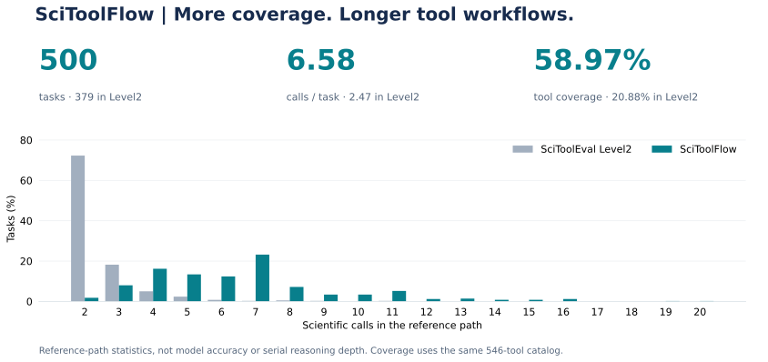
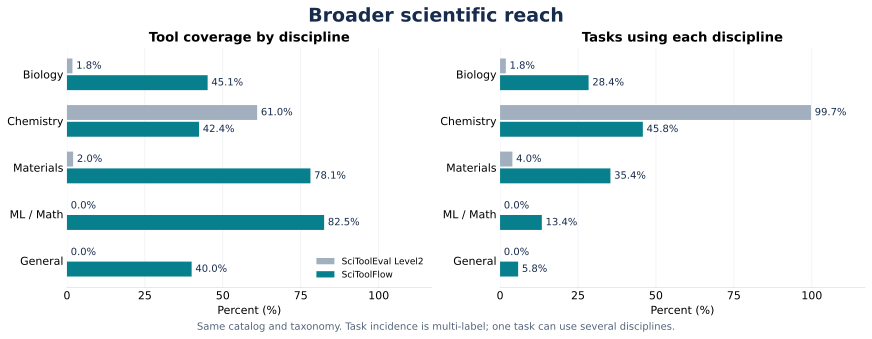

# SciToolFlow

**用于评估大语言模型科学多工具调用能力的 benchmark。**

SciToolFlow 提供 **500 道多工具任务、546 个任务工具和 ReAct / SciToolAgent 两个 baseline**，覆盖生物、化学、材料与机器学习／数理计算。任务要求模型选择工具、衔接参数、处理执行结果，并提交可核验的结构化答案。

- **任务与执行证据**：每道任务包含公开输入和答案 schema，评分端单独保存参考答案、必要调用路径与工具输出证据。
- **统一工具接口**：工具实现、输入输出契约、图谱与功能向量随项目提供；DescribeTools 支持按需批量查询工具用法。
- **可复现的实验流程**：两个 baseline 共用执行器与评分器，支持 API 和本地模型，分别报告运行完成、工具规划、答案和联合通过率。

[任务说明](tasks/README.md) · [工具接口](tools/README.md) · [评分细则](evaluation/README.md)

使用流程为：**安装环境 → 配置工具与模型 → 运行 baseline → 评分与可选 LLM 复核**。下文命令均从 `SciToolFlow/` 根目录执行。

## 与 SciToolEval Level2 的对比

**覆盖更多科学工具，组合更长的执行链，并让答案与执行证据一起接受核验。**

SciToolFlow 面向科学多工具调用：500 道任务、546 个科学工具，覆盖生物、化学、材料与数理计算。下表比较官方公开的 **SciToolEval Level2**；SciToolAgent 是其 agent 框架，二者名称不混用。

| | SciToolEval Level2 | **SciToolFlow** | 变化 |
| :--- | ---: | ---: | ---: |
| 任务数 | 379 | **500** | **+31.9%** |
| 科学工具池<sup>[1](#comparison-note-1)</sup> | 477 | **546** | **+69** |
| 每题参考科学调用数 | 2.47 | **6.58** | **2.66×** |
| 每题不同工具数 | 2.33 | **4.91** | **2.11×** |
| 参考路径覆盖工具数<sup>[2](#comparison-note-2)</sup> | 114 | **322** | **2.82×** |
| 工具覆盖率<sup>[2](#comparison-note-2)</sup> | 20.88% | **58.97%** | **+38.10 pp** |
| 跨类别任务占比<sup>[2](#comparison-note-2)</sup> | 5.54% | **28.00%** | **+22.46 pp** |



### 更完整的多工具任务

**90.2%** 的任务需要至少 4 次参考科学调用，原 Level2 为 **9.5%**；中位数从 **2 次**提高到 **6 次**，最长路径从 **11 次**扩展到 **20 次**。模型需要处理更多工具选择、参数衔接、分支结果与答案整合。

这里统计的是参考路径中的科学调用，包含对不同对象的重复工具使用，排除 DescribeTools；它不是模型思考轮数，也不是串行依赖深度。更长的路径体现执行负担，不能单凭长度断言科学推理更深。

### 从化学主导，扩展到四个科学学科



| 学科／辅助类别 | 工具覆盖：Level2 → SciToolFlow<sup>[2](#comparison-note-2)</sup> | 涉及任务：Level2 → SciToolFlow<sup>[3](#comparison-note-3)</sup> |
| :--- | :--- | :--- |
| 生物 | 2/113 → **51/113** | 7/379 → **142/500** |
| 化学 | **108/177** → 75/177 | 378/379 → 229/500 |
| 材料 | 4/201 → **157/201** | 15/379 → **177/500** |
| 机器学习／数理 | 0/40 → **33/40** | 0/379 → **67/500** |
| 通用辅助 | 0/15 → **6/15** | 0/379 → **29/500** |

SciToolFlow 的公开主学科分布为：化学 **159**、材料 **154**、生物 **140**、数理 **47**。同时提供 **40 个数理工具、15 个通用工具**，支持统计检验、回归、线性代数及结构化数据处理。546 个科学工具统一契约与执行绑定，另提供一个支持批量查询的 DescribeTools。

### 从“给出答案”到“可以检查答案怎么得到”

| 可复查内容 | 官方公开 Level2 文件<sup>[4](#comparison-note-4)</sup> | **SciToolFlow** |
| :--- | :--- | :--- |
| 答案接口 | 所比较的答案 JSONL 未含答案值字段 | **500 份结构化金标准、公开输出 schema、字段规则** |
| 参考执行证据 | 所比较的两个 JSONL 不含逐步输出 | **500 份证据归档、3,344 条工具结果** |
| 科学工具执行 | 本次未重新部署原环境 | **547/547 入口静态预检；隔离 worker、超时和明确错误反馈** |
| 计划评价 | 参考工具路径与 LLM 判断 | **实际工具、实参、依赖与预算；支持独立分支换序** |
| 答案评价 | 官方脚本使用 LLM 判断 | **字段类型、完整数组、显式数值容差；歧义单独复核** |
| 结果报告 | Pass / Planning / Answer | **Completion / Planning / Answer / Joint；规则分与复核分分开** |

**公开题目与私有参考分离，失败和缺失不从分母消失。** 两个 baseline 共用工具执行器和评分器；LLM 可选择 API 或本地模型，复核记录绑定参考与预测双哈希。

<details>
<summary><strong>已知限制与统计来源</strong></summary>

**优势有边界：** 当前化学工具覆盖低于原集；有序工具路径为 257 种，少于原集的 335 种，尚无独立隐藏测试集。参考证据不全是完整模型对话；547 项静态预检不等于所有远端服务实时可用。以上比较支持覆盖、执行负担和工程可复查性的改进，不宣称科学质量或模型准确率全面领先。

脚本不调用科学工具或 LLM，不使用模型成败筛选任务。数据版本：`20261018-scientific-contract-audit`；统计可追溯至规范题库、参考和固定上游提交。

[统计 JSON](docs/comparison/statistics.json) · [工具增删明细](docs/comparison/tool_delta.json) · [上游元数据](docs/comparison/sources/upstream_metadata.json) · [PNG 概览](docs/comparison/overview.png) · [PNG 覆盖图](docs/comparison/coverage.png)

</details>


## 项目结构

```text
SciToolFlow/
├── tasks/                       # 公开题目、输入附件和答案 schema
├── tools/                       # 工具实现、契约、worker、图谱与向量
├── baselines/{react,scitoolagent,common}/
├── evaluation/                  # 评分代码、参考答案与执行证据
├── resources/                   # 已包含的科学工具源码、小型模型与参数
├── configs/                     # 环境文件、服务参数和配置模板
├── scripts/                     # 模型服务、实验流水线与构建检查
├── results/                     # 实验产生的预测、轨迹与分数
└── .local/                      # 本地密钥、权重和外部资源，不纳入版本管理
```

Agent 运行时只加载公开题目、附件和工具契约；参考答案与参考轨迹由独立评分器读取。项目运行不依赖另外下载原始 SciToolAgent 仓库。

## 安装

运行目标为 **Linux x86_64、Python 3.10**。科学工具按依赖分布在四个 Conda 环境中：

- `SciTool-Unified`：项目入口、测评和大多数科学工具。
- `SciTool-LLM`：vLLM、Transformers 和模型工具。
- `SciTool-RXN-Local`：本地反应模型。
- `SciTool-Chroma`：Chroma 工具。

日常运行只需激活 `SciTool-Unified`，工具执行器会自动选择其余环境的 Python。本地模型与部分科学工具需要 NVIDIA GPU；使用生成 API 不会消除科学工具自身的 GPU 或模型依赖。

### 1. 准备安装源

从 [Miniconda 官方安装说明](https://www.anaconda.com/docs/getting-started/miniconda/install)安装 Conda，并在终端执行 `conda --version` 确认可用。[环境文件](configs/environments/)已列出 Python 和依赖版本，`conda env create` 会依次安装 Conda 与 pip 依赖。

GPU 依赖使用特定构建：需要为 Python 3.10／Linux x86_64 准备 **`vllm==0.21.0+cu129` wheel 和 `xformers==0.0.35` 的 cu128 wheel**。下载入口为 [vLLM v0.21.0 发行页](https://github.com/vllm-project/vllm/releases/tag/v0.21.0)和 [PyTorch cu128 的 xformers 安装包目录](https://download.pytorch.org/whl/cu128/xformers/)；选择对应版本与平台的 `.whl` 后放入 `.local/wheels/`。源码仓库不分发这些文件。完整版本见 [LLM 依赖](configs/services/requirements-qwen-vllm.txt)。

```bash
mkdir -p .local/wheels
# 将所需 .whl 文件放入 .local/wheels/ 后，设置安装源。
export PIP_FIND_LINKS="$PWD/.local/wheels"
export PIP_EXTRA_INDEX_URL="https://download.pytorch.org/whl/cpu https://download.pytorch.org/whl/cu128"
```

### 2. 创建四个环境

逐条执行以下命令，每条成功后再执行下一条。YAML 中的 `name` 决定环境名，命令会创建环境并安装其依赖。

```bash
conda env create -f configs/environments/SciTool-Unified.yml
conda env create -f configs/environments/SciTool-LLM.yml
conda env create -f configs/environments/SciTool-RXN-Local.yml
conda env create -f configs/environments/SciTool-Chroma.yml
```

已有同名环境时跳过对应命令。若报 `No matching distribution found`，按报错中的包名和版本检查安装源；尤其是上述 GPU wheel，缺失时仅复制 YAML 不能完成安装。

### 3. 安装 SciToolFlow

```bash
conda activate SciTool-Unified
python -m pip install -e . --no-deps --no-build-isolation
```

`-e .` 从当前源码目录安装项目，`--no-deps` 保留环境文件安装的依赖。其余三个环境运行独立工具 worker，无需重复安装 SciToolFlow。

### 4. 检查环境

```bash
conda env list
conda run -n SciTool-Unified python --version
conda run -n SciTool-LLM python --version
conda run -n SciTool-RXN-Local python --version
conda run -n SciTool-Chroma python --version
```

四个环境应均报告 Python 3.10。运行实验前，还需完成下文的服务与科学资源配置。环境文件来自开发部署的版本快照，跨机器完整重建尚未验证；NVIDIA 驱动、系统库和专用 wheel 需与目标平台匹配。

## 配置工具与本地资源

服务地址和密钥保存在 **`.local/credentials/services.env`**，环境及资源路径保存在 **`.local/credentials/runtime.env`**。首次使用时从模板创建：

```bash
umask 077
mkdir -p .local/credentials
cp -n configs/services.env.example .local/credentials/services.env
cp -n configs/runtime.env.example .local/credentials/runtime.env
```

程序自动读取这两个文件；已有配置会保留。按实验涉及的功能填写，不使用的服务可留空。

### 填写 Conda 路径

执行 `conda env list` 查看环境位置。在 `runtime.env` 中填写四个环境的父目录，以及 LLM 环境的 Python。例如，环境位于 `/opt/conda/envs/` 时设置：

```dotenv
SCITOOL_CONDA_ENVS_PATH=/opt/conda/envs
SCITOOL_LLM_PYTHON=/opt/conda/envs/SciTool-LLM/bin/python
```

将示例中的 `/opt/conda/envs` 替换为实际的绝对路径。

### 填写科学工具的账号

在 `services.env` 中，将以下变量的值替换为对应服务提供的真实密钥：

- **Materials Project**：注册并登录 [Materials Project](https://materialsproject.org/)，在 [Dashboard](https://next-gen.materialsproject.org/dashboard)取得 API key，填入 `MP_KEY`。操作说明见[官方 API 入门](https://docs.materialsproject.org/downloading-data/using-the-api/getting-started)。
- **Brave Search**：从 [Brave Search API](https://brave.com/search/api/)进入控制台，开通适用计划并在 API Keys 中创建密钥，填入 `BRAVE_SEARCH_API_KEY`。供名为 `BingSearch` 的工具使用；[官方授权说明](https://api-dashboard.search.brave.com/documentation/guides/authentication)。
- **ChemSpider**：通过 [RSC Developer Portal](https://developer.rsc.org/)注册或登录，申请具有 ChemSpider／Compounds API 权限的密钥，填入 `CHEMSPIDER_API_KEY`，供 `InChIToCSID` 使用。门户可能要求登录；访问权限与申请条件以 RSC 为准。
- **Wolfram Alpha**：在 [Developer Portal](https://developer.wolframalpha.com/)创建应用并取得 AppID，填入 `WOLFRAM_ALPHA_APPID`；[官方 AppID 获取说明](https://products.wolframalpha.com/api/documentation)。
- **Chroma**：从官方仓库提供的[权重授权申请入口](https://chroma-weights.generatebiomedicines.com/)申请下载 token，填入 `CHROMA_KEY`。这是科学工具模型的权重授权；[官方说明](https://github.com/generatebio/chroma#get-started)。

这些是科学工具的授权，与生成 LLM 的密钥分开。公共 HTTP 数据源还需要网络可达。每项配置对应的全部工具名称可查 [tool_resources.json](configs/tool_resources.json)。

### SciToolAgent 检索配置

在 [AIHubMix 控制台](https://console.aihubmix.com/)创建有 embedding 调用权限的 API key，按[官方密钥管理说明](https://docs.aihubmix.com/cn/console/api-keys)配置。在 `services.env` 中设置：

```dotenv
SCITOOL_EMBEDDING_API_BASE=https://aihubmix.com/v1
SCITOOL_EMBEDDING_API_KEY=YOUR_EMBEDDING_API_KEY
```

附带的工具索引使用该服务的 `text-embedding-3-large`、3,072 维、L2 归一化向量。将密钥替换为具有该服务 embedding 权限的密钥；模型与维度由索引元数据指定。ReAct 不需要此配置；SciToolAgent 在使用本地生成模型时仍需要检索 embedding。更换提供商或 embedding 模型需要重建索引。

### 选择生成 LLM

用于 baseline 和 LLM judge 的模型由使用者选择，**不限定模型系列，也不要求权重存放在 `.local/`**。本地部署可使用任意兼容的模型目录，通过 vLLM 的服务地址与模型名接入；远程 API 使用 `SCITOOLFLOW_API_BASE`、`SCITOOLFLOW_API_KEY`、`SCITOOLFLOW_API_MODEL`。具体启动方式见下文“配置生成模型”。纯规则评分不需要 LLM。

### 准备科学工具依赖的文件

科学工具使用的资源与驱动 Agent 的生成 LLM 分开配置。仓库已提供约 **52 MB 的小型资源包**，最大单文件约 **2.9 MB**；大模型权重、完整 HIPPIE 数据和平台相关二进制文件不随源码分发。

**仓库已包含，无需另行下载：**

- **MOFSimplify**：两个小型 HDF5 模型及配套训练／验证／测试表格，约 7.8 MB，位于 [resources/models/MOFSimplify](resources/models/MOFSimplify)。
- **外部源码**：OmegaFold、DeepTMHMM2、RXN Sandbox 的源码与 RXN 词表；RASPA2、Zeo++／Voro++ 的可编译源码，以及 Eigen 头文件，位于 [resources/external_sources](resources/external_sources)。RXN 同时包含其小型 SCScore 支持文件。
- **力场与参数**：本项目实际使用的 RASPA 力场定义、逐文件 SHA256 清单，以及对应 aiida-lsmo 参数／渲染器和许可。
- **小型归档与来源记录**：MP 公开历史快照及电荷密度索引、DeepTMHMM2 和 HIPPIE 的历史来源记录。来源记录不代表相应的大文件已经包含。
- **公开任务输入**：Q-Chem 输出等任务附件已在 [tasks/assets](tasks/assets/) 中，无需重复下载。

首次使用时执行一次离线准备，将资源放到工具要求的 `.local/` 路径：

```bash
python scripts/prepare_resources.py
python scripts/prepare_resources.py --check
```

离线准备脚本的参数与冲突处理见文末“脚本说明”。文件清单、来源许可及编译步骤见 [resources/README.md](resources/README.md) 和 [resources/manifest.json](resources/manifest.json)。

**仍需自行下载或安装：**

- **用于 Agent／judge 的本地生成模型**：自由选择模型，按下文部署；使用远程生成 API 时无需下载其权重。
- **ProteinForceGPT**：[lamm-mit/ProteinForceGPT](https://huggingface.co/lamm-mit/ProteinForceGPT)，完整模型和 tokenizer 放入 `.local/models/ProteinForceGPT/`。
- **ESMFold**：[facebook/esmfold_v1](https://huggingface.co/facebook/esmfold_v1)，完整 Transformers 模型放入 `.local/models/esmfold_v1/`。
- **OmegaFold 权重**：下载 [release1.pt](https://helixon.s3.amazonaws.com/release1.pt)，保存为 `.local/models/OmegaFold/release1.pt`。源码已提供，本工具使用 model 1。
- **DeepTMHMM2 权重**：下载 [10 个 checkpoints](https://github.com/fteufel/DeepTMHMM2/tree/526f6c60f93c0868c7315413da8e669d12373cc3/checkpoints) 至 `.local/external_sources/DeepTMHMM2/checkpoints/`；另从 [ESM 官方模型清单](https://github.com/facebookresearch/esm#available-models)取得 `esm2_t33_650M_UR50D.pt` 与 contact-regression 文件，放入 `.local/models/torch_cache/hub/checkpoints/`。源码与历史版本记录已提供，权重须匹配所记录的版本。
- **BioT5 权重**：分别下载 [dti-human](https://huggingface.co/QizhiPei/biot5-base-dti-human)、[peer-binloc](https://huggingface.co/QizhiPei/biot5-base-peer-binloc)、[peer-human_ppi](https://huggingface.co/QizhiPei/biot5-base-peer-human_ppi)、[peer-solubility](https://huggingface.co/QizhiPei/biot5-base-peer-solubility)、[peer-yeast_ppi](https://huggingface.co/QizhiPei/biot5-base-peer-yeast_ppi)、[text2mol](https://huggingface.co/QizhiPei/biot5-base-text2mol)和 [BioT5+ chebi20](https://huggingface.co/QizhiPei/biot5-plus-base-chebi20)，按完整仓库名最后一段建立 `.local/models/` 下的模型目录。
- **Chroma 权重**：按 [generatebio/chroma](https://github.com/generatebio/chroma#get-started)申请 token 并配置 `CHROMA_KEY`；权重及校验缓存写入 `.local/models/chroma/`。
- **RXN 预测权重**：从 [rxn4chemistry/rxn-sandbox](https://huggingface.co/rxn4chemistry/rxn-sandbox)下载实际模型文件，分别放到 `.local/models/rxn-sandbox/models/forward/Pistachio2025Q2-Forward.ckpt` 和 `retrosynthesis/Pistachio2025Q2-Retro.ckpt`。源码、词表与 SCScore 小文件已提供；不要使用 Git LFS 指针替代预测权重。
- **HIPPIE 完整数据**：约 132 MB，从[官方历史版本页](https://cbdm-01.zdv.uni-mainz.de/hippienew/download/)选择 v2.4 TAB；当前工具读取 `.local/reference_data/HIPPIE/hippie_v2_4_20261013.tsv`。已提供的历史 SHA256 是核验依据；新的 `current` 文件或不同版本不能视为同一快照。
- **科学程序的可执行文件**：RASPA2 和 Zeo++ 的源码已提供，需在目标机器编译；DSSP／`mkdssp` 从 [PDB-REDO/dssp](https://github.com/PDB-REDO/dssp)安装。具体命令和路径配置见 [资源说明](resources/README.md)。

大模型的下载方法见 [Hugging Face 官方文档](https://huggingface.co/docs/huggingface_hub/guides/download)。MP 的完整归档仍从 [MP 官方 AWS 数据集](https://registry.opendata.aws/materials-project/)取得；仓库内的小型快照不代表全部历史对象。服务账号及密钥仍按前文单独申请和配置。

资源放到其他位置时，在 `runtime.env` 设置相应绝对路径：`FORCEGPT_MODEL_PATH`、`ESMFOLD_MODEL_PATH`、`OMEGAFOLD_MODEL_PATH`、`DEEPTMHMM_MODEL_PATH`、`QizhiPei_MODEL_PATH`、`SOLVENT_THERMAL_MODELS`、`RASPA_EXECUTABLE_PATH`、`SCITOOL_ZEOPP_EXECUTABLE`、`SCITOOL_DSSP_EXECUTABLE`。RXN 等固定目录资源保留上述结构。

### 验证安装与工具配置

```bash
python cli.py validate                  # 题目、参考、源码和契约完整性
python scripts/check_foundation.py      # 547 个入口的绑定、环境、资源和图谱静态预检
python cli.py describe PearsonCorrelation
python cli.py call PearsonCorrelation --arguments '{"x":[1,2,3],"y":[2,4,6]}'
```

预检列出缺少的环境、密钥、权重和程序。工具接口是否在线还需实际调用确认；数据包验证与静态预检不需要启动生成 LLM。

## 配置生成模型

两种方式都适用于 **ReAct、SciToolAgent，以及可选 LLM judge**；actor 与 judge 可以选不同后端和模型。

### 本地模型：通过 vLLM 接入自选模型

模型可从其发布方或 [Hugging Face 模型库](https://huggingface.co/models)取得，保存到任意可访问目录。选择支持对话生成的模型，确认所安装 vLLM 版本支持其架构，参见 [vLLM 支持模型清单](https://docs.vllm.ai/en/latest/models/supported_models/)。模型系列、规模、量化方式、权重位置和 GPU 数量均由使用者决定。

在独立终端或 tmux 中启动服务。以下 `/absolute/path/to/your-model` 是自选模型的实际目录，`scitoolflow-local` 是对外服务名：

```bash
conda activate SciTool-LLM
CUDA_VISIBLE_DEVICES=0,1 vllm serve /absolute/path/to/your-model \
  --served-model-name scitoolflow-local \
  --host 127.0.0.1 --port 8016 --tensor-parallel-size 2 \
  --dtype auto --gpu-memory-utilization 0.90 --max-num-seqs 2
```

例如单卡部署时，将 `CUDA_VISIBLE_DEVICES` 改为一个设备编号，并将 `--tensor-parallel-size` 改为 `1`。模型的 chat template、上下文上限和原生 reasoning 参数按其官方部署要求设置；[vLLM 服务文档](https://docs.vllm.ai/en/latest/serving/openai_compatible_server/)。

在 `.local/credentials/services.env` 配置相同的地址和服务名，然后回到 `SciTool-Unified` 环境运行 baseline：

```dotenv
SCITOOLFLOW_VLLM_BASE=http://127.0.0.1:8016/v1
SCITOOLFLOW_VLLM_MODEL=scitoolflow-local
```

`--backend vllm` 只连接本机 loopback 服务，不读取生成 API 密钥。使用远程自托管服务时，按下文 API 方式配置地址。运行参数 `--max-input-tokens` 与 `--max-output-tokens` 应为所选模型的上下文窗口预留足够空间；更换模型后使用新结果目录并记录模型版本和采样设置。

通用本地模型使用上述 vLLM 服务接入。项目另附 Qwen 专用启动配置及直接 worker，其适用范围见文末“脚本说明”。

### 生成 API：OpenAI Chat Completions 兼容接口

在 `services.env` 设置：

```dotenv
SCITOOLFLOW_API_BASE=https://your-provider.example/v1
SCITOOLFLOW_API_KEY=YOUR_GENERATION_API_KEY
SCITOOLFLOW_API_MODEL=YOUR_MODEL
SCITOOLFLOW_API_TOKEN_PARAMETER=max_completion_tokens
```

若接口只接受 `max_tokens`，将最后一项改为 `max_tokens`。默认请求 JSON object；不支持时设 `SCITOOLFLOW_API_JSON_MODE=0`，仍做本地协议／答案格式校验。支持 JSON Schema 的服务可显式设置 `SCITOOLFLOW_API_STRUCTURED_OUTPUT=1`；默认不开启。可用 `SCITOOLFLOW_API_EXTRA_BODY` 配置 temperature 等供应商参数，禁止覆盖模型、messages、token 上限和结构协议。HTTP 失败不自动重发付费生成。

将 `YOUR_GENERATION_API_KEY` 和 `YOUR_MODEL` 替换为供应商提供的值。生成 API 与检索 embedding 分别配置，支持使用不同的服务和授权。

## 运行 baseline

先用两条任务确认部署，再运行全部 500 题：

```bash
# 本地 ReAct
python cli.py run --baseline react --backend vllm --tasks FLOW-0285,FLOW-0481 \
  --output results/react_demo/predictions.json
# 生成 API：读取 services.env 中的 SCITOOLFLOW_API_MODEL
python cli.py run --baseline react --backend api --tasks FLOW-0285,FLOW-0481 \
  --output results/react_api_demo/predictions.json
# SciToolAgent：同一套 backend/model 参数
python cli.py run --baseline scitoolagent --backend vllm --tasks FLOW-0285,FLOW-0481 \
  --output results/kg_demo/predictions.json
python cli.py run --baseline scitoolagent --backend api --tasks FLOW-0285,FLOW-0481 \
  --output results/kg_api_demo/predictions.json
```

ReAct 从分类工具名开始，按需调用 DescribeTools，支持 think、inspect、工具调用和 finish。SciToolAgent 依次进行 KG 检索、计划链生成、逐工具执行和总结，支持至多三轮重规划；所有角色的模型请求均计入预算。两者共用执行器、公开答案结构及评分，DescribeTools 不计入科学调用路径。

默认每题最多 80 个决策步、20 次工具发现、8 次显式 think、1,800 秒，每次模型输出最多 4,096 tokens；科学调用预算读取题目的 `max_tool_calls`。同工具同参连续十个决策步后终止，非连续重复不累计。完整参数见 `python cli.py run --help`，协议与实现见 [ReAct](baselines/react/README.md) 和 [SciToolAgent](baselines/scitoolagent/README.md)。比较 baseline 时应固定预算、采样、模型及 API 结构约束能力。

批量运行及自动评分由 `scripts/run_benchmark.py` 提供，命令与参数示例见文末“脚本说明”。

长任务建议在 tmux 中运行。中断后，在**同一代码、题库和运行设置**下向原命令追加 `--resume`；已记录失败也会保留，只有显式 `--retry-failed` 的单独 run 命令才重做失败题。未写断点的中断题从头运行。代码或模型设置变更时须使用新结果目录，禁止改指纹强行合并。

## 测评

**规则评分纯离线，不调用 LLM。** 默认按全部 500 题计分；抽测必须给 `--tasks`，否则其余题按缺失失败计算。

```bash
python cli.py score --tasks FLOW-0285,FLOW-0481 --predictions results/react_demo/predictions.json \
  --output results/react_demo/scores.json
# 可选本地 judge；也支持 --backend local
python cli.py judge --backend vllm --requests results/react_demo/scores_review_requests.json \
  --output results/react_demo/reviews_local.json
# 可选 API judge，支持与 actor 不同的模型
python cli.py judge --backend api --model YOUR_JUDGE_MODEL --requests results/react_demo/scores_review_requests.json \
  --output results/react_demo/reviews_api.json
# 只有显式传 reviews 才应用复核结论
python cli.py score --tasks FLOW-0285,FLOW-0481 --predictions results/react_demo/predictions.json \
  --reviews results/react_demo/reviews_local.json --output results/react_demo/reviewed_scores.json
```

| 指标（JSON 字段） | 含义 |
| :--- | :--- |
| **Completion** (`pass_rate`) | 正常提交非空答案，未报告失败或科学预算超限；不表示答对 |
| **Planning** (`tool_planning_accuracy`) | 完成任务，真实成功调用的工具、实参与参考依赖匹配；独立分支可以换序，合法短路径可交复核 |
| **Answer** (`final_answer_accuracy`) | 完成任务，必填字段、类型、科学内容、完整数组及显式容差均通过 |
| **Joint** (`joint_pass_rate`) | 同一题 Completion、Planning、Answer 全部通过 |
| `*_strict` | 复核前的规则判定，不因 LLM 复核而覆盖；pending 按未通过计入比例 |
| `pending_*` | 仍需语义／独立审核的题数；没有静默从分母删除 |
| `joint_accuracy_lower_bound / upper_bound` | 当前已通过的比例／可满足条件的 pending 全部通过时的乐观上界，不是统计置信区间 |
| `reference_path_match_rate` | 路径匹配诊断，不以正常完成为前提；不能当作正式 Planning |
| `mean_answer_*_credit_supplied` | 已提供预测的字段／科学叶子微平均部分分；叶子规则去重，不等于整题准确率 |
| `mean_step_recall_supplied` | 已提供预测的必要调用（工具及实参）匹配召回均值；不等于完整计划正确 |
| `mean_tool_occurrence_recall_supplied` | 已提供预测按工具出现次数计算的召回均值；弱于实参／依赖核验 |

比例字段取 0–1；正式主指标分母为所选全部有效题（当前全量为 500），失败和漏交均保留。科学数值按 `abs(pred-ref) <= atol + rtol*abs(ref)` 比较；标识符、单位、对象身份和数组顺序按规则检查。DescribeTools 的实际成本保留，但排除于科学路径、召回和科学预算。

LLM judge **只复核 pending**，不能把明确数值错误、缺字段或 schema 错误改判通过；数据源变化等要求独立审查的项目不自动交给 LLM。API judge 会向所配服务发送问题、参考和完整实际证据；超出上下文的请求保留未决，不截断科学结果。复核绑定参考／预测双哈希；规则分和复核分分别保存，同一弱模型自审不是专家认证。

## 实验产物

| 产物 | 内容 |
| :--- | :--- |
| `predictions.json` | 每题状态、真实 calls、答案、失败原因和运行指纹 |
| `trajectories/*/trajectory.json` | 每步模型决策、观察、预算；KG baseline 还含检索和角色阶段 |
| `progress.json / experiment.json` | 逐题进度／实验阶段；前者的 completed 只是运行完成数 |
| `scores.json / scores_review_requests.json` | 规则分数／待复核证据 |
| `reviews*.json / reviewed_scores.json` | 复核记录／明确应用复核后的分数 |

## 数据版本与使用范围

题库版本为 `20261018-scientific-contract-audit`。500 条参考为经助手逐项审查的暂定版本，尚未划分独立隐藏测试集。任务覆盖和静态部署检查不代表所有外部接口持续可用；学科分布、比较口径与已知限制见本页对比部分。

报告实验时，应同时记录题库版本、baseline、模型、后端、采样、预算和是否使用 LLM 复核。规则分与复核分分别保留；不同题库或运行指纹的预测不应合并。已有运行与审查记录见 [results](results/README.md)。

## 许可与来源

代码许可见 [LICENSE](LICENSE)。SciToolAgent baseline 适配自 [HICAI-ZJU/SciToolAgent](https://github.com/HICAI-ZJU/SciToolAgent)，来源、固定版本与实现差异见 [baseline 文档](baselines/scitoolagent/README.md)。外部模型、数据和科学程序遵循各自的许可与访问条件。

## 脚本说明

### 离线资源准备：`scripts/prepare_resources.py`

将 `resources/manifest.json` 列出的资源复制到 `.local/`，全程不联网。先验证整批源文件 SHA256，再检查目标：相同文件复用；发现内容冲突则停止，不覆盖本地修改。准备完成只表示随仓库的小资源齐全，不表示大权重、密钥或编译程序已经配置。

```bash
python scripts/prepare_resources.py
python scripts/prepare_resources.py --check
# 只准备指定组件，可重复传入 --component。
python scripts/prepare_resources.py --component mofsimplify_models
# 使用独立目录检查，不改变工具默认读取路径。
python scripts/prepare_resources.py --destination .local/work/resource_staging
```

### 实验流水线：`scripts/run_benchmark.py`

依次执行 baseline 和规则评分；显式开启 `--judge` 后，再生成 pending 复核并重新评分。actor 与 judge 可使用不同后端和模型，结果写入 `--output-dir`。

全量运行及自动评分：

```bash
# 选择 scitoolagent 可运行 KG baseline；--backend api 使用已配置的生成 API。
python scripts/run_benchmark.py --baseline react --backend vllm --tasks all --concurrency 2 \
  --output-dir results/react_full
# 可选：本地 actor + API judge；仅处理规则评分留下的 pending 项
python scripts/run_benchmark.py --baseline react --backend vllm --tasks all --concurrency 2 \
  --judge --judge-backend api --judge-model YOUR_JUDGE_MODEL --output-dir results/react_with_judge
```

### 预检与构建脚本

- `scripts/check_foundation.py`：检查工具绑定、解释器、声明资源、图谱和向量，结果写入 `results/reports/tool_preflight.json`；不调用科学工具或生成 LLM。
- `scripts/index_results.py`：为本机结果生成 `results/index.json`，保留原始轨迹和哈希。
- `scripts/compare_level2.py`：生成本页图表与统计，不调用科学工具或 LLM，也不按模型成败筛选题目。
- `scripts/freeze.py`：在源码、文档或打包资源变更后重建 `MANIFEST.json`；随后执行 `python cli.py validate` 校验分发文件。

从本地并列的官方仓库重新提取元数据并绘图：

```bash
conda activate SciTool-Unified
python scripts/compare_level2.py --refresh-upstream --upstream ../SciToolAgent
# 无上游 checkout 时，默认使用已校验的元数据快照
python scripts/compare_level2.py
```

### Qwen 专用启动配置

项目另提供 [Qwen 部署配置](configs/services/qwen_vllm.json)及 `scripts/model_service.py`，用于已验证的 Qwen 启动参数；该脚本包含 Qwen 专用 reasoning 设置。`--backend local` 也属于 Qwen3.5 专用 Transformers worker，并发为 1，使用 `SCITOOL_MODEL_PATH`、`SCITOOL_LLM_PYTHON` 和 `SCITOOL_LLM_GPU` 配置，可能复用同权重常驻服务。**其他本地模型使用上面的通用 vLLM 接入方式**，不依赖这两个 Qwen 专用入口。


## 统计口径

<a id="comparison-note-1"></a>

**[1] 工具池。** 工具池按 dispatcher 的去重注册名称计算：原项目 489 个列表槽位、477 个名称；当前 546 个科学工具，不含 DescribeTools。净增 69 包括新增名称、分类调整、别名合并与删除，不能解释为从零实现 69 个新算法。

<a id="comparison-note-2"></a>

**[2] 工具覆盖与分类。** 横向覆盖统计将原路径的正式别名映射到当前 **546 工具**的共同目录与分类，分母一致；原项目自身目录的原生覆盖率为 **113/477=23.69%**。跨类别包含通用辅助类别。机器学习原先没有独立注册组；新增范围与重新分类不能混为一谈。

<a id="comparison-note-3"></a>

**[3] 学科任务数。** 学科涉及任务按多标签统计：一题可计入多个学科，因此不能将各行相加作为总题数。两组比例的分母分别为 379、500，不将上游推断主学科与本项目人工标签混比。

<a id="comparison-note-4"></a>

**[4] 上游版本与证据范围。** 上游固定到 [`ac1cf19f`](https://github.com/HICAI-ZJU/SciToolAgent/tree/ac1cf19fcef84e69f149db6da424afe4e9b2f11f)，仅对该提交公开文件作结论，不推断作者内部数据缺失。[论文](https://arxiv.org/html/2507.20280v1#S2.SS2)报告 Level2 为 379 题，并有专家审核；本项目参考仍是助手审查版本。
