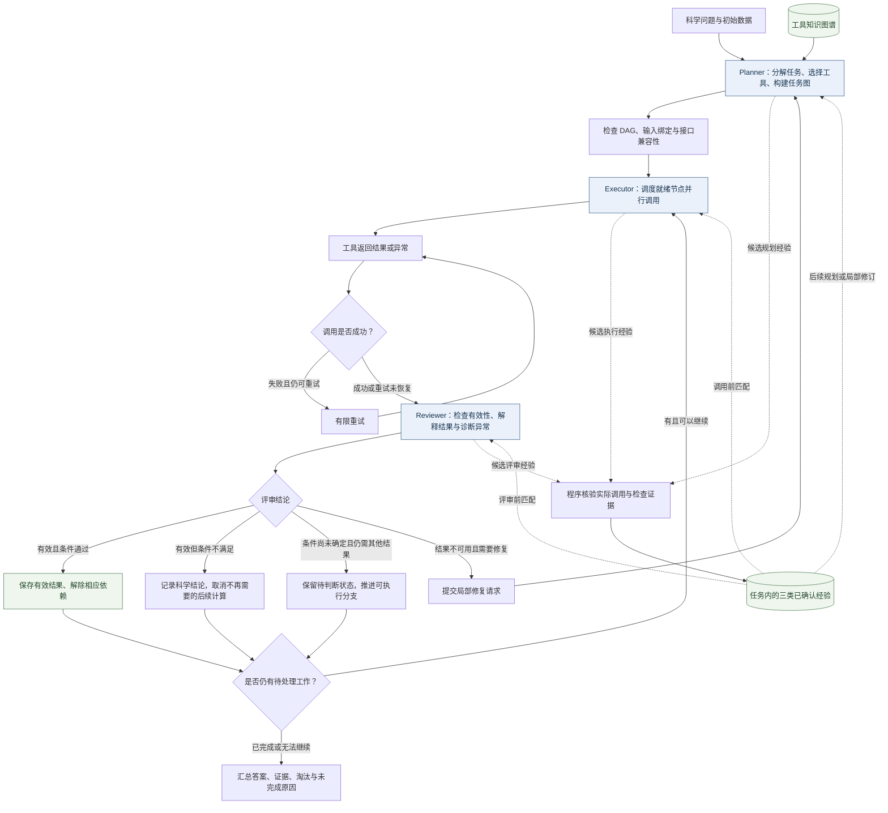

# SciMas

**SciMas 是面向复杂科学问题的多智能体科学工具编排方法。** 它将科学问题转化为带有数据依赖与科学约束的任务图，通过图规划、工具执行和过程评审三个智能体协作完成求解，并在单次任务内积累经过验证的角色经验。

本文依据 [《科学工具编排-v2》](科学工具编排-v2.docx) 第 2 节整理，统一使用 **SciMas** 作为方法名。以下描述的是方法设计；具体代码实现与实验结果需分别验收。

完整工作流实现位于 [baselines/scimas/](../baselines/scimas/README.md)：包含 SciMas 独立工具知识图谱、Planner／Executor／Reviewer、并行任务图执行、科学审查、局部修复和任务内角色经验。运行方式和当前交付范围以该目录说明为准。

## 1. 核心思路

复杂科学问题往往包含多个候选对象、多种分析方法以及分阶段的科学条件。SciMas 将这些关系显式组织起来，使系统能够决定：选哪些工具、怎样传递数据、哪些分支能够并行、哪些计算可以停止，以及出错后需要修复哪一部分。

整个方法由四个相互衔接的机制组成：

| 机制 | 做法 | 解决的问题 |
| --- | --- | --- |
| 任务图规划 | 从科学目标出发检索工具图谱，构建带输入绑定和筛选条件的 DAG | 工具选择、调用衔接与依赖关系不明确 |
| 依赖感知的并行执行 | 已获得有效输入、控制条件通过且资源允许的节点即可启动 | 独立分支等待、重复前处理与资源冲突 |
| 过程评审与局部修复 | 检查返回结果，动态筛选候选；对持续异常修订受影响的子图 | 无效计算继续推进、异常导致整图重跑 |
| 角色经验更新 | 将经实际执行与检查确认的处理方式，分别写入三个角色的经验集合 | 相同任务内重复遇到同类接口、转换或解析问题 |

模型参数保持固定。数值比较、字段校验、调度、状态管理和结果存储由程序完成；智能体承担任务理解、工具组合、参数适配、结果解释及异常诊断等决策。

## 2. 三个智能体如何分工

| 角色 | 主要输入 | 主要职责 | 交付给后续环节的内容 |
| --- | --- | --- | --- |
| **图规划智能体（Planner）** | 科学问题、初始数据、工具知识图谱、规划经验；修复时还接收异常信息 | 拆分子任务，选择工具，绑定输入，建立数据依赖与控制依赖；按反馈局部修图 | 可执行任务图或局部修订方案 |
| **工具执行智能体（Executor）** | 当前任务图、有效结果、节点状态、资源约束、执行经验 | 组织就绪节点，构造调用参数，执行工具，记录返回结果，在允许次数内重试 | 可追溯的调用记录、输出及错误信息 |
| **过程评审智能体（Reviewer）** | 原问题约束、工具输出及元数据、执行状态、评审经验 | 先判断结果是否有效，再判断科学条件是否满足；决定继续、筛除、等待或申请修复 | 有效性结论、候选状态、后续控制信号或修复请求 |

三个角色使用独立的提示和决策上下文。最终由过程评审环节汇总有效结果、科学判断，以及未完成部分的原因。

## 3. 任务图与共享状态

### 3.1 工具知识图谱与任务图

**工具知识图谱**保存通用工具知识，例如能力、输入输出、前置关系与接口兼容信息，供工具检索和组合使用。

**任务图**是面向当前问题生成的具体调用计划。一个节点表示一次工具调用，而非一个工具名称；同一工具处理不同对象时可以对应多个节点。节点至少需要明确：

- 使用的工具、处理对象和调用参数。
- 每个输入字段来自问题的初始数据，还是某个前置节点的输出。
- 预期输出的数据类型、必要字段和单位。

任务图包含两类边，两类边合并后仍须构成有向无环图（DAG）：

| 边类型 | 含义 | 示例 |
| --- | --- | --- |
| 数据依赖 | 后一个调用使用前一个调用产生的数据 | 结构解析输出作为性质计算的输入 |
| 控制依赖 | 后一个调用必须等待某个科学条件通过 | 候选满足必要的初筛条件后，才启动后续高成本计算 |

共享前处理只需建一个节点，多个分支引用其有效输出。需要完整比较的分支在最终汇合节点等待全部指定结果；单个分支内部的后继调用可以在本分支就绪后立即推进。

### 3.2 需要维护的状态

| 状态 | 保存内容 | 更新原则 |
| --- | --- | --- |
| 当前任务图及其版本 | 节点、依赖、输入绑定、筛选条件 | 初始规划生成；局部修复后重新验证 |
| 节点运行状态 | 等待、运行中、完成、失败、取消或过期等执行信息 | 随工具返回和评审决定更新 |
| 有效结果集合 | 通过有效性检查的输出及其来源 | 只有有效输出可以用于后续计算；受图修订影响的结果失效 |
| 候选评审状态 | 每个候选、每项科学条件的通过／不通过／待判断状态 | 依据原问题的阈值和逻辑判断 |
| 三类角色经验 | 适用条件、处理操作、实际执行及检查证据 | 经确认后写入，匹配后供对应角色参考 |

**有效结果、科学结论和角色经验分别管理。** 有效计算结果可能表明候选不合格；处理方式能够复用，也不意味着可以用另一候选的属性值代替当前候选的计算。

## 4. 完整 workflow

一次求解依次经历以下过程：

1. **理解目标。** 提取研究对象、输入、输出要求和科学约束，初始化执行状态以及三个空的角色经验集合。
2. **规划与验证。** 检索工具图谱，建立调用节点、输入绑定和两类依赖；评审核对筛选条件，程序检查任务图结构与接口。
3. **启动就绪调用。** 节点只有在所需输入有效、全部控制条件通过、且资源允许时才能启动。在并发上限内执行独立节点；共享写入使用独立目录或互斥调度。
4. **接收并评审结果。** 每个工具返回后即可进入检查，合格输出立即推进本分支，不要求所有并行调用一起结束。调用失败先在允许次数内重试，仍未恢复则诊断并提出修复请求。
5. **控制后续计算。** 对科学上不合格的候选停止不再需要的计算；对未确定的候选继续收集必要证据；对运行异常局部修图，并处理相应的结果失效。
6. **更新角色经验。** 处理方式经实际执行与检查确认后，写入对应角色的经验集合，供当前问题后续同类操作使用。
7. **结束并报告。** 完成要求的计算与判断，或确认剩余流程无法继续后，汇总结果及证据，明确未完成部分，避免将不确定结论写成确定结论。

其中，步骤 3—6 构成由结果返回驱动的循环。局部修复使流程返回规划环节；经验更新则影响后续同类操作的决策。

## 5. 过程评审的三个关键边界

### 5.1 先检查有效性，再判断科学条件

| 观测情况 | 解释 | 后续动作 |
| --- | --- | --- |
| 调用成功，字段、类型与单位满足要求 | 获得可用证据 | 保存有效结果，判断科学条件或推进依赖 |
| 有效结果明确违反科学条件 | 科学上不合格 | 记录不通过；按任务要求取消不再需要的计算 |
| 调用失败、缺少必要字段、单位无法确认 | 证据不可用 | 重试、诊断或修复，不能据此认定候选不合格 |
| 有效证据尚不足以判断全部条件 | 待判断 | 等待或执行其余必要计算 |

文档将单项科学条件的状态记为 `1`（通过）、`0`（不通过）和 `−1`（待判断）。对于要求所有必要条件同时成立的筛选任务，任一条件不通过即可判定该候选不合格，全部通过才能判定合格，其余情况保持待判断。其他逻辑组合需要按原问题单独解释。

### 5.2 早停必须服从交付要求

如果任务只要求返回满足全部条件的候选，某项必要条件不通过后，可以停止该候选不再需要的后续计算。如果任务要求每个对象的完整属性表，或明确要求比较所有指定方法，即使某个对象已不合格，也仍须保留这些计算。正常的不合格结果不会触发替换工具来争取通过。

### 5.3 局部修复必须保持科学含义

修复请求需要包含错误节点、输入来源、错误信息和预期输出。Planner 可以修正参数、补充格式转换或选择语义兼容的替代工具，但必须保持用户指定的科学目标、工具与模型要求。

图修订后再次检查依赖和接口。未受影响的结果在输入、参数、工具版本及环境一致时可以复用；受影响的下游结果需要重新计算。受影响但已在途的调用保留启动配置，返回后标记为过期，不能推动新版本任务图。

## 6. 角色经验如何更新

角色经验表示**在什么条件下，采用什么处理方式，以及有哪些执行证据支持它**。三个角色分别维护自己的经验，独立问题之间从空集合开始。

| 经验类型 | 记录内容 | 写入条件 |
| --- | --- | --- |
| 规划经验 | 工具衔接、格式转换、依赖调整 | 通过依赖检查，且相应结果被后续调用有效使用 |
| 执行经验 | 参数映射、输入适配 | 实际调用成功，输出满足要求 |
| 评审经验 | 字段解析、单位处理、异常处置 | 解释与处置依据得到文档、元数据或确定性检查确认 |

当前实现将经验保存为任务内的接口使用模式，按角色、当前分支及相关工具契约匹配，工具衔接核对两端版本。每角色最多保存 20 条，每次决策最多提供 3 条；重复模式保留最新确认证据。旧节点 ID、常量值和科学结果不作为可迁移内容，数组索引需在新对象上重新解析。

Planner 在图修复中参考成功衔接；Executor 在调度时参考已验证的参数来源模式，改变参数仍须修图；Reviewer 在新结果上应用已确认的访问方式并独立检查。提取与匹配无需额外模型请求，首次规划没有先验经验，最终报告使用实际观测。单位、方法与科学条件仍需逐对象判断。实现细节见[任务内 skill](../baselines/scimas/README.md#planner-与任务内-skill)。

## 7. 一个贯穿案例：多候选材料筛选

以下是说明机制的示意任务，不对应现有工具名称或实验结果：输入若干候选材料，要求返回同时满足稳定性、目标电子性质及指定输运性质条件的候选，并给出筛选证据。

1. **图规划：** 为每个候选建立共享的结构读取与标准化节点。稳定性和电子性质分析在具备输入后独立执行；目标输运计算需要相应前置数据，并受必要筛选条件控制。最终汇总节点接收各候选的评审结论。
2. **并行执行：** 不同候选及同一候选的独立分析分支可以并行。候选 A 的前处理和初筛先完成后，可立即推进后续计算，无需等待候选 B。
3. **科学早停：** 候选 B 的有效计算结果明确违反一项必要条件，则记录不合格，并停止它不再需要的高成本计算。如果题目改为要求完整属性报告，则这些计算仍需执行。
4. **异常修复：** 候选 C 的下游调用因结构格式不兼容而失败，重试后仍未恢复。Reviewer 提交错误与格式要求，Planner 在受影响分支插入转换节点；候选 A 的有效结果继续保留，候选 C 受影响的下游节点重新执行。
5. **经验更新：** 转换和后续调用验证成功后，Planner 记录适用的格式衔接方式，Executor 记录对应输入映射，Reviewer 在有独立依据时记录输出解析方式。后续满足相同接口条件的候选可采用这些处理方式，但其科学性质仍需重新计算。
6. **最终输出：** 分别列出合格候选、不合格候选及依据，并说明跳过了哪些计算。如果某个候选始终缺少有效证据，则报告无法判定及原因。

这个案例体现了 SciMas 的完整链条：**先建立依赖，再利用并行性；以科学条件控制计算，以局部修复处理异常，再将经验证的处理方式用于当前任务的后续操作。**

## 8. 方法配置与实验状态

原文第 3.3 节给出了以下实验设计值。这些数值是文档中的设置，尚不能视为当前项目已落地的 SciMas 默认配置：

| 配置项 | 文档设置 |
| --- | --- |
| 基座模型 | GPT-4o |
| 并发上限 | 4 |
| 节点纠错重试 | 最多 1 次 |
| 每任务局部图修复 | 最多 2 次，经验触发的图修订也计入 |
| 图谱检索 | 初始相关工具 5 个，邻域深度 3，候选上限 10 |
| 每角色经验容量 | 20 条 |
| 每次读取的匹配经验数 | 文档未填具体数值 |

原文实验章节仍包含结果占位符，并沿用 SciToolEval 及其原有指标描述。SciMas 若在 SciToolFlow 上开展实验，应明确选用 full 或 mini、统一使用项目现行评分规则，并单独记录效率与恢复行为，不能将这些占位内容当作已验证结论。

当前 v2 消融定义中，`w/o Local-repair` 同时关闭执行前图完善与运行期局部修复，保留科学 Reviewer；`w/o All` 在经验、并行、早停和两类修图之外，再关闭图、结果与最终答案阶段的科学 Reviewer。确定性检查、正常数据依赖、通信与格式纠正仍保留。它们属于明确披露的扩展／组合消融，实际定义以[消融说明](../baselines/scimas/ablation/README.md)为准，原文中的结果占位符不作为实验结论。
