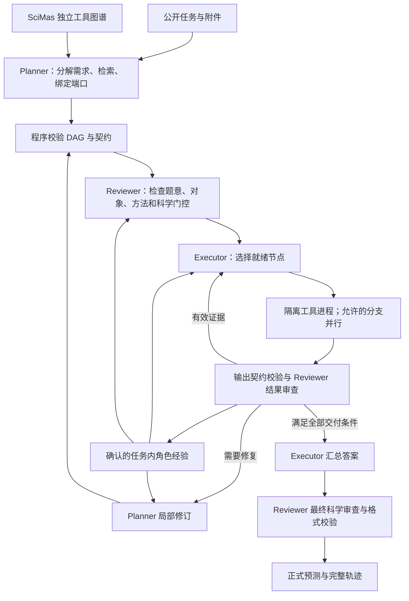

# SciMas

SciMas 将科学问题组织为带数据依赖和科学条件的任务图，由 **Planner、Executor、Reviewer** 协作完成工具选择、并行执行、过程审查和局部修复。它使用自己的工具知识图谱，与 SciToolAgent 的图谱和检索策略独立。

消融实验通过 `--scimas-ablation` 选择 `wo-exp`、`wo-parallel`、`wo-early-stop`、`wo-local-repair` 或 `wo-all`；默认 `full` 保留全部机制。下文工作流默认描述完整方法；各变体共用运行、轨迹和评分入口，定义与命令见[消融实验](ablation/README.md)。

检索可使用 `--embedding-backend local`（本地 Qwen3-Embedding-4B，2,560 维）或 `--embedding-backend api`（原有 text-embedding-3-large，3,072 维）。两套索引独立保存，生成模型可继续使用 `official` 或 `school`；启动服务、建库与切换方式见[向量检索配置](../../docs/embedding.md)。

## 运行与评分

SciMas 与其他 baseline 共用公开题目、模型客户端、任务预算、预测文件和 `workflow.v1` 评分入口。公开入口默认为Mini-200，Full-500源库需显式选择；两者题号与实验身份分开。

```bash
# 本地 vLLM；服务地址由 SCITOOLFLOW_VLLM_BASE 指定
python cli.py run --baseline scimas --dataset mini --tasks SMAS-0103 \
  --backend vllm --model YOUR_SERVED_MODEL \
  --output results/scimas_mini/predictions.json

python cli.py score --dataset mini --tasks SMAS-0103 \
  --predictions results/scimas_mini/predictions.json \
  --output results/scimas_mini/scores.json

# 生成 API；仍需安装科学工具所需的本地依赖
python cli.py run --baseline scimas --dataset full --tasks FLOW-0029 \
  --backend api --model YOUR_API_MODEL \
  --output results/scimas_api/predictions.json
```

### AIHubMix / DPSK API

提供 [dpsk_api.json](../../configs/services/dpsk_api.json) 配置：`https://aihubmix.com/v1`，模型 `doubao-deepseek-v4.1-flash-1017`。从项目根目录在交互终端执行：

```bash
conda activate SciTool-Unified
python -m scripts.services.configure_api
python -m scripts.services.configure_api --check

python cli.py run --baseline scimas --dataset mini --tasks SMAS-0103 \
  --backend api --model doubao-deepseek-v4.1-flash-1017 \
  --max-output-tokens 32768 \
  --output results/scimas_dpsk/predictions.json
python cli.py score --dataset mini --tasks SMAS-0103 \
  --predictions results/scimas_dpsk/predictions.json \
  --output results/scimas_dpsk/scores.json
```

配置命令隐藏输入密钥，原子保存至 `.local/credentials/services.env`，文件权限为 `600`，保留现有 embedding 和科学服务配置。密钥不作为命令行参数或配置模板内容；该目录由 Git 忽略。`--check` 使用同一生成客户端发起一次小额真实请求，不运行 benchmark。环境变量优先于本地文件。

该配置使用已验证的 `httpx` 传输、`max_tokens`、JSON object 模式、32,768 输出 token 上限和 300 秒请求超时；完整 JSON Schema 由本地协议校验。模型默认思考消耗同一输出额度，运行命令也需显式设置 `--max-output-tokens 32768`；实际用量按服务端返回的 usage 记录。`httpx` 对建立连接失败最多重试两次；收到 HTTP 响应后的错误和发送后的读取／写入失败均不自动重发。长思考请求遇到读取超时时会明确失败，不将联调失败包装成任务通过。生成密钥与检索 embedding 的密钥分别配置。需要更换供应商时，使用 `--profile /path/to/profile.json`，或按部署文档配置其他兼容接口。

### DeepSeek 官方直连与长任务

本机可将官网与校内接口分别保存为 `official` 和 `school`：完整配置与各自密钥位于 `.local/credentials/api/official.env` 和 `.local/credentials/api/school.env`（权限 `600`，由 Git 忽略）。使用 `python -m scripts.services.configure_api --use official` 或 `--use school` 切换后，启动新的运行进程。切换会一起更新地址、模型和对应密钥；embedding 等其他服务配置保留。显式导出的环境变量仍优先于本地配置文件。

校内公开配置见 [school_api.json](../../configs/services/school_api.json)：`https://api.llm.ustc.edu.cn/v1`，模型 `deepseek-v4-flash-ascend1`，显式设置 `thinking={"type":"disabled"}`。该模型已通过小请求的 JSON 输出验证。校内密钥保存在本机凭据文件中，公开配置只包含接口与模型设置。

[deepseek_api.json](../../configs/services/deepseek_api.json) 使用 `https://api.deepseek.com`、`deepseek-flash`、10 秒连接超时、600 秒生成响应等待上限和 65,536 输出 token 上限。连接失败仍按发送前重试规则处理，避免 TLS 建连占用整个长生成超时。`SCITOOLFLOW_API_TRUST_ENV=0` 使生成客户端忽略代理环境变量；embedding 和科学工具仍各自使用原有网络配置，不全局清空代理。各角色请求均明确要求 JSON 对象，满足供应商 JSON 模式的提示词要求。

```bash
python -m scripts.services.configure_api --profile configs/services/deepseek_api.json
python cli.py run --baseline scimas --dataset mini --tasks all \
  --backend api --model deepseek-flash --concurrency 8 \
  --max-context-chars 1500000 --max-output-tokens 65536 \
  --max-model-requests 400 --task-timeout 7200 \
  --output results/scimas_deepseek/predictions.json
```

按[官方模型说明](https://api-docs.deepseek.com/quick_start/pricing/)，模型服务提供 1M token 上下文；本地 150 万字符保护阈值是字符限制，不等同于 token 数。API 路径由字符保护和服务端真实上下文限制检查，`--max-input-tokens` 不作为 API 的精确计数器。思考和回复共享单次输出额度。增加上限不会预先消费这些 token，统计仍取服务端实际 usage。

不设置决策步数或工具调用数硬上限，400 次生成请求由所有角色共享，允许超过 32 步的工作流；初始规划及局部修复边界仍按算法配置执行。`--concurrency 8` 表示最多 8 个独立任务进程，可以跨任务同时请求 API，不改变单题 Planner／Executor／Reviewer 的依赖关系。它与 `tool_concurrency=4`（单题同时执行的工具数）分别控制。本次若只选两题，实际同时在途的模型请求最多两个，不能把配置上限当作已测吞吐。

供应商 JSON 模式可能返回 HTTP 200、`finish_reason=stop`、但正文仅含空白的响应。客户端保留这种原始响应及其 usage，交由已有的协议纠错次数和总请求预算处理；空白不视为有效决策，不跳过科学工具，也不填充答案。传输层不会因此隐式重发，后续纠错请求逐次记录和计费。HTTP 错误、断连、内容过滤与输出截断继续沿用明确失败规则。

也可用 `python -m baselines.scimas.run`，参数与 `cli.py run --baseline scimas` 相同。`--backend local` 使用现有本地 worker；三种后端都通过 `src/models/`，不绑定某个模型。生成服务与 embedding 服务分别配置，参见[安装与部署](../../docs/setup.md)。

只查看规划时，使用 `python cli.py plan --dataset mini --tasks SMAS-0103 --backend vllm --output results/scimas_plan`。`plan` 产物不包含完整执行轨迹，不能提交正式评分。

## 完整工作流



1. **规划。** 只读取公开问题、经清单验证的附件和工具知识。Planner 提取有原文依据的需求，按子任务检索工具，按需查询契约，提出 DAG。程序检查已知参数、类型、依赖环路和交付覆盖；动态输出字段留待实际执行时验证。检索结果用于发现工具，不构成白名单：已注册的规范工具名可以直接用于建图，由框架补齐当前契约。每次规划请求携带检索历史及剩余额度；相同检索在本轮内复用，去重仅合并多余空白，保留科学名称和单位的大小写区别；检索额度耗尽后应提交方案或明确报告缺少的能力。
2. **执行前审查。** Reviewer 对照原问题核对完整性、计算方向、对象、单位、方法和筛选条件。类型正确不代表科学正确，例如 `inverse × inverse` 不能替代 `original × inverse`。科学门控必须获得绑定当前节点身份的批准。
3. **事件驱动执行。** Executor 选择就绪节点，程序解析真实参数并调用工具。一个分支的结果通过审查后即可推进其后继，无需等待其他独立分支结束。只有已确认可隔离并行的工具才能重叠运行；其余工具独占本任务执行槽。并行回执逐项领取，尚未领取的完成结果继续受跟踪，确保前一项审查异常或图修订后仍能记录并作废相关证据。工作线程异常退出记录为工具错误，主线程中断仍停止任务。
4. **结果与条件。** 原始输出先通过公共契约及节点检查，再由 Reviewer 检查其科学用途。缺失、失败和陈旧结果不可用于下游，也不会被当作科学筛选的“不通过”。条件为明确假时记录淘汰依据；完整报告需求不允许依赖候选筛选分支。
5. **有限恢复。** 执行科学工具前，Reviewer 的异议反馈给 Planner 完善图；此时没有已执行科学结果，允许调整前置解析及其消费者。完整方法的这一阶段不消耗运行期局部修复额度；v2 消融中的 `wo-local-repair` 和 `wo-all` 将其关闭。执行中，明确的暂时连接、超时和限流失败允许一次重试，其他问题由 Reviewer 诊断、Planner 局部修复。原始错误类型和信息传递给两个角色；每轮修订有独立请求上限，包含契约查询、检索决策、输出检查和格式纠错。运行期修复不得改动无关节点或降低原始需求；保留未受影响的有效结果，作废受影响后继，取消相关在途进程。所有实际尝试，包括失效调用，保留在轨迹中。
6. **提交。** 所有节点均取得有效结果或有合法筛选依据后，Executor 按公开 `answer_schema` 汇总，Reviewer 再核对科学结论。格式错误反馈只来自公开结构，格式纠正不提供参考答案。长数组可用 `{"$observation":"o0001","field":["实际字段"]}` 引用当前已接受输出，程序展开后再验证，避免模型重新抄写造成误差。若缺少必要证据，可申请剩余次数内的局部修复；不能把运行失败包装成完成。

Reviewer 是同一基模的独立角色上下文，并非正确性预言机。审查以公开问题为准，Planner 增添的实现偏好不能成为额外的科学验收条件。修复请求必须指向当前图中的非空节点集合；节点名或结构错误先获得有次数限制的协议反馈，不消耗科学修复轮次，持续无效仍会失败。`completed` 表示完成了执行与审查协议；是否科学正确仍由独立 benchmark 评分判断。

公开文本附件经过清单和哈希校验后，可作为理解问题的预览。只有文件中提供的数据，以及题目明确要求的文件处理操作，需要真实读取工具及下游结果绑定；预览不能替代读取观测。任务输入中独立提供的完整值可直接使用，除非题目明确指定其他来源。附带文件本身不构成额外的读取义务。跨 baseline 比较仍应报告附件呈现方式，不能把不同输入条件的成绩直接归因于算法。见[验收记录](ACCEPTANCE.md)。

## 独立工具知识图谱

| 方法 | 图谱与向量 | 用途 |
| --- | --- | --- |
| SciToolAgent | `tools/graph/graph_store.json`、`index_store.json` | 原有工具关系与检索 |
| SciMas | `tools/graph/scimas/graph.json`、`embeddings.json.gz` | 工具与输入输出端口、数据概念、规划约束及资源信息 |

共同契约来自 `tools/catalog/catalog.json`。SciMas 独有补充知识存于 `tools/graph/scimas/annotations.json`，绑定契约及实现来源。全部 **472** 个图谱工具都有契约派生规划信息；**99** 个具有绑定当前源码和契约的补充注释，其中原有 **6** 个保留详细的形状约束、方法限制和端口说明。本轮对 **97** 种本地工具完成生产 Executor 的成对隔离调用检查，补充并行执行提示；这些集合有重叠。记录见 [parallel_review.json](../../tools/graph/scimas/parallel_review.json)。并行权限要求独立 worker 进程、独立工作目录和不变的输入文件，不代表任意线程安全或已测得加速比。未审查工具的并行安全性与未测成本保持未知。`DescribeTools` 是普通通用工具，但不进入图谱或向量索引。

SciMas 为 472 个工具保存功能向量；API 索引使用 `text-embedding-3-large`、3072 维，本地索引使用 Qwen3-Embedding-4B、2560 维。检索必须使用与所选索引身份一致的模型。端口和约束作为图结构与上下文使用，不单独编码。只调整图规划校验或端口 schema 时，重建图谱并保留原功能向量；工具功能描述改变时才需要更新相应向量。

```bash
python -m baselines.scimas.build_knowledge
```

加载时校验契约、注释、图谱和向量身份；公共描述变化时，应先按工具维护流程更新功能向量，再重建 SciMas 图谱。候选连接和替代工具不自动授权科学方法替换。

## 任务图与证据

每个节点描述一项工具调用：`id`、`tool`、`purpose`、`object`、`arguments`；可声明条件 `when`、单调用映射 `for_each` 和输出 `checks`。数据依赖由参数绑定生成，控制依赖由条件引用生成。

| 绑定 | 含义 |
| --- | --- |
| `literal` | 明确常量，不用于伪造计算结果 |
| `task` | 公开输入字段 |
| `node` | 已接受前置节点的真实输出字段 |
| `item` | 映射中的当前输入元素 |
| `collect` | 映射展开后的有序输出集合 |
| `list` | 多个绑定的有序集合，可保留空集合的来源依赖 |

`decoded=true` 只允许读取契约明确声明的 JSON 字符串。自然语言输出供 Reviewer 阅读和最终报告使用；若下游需要结构化值，须规划实际解析或转换工具，不能把 Reviewer 猜出的字段当作原始工具输出。单位、对象和方法等确认元数据必须引用实际输出字段，并通过精确值核验。

`complete` 需求要求完整报告；`screen` 需求允许有依据的候选早停。`for_each` 可以消费任务或工具输出的数组、上游模板的 `collect`，以及绑定列表。模板按真实依赖依次展开，每次最多 128 项；下游继续绑定生产节点，保持来源与顺序。生成的子节点名遵循同一长度限制，长名称使用确定性的哈希后缀缩短，并继续检查名称冲突。空动态集合保留生产节点证据。它是单调用映射，不是任意嵌套程序。不得用筛选后缺失的结果悄悄填充聚合输入。

JSON Schema 对象在未声明 `additionalProperties=false` 时允许动态字段，读文件工具返回的记录列不必全部列入静态 schema。程序保留 `oneOf`、`anyOf`、`allOf` 及同级约束，将动态路径列为 `runtime_obligations`，并把校验报告交给 Reviewer。科学上合理的绑定可以先进入执行；实际字段缺失、下游参数类型不符、映射来源不是数组或超过展开上限仍会失败。封闭对象、标量输出、未知工具、依赖环路、科学条件和交付覆盖仍受检查。

每个结果绑定当前节点及其所有前置依赖的身份。`TaskGraph.revise()` 创建新版本，需求不变，返回改动及失效范围。修订前的原始调用不删除；只有当前有效结果进入后续计算。当前仅在单次任务内复用结果，不提供跨运行的科学缓存。

## 调度、经验与资源

[config.json](config.json) 设置 SciMas 的算法边界：

| 设置 | 默认 | 含义 |
| --- | ---: | --- |
| `tool_concurrency` | 4 | 单题最多同时运行的工具调用 |
| `transient_retries` | 1 | 每个节点身份的暂时故障重试次数 |
| `graph_refinements` | 2 | 执行前完善图的次数；wo-local-repair／wo-all 强制为 0 |
| `local_repairs` | 2 | 科学执行开始后，各角色共享的局部图修复次数 |
| `repair_requests` | 6 | 每轮图修订的实际生成请求上限，包含格式纠错、检索决策和检查已有输出 |
| `planning_requests` | 10 | 初始分解、检索反馈及建图的请求上限 |
| `protocol_retries` | 3 | 单次角色协议纠错上限；连续重复检查／思考或重复提交同一被拒答案的停滞判定阈值 |
| `max_map_items` | 128 | 单次映射的最大展开项数 |
| `experience_capacity` | 20 | 当前任务内每个角色的经验容量 |
| `experience_matches` | 3 | 每次角色决策最多注入的匹配经验 |

`--concurrency` 控制同时运行的题目数，与单题工具并行数不同。每个调用使用独立工作目录和产物目录，子进程组支持取消。先前调用的产物只有出现在已接受输出中、且确实位于本次运行目录，才会加入后续文件访问列表。

各角色共享 `--max-model-requests` 和 `--task-timeout`。工具调用受 `--tool-timeout` 限制；可选的调用数、思考步数和决策数上限继续有效。默认沿用项目统一资源策略，不把参考路径长度当作任务预算。每次真实模型请求都写入同一 ledger；格式修正、审查、重规划和最终汇总均计费。

`graph_refinement_attempts`／`graph_refinements` 分别记录执行前的修订尝试与实际应用；`repair_attempts`／`repairs` 记录执行中的局部修复。尝试记录包括请求数、最后错误和终止原因；没有合法替换图时，不会虚报已应用修复。达到单轮请求上限返回 `RepairRequestLimit`。重复同一辅助决策时，模型保留已有观测并收到选择实质动作的提示；连续提交同一被拒最终答案且未修改时返回 `FinalAnswerNoProgress`，不将停滞记为任务完成。不同内容的合理推理与检查仍受统一任务资源边界约束。

角色上下文只在 `graph.requirements` 保留一份完整科学需求，避免重复发送相同文本；full 与消融组都显式接收执行策略及门控状态。一次图修订中，已查看的证据在后续契约查询和方案纠错间保留，减少重复检查。条件的相等与集合成员判断采用一致的精确 JSON 语义：`1` 与 `1.0` 数值相等，布尔值与数字不同，嵌套结构遵循相同规则；不使用近似容差或字符串转换。

embedding 用量记录本次规划／任务开始以来的增量；顺序复用检索器时，之前的查询、token 与通信等待不重复计入本题。默认正式实验入口按题创建检索器。

### Planner 与任务内 skill

Planner 分两步工作：先提取科学交付目标和检索查询，再建立工具调用图。两步使用各自的短提示，不在需求分解时加载建图、门控和输出路径规则。普通任务优先采用节点、参数绑定和交付映射；仅在需要动态候选数组、条件筛选或确切元数据前置条件时使用可选字段。结构校验与科学评审仍覆盖完整任务，不以省 token 为由删减要求。

这里的 **skill 指经过实际执行验证的任务内接口经验**，记录在 `experiences`，并通过角色请求的 `experience` 字段提供。它不是预置标准答案，也不是跨题经验库。

| 角色 | 保存的 skill | 使用时机 |
| --- | --- | --- |
| Planner | 成功消费过的源工具输出字段 → 下游工具参数的衔接模式 | 图修复时，为当前受影响分支提供已验证的适配参考 |
| Executor | 成功参数的来源类型、源工具、字段访问模式；常量仅记录类型 | 调度当前就绪节点时，辅助识别输入适配；参数修改仍须修图 |
| Reviewer | 成功通过结构检查的原生／JSON 解码输出访问方式 | 检查当前工具的新结果时，辅助读取；仍独立判断科学正确性 |

同类模式去重，每个角色最多保存 20 条，每次匹配最多返回 3 条。数组索引使用占位符，旧节点 ID、常量值及对象的科学结果不进入可迁移模式；观测 ID 保留用于追溯。匹配核对当前分支及涉及工具的契约，工具衔接核对两端版本。任何一端出现确定性接口失效，相关经验一起失效。新对象的形状、单位、方法和索引必须重新核对，模式不会自动执行或替代计算。

提取、去重和匹配均为本地操作，不增加 LLM 请求；首次规划时经验为空。最终答案汇总与最终评审依赖真实观测，不注入接口经验。`w/o EXP` 和 `w/o All` 同时关闭提取、存储和注入。skill 的作用是减少已解决接口问题的重复摸索，是否提升模型成绩、降低总 token，需要同题同配置的配对实验验证。

## Reviewer 与修复闭环

Reviewer 负责定位科学或接口问题，修复角色负责针对该原因改变图。反馈应写清受影响节点、实际结果与要求的差异；修复请求可以通过 `suggested_change` 和 `verification` 表达建议改动及复核方式。这些字段可选，避免把说明格式变成新的执行门槛。科学判断不以反馈文字是否齐全替代实际证据。

框架将发起该次修复的评审依据直接传给修复角色：包括观测 ID、来源观测、参数解析验证、结构错误及已有数值证书，不重复复制完整数组。修订后的 Reviewer 同时看到原始问题和实际变动字段，复核是否针对原问题；仅改变 `purpose` 会标记为没有操作性变化，不能据此声称修复了计算错误。针对科学说明的合理澄清仍可接受。

修复记录区分三个事实：图已应用、图重新通过评审、受影响节点已有有效执行证据。`changes` 记录增删节点及改动字段，`graph_review` 记录图评审，`execution_evidence` 记录接受、筛除和仍待执行的节点；这些记录都不等同于任务最终成功，最终答案仍需独立评审和正式评分。状态只在图或证据改变时更新，复用现有检查点，不额外请求模型。

如果 Reviewer 对确定性检查失败的输出返回 accept，程序将具体错误反馈给它，在已有纠错次数内要求重新判断。失败结果不会成为下游输入，Reviewer 可以检查证据、提出实际修复或明确拒绝。科学要求和确定性检查仍适用于所有消融变体。v2 的 `wo-all` 不调用科学 Reviewer，图、结果及最终答案阶段只记录明确标记的程序检查，正式评分保持不变。

## 通信恢复与错误反馈

每个运行及消融结果目录自动生成 `monitor/monitor.md` 和 `monitor/monitor.json`。监控每10秒显示完成进度、活动角色／工具阶段、输入与输出token、调用数及失败记录；独立监控进程不修改任务计时。建图入口同样支持监控。[使用说明](../../docs/monitoring.md)

连续 3 道任务因生成 API 或 embedding 通信故障终止时，批次暂停派发新任务，已在运行的任务继续收齐结果。`progress.json` 显示 `paused_infrastructure` 和具体通信诊断；`--network-failure-threshold` 可修改阈值，0 表示关闭。网络恢复后，在相同代码及配置下继续：

```bash
python cli.py run --baseline scimas --dataset mini --tasks all \
  --backend api --model YOUR_API_MODEL --concurrency 2 \
  --output results/YOUR_RUN/predictions.json --resume --retry-infrastructure
```

恢复时必须保留首次运行的其他参数。`--retry-infrastructure` 只重新运行已标记的基础设施失败题及尚未运行题，模型／科学失败保留；旧尝试保存到预测文件的 `attempt_history`，原轨迹仍保留。代码、prompt 或配置发生变化时必须新建实验目录，不能强行拼接旧结果。

生成客户端只对确定发生在发送前的建连失败进行有界退避重连，并保持原接口和代理路线。读写中断和 HTTP 错误不自动重放可能已计费的生成。通信错误单独标记，不作为科学负面结果。

Executor 选错 ready 节点、Repair 查询未知工具名会收到有限次数的纠错反馈。Reviewer 分别看到声明绑定、实际实参、来源观察和待审核／已接受／过期状态；确定性数值证书辅助审查，不替代科学任务判断。`max_failures_per_action=0` 统一表示关闭累计限制；瞬时工具重试和局部修复仍有各自的次数保护。

## 实现效率

角色请求将任务与图等稳定上下文放在前面，将执行状态放在后面，并采用紧凑 JSON 编码。图谱连接候选、输出预览序列化和角色 prompt 在任务内复用；科学证据有效性仍随图修订重新检查。轨迹保留全部内容与原子检查点，使用紧凑格式减少重复写入。详见[效率设计与测量边界](EFFICIENCY.md)。

## 轨迹与代码

完整轨迹保存在 `results/<运行名>/trajectories/<任务ID>-<run_id>/trajectory.json`。其中保存角色请求、实际工具输入输出、图版本、局部修订、科学审查、筛选依据、经验及资源 ledger；工具产物位于同级 `calls/`。模型看到的是有明确截断标识的预览，可以按观测 ID 和字段路径查看完整值；原始结果保留在轨迹中。

每题自动记录 `metrics.runtime_seconds`（扣除通信故障等待后的运行秒数）、`metrics.tool_calls`（含失败、重试及 `DescribeTools` 的派发总次数）、`metrics.input_tokens` 和 `metrics.output_tokens`（所有角色生成的输入／输出总用量）。同一对象保存在预测与轨迹中，批次另生成 `task_metrics.json`。未知 usage 以 `null` 标记并保留已知小计；缓存和思考 token 不重复累加。完整口径及续跑规则见[实验输出](../../results/README.md#逐题运行成本)。

### 单题案例分析

`trajectory.json` 保存完整公开问题与输入、附件预览、每次模型请求的全部消息和生成参数、原始响应、解析后的决策和协议错误。每步具有 `step_id`、记录时间和相对起点的秒数；模型请求另有起止时间、耗时和 usage。接口实际返回的附加消息字段和输出截断时的部分响应也保留，部分响应不会作为有效决策执行。

工具派发步骤记录实际参数、文件范围、超时、工作目录和并行标记；完成记录保存完整输出、错误及 dispatcher 已脱敏的诊断信息。并行调用的真实起止时间与主循环收集顺序分别记录。`graphs`、`reviews`、`repairs`、`results`、`pruned`、`approved_gates` 和 `experiences` 保留图版本、审查、修复、证据采纳和筛选状态；`pending_calls` 标识尚未收齐的调用。规划过程在完成前保存不重复模型消息的 `planning_progress`。异常或正常中断会保存最后检查点；强制终止或掉电后的完整性以最后实际落盘内容为限。

运行时继续使用原有紧凑 JSON 检查点，不增加逐步文件写入，不为生成案例报告调用模型。运行结束后按需离线导出：

```bash
python -m baselines.scimas.trajectory \
  results/YOUR_RUN/trajectories/TASK_ID-RUN_ID/trajectory.json
```

默认在该次任务目录下生成 `analysis/`：

| 文件 | 用途 |
| --- | --- |
| `trajectory.md` | 可读的逐步案例索引，含决策、错误和统计预览，以及完整 JSON 的链接 |
| `requests/<step_id>.json` | 单次模型的完整输入、响应、解析决策、校验与耗时 |
| `calls/<observation_id>/request.json`、`response.json` | 单次工具的完整参数、输出与诊断 |
| `manifest.json` | 原始轨迹路径和 SHA256，便于确认导出来源 |

可用 `--output /path/to/analysis` 指定独立导出目录。导出不改写原始轨迹，不运行模型、工具或评分器，不计入任务时间。Markdown 中的长内容仅作有标识的预览，JSON 保留完整内容。历史轨迹未记录的字段不会推测补齐。

新增元数据复用既有检查点，主要增加少量字段的编码开销；不声称记录完全没有成本。`wall_runtime_seconds` 保留真实墙钟时间，`runtime_seconds` 只扣除有记录的通信故障等待；日志、正常模型响应、工具执行及科学纠错仍计时。API 故障中止的尝试设置 `runtime_reportable=false`、`runtime_seconds=null`，不作为速度统计样本。

| 模块 | 职责 |
| --- | --- |
| `knowledge.py`、`build_knowledge.py` | 独立图谱构建、校验、检索与端口查询 |
| `schema.py`、`task_graph.py`、`validation.py` | 规划语言、版本化 DAG、静态与运行时证据校验 |
| `assets.py` | 清单与内容哈希校验后的公开附件、预览和原文依据 |
| `planner.py` | 初始任务分解、检索历史与迭代建图 |
| `runtime.py` | 三角色协作、审查、修订和最终提交 |
| `executor.py` | 并发进程调度、目录隔离与取消 |
| `roles.py`、`context.py`、`prompts/` | 角色协议、稳定前缀上下文、有限格式纠正与请求记录 |
| `trajectory.py` | 轻量步骤身份与离线案例导出，运行时不生成报告副本 |
| `experience.py` | 任务内证据支持的角色经验 |
| `runner.py`、`run.py` | 独立规划命令与完整 baseline 入口 |

验收依据见 [ACCEPTANCE.md](ACCEPTANCE.md)。运行测试：

```bash
python -m pytest tests/scimas -q
```

验收中的 `tests/scimas/run_isolated_acceptance.py` 是模型请求的邮箱适配器：每次由一个新建的、信息受限的子智能体回复，实际工具仍由上述运行时调用。它不是新的生产模型后端；子智能体不读取参考答案或评分规则，未公开的 token 用量记录为未知。
