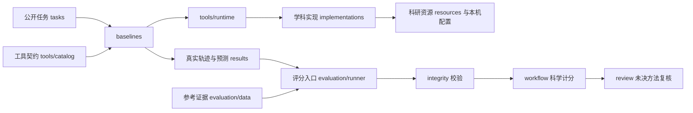

# 项目结构与开发指南

SciToolFlow以公开任务为中心，任务、工具、baseline和评分器各自有明确的入口。命令从项目根目录执行，统一用户入口为`python cli.py`。

```text
SciToolFlow/
├── tasks/                         公开题目、答案格式、输入附件及其加载／校验接口
├── tools/
│   ├── catalog/                   工具契约、名称解析、DescribeTools与端口校验
│   ├── runtime/                   公开执行入口、环境路由、worker与失败反馈
│   ├── implementations/           按学科组织的科学实现及共享依赖
│   └── graph/                     派生工具图谱和功能检索向量
├── baselines/
│   ├── common/                    批处理、执行会话、答案格式和 JSON 决策协议
│   ├── react/                     ReAct循环、提示词、上下文和轨迹
│   └── scitoolagent/              图谱检索与SciToolAgent策略
├── evaluation/
│   ├── runner.py                  统一评分服务入口
│   ├── workflow/                  当前workflow.v1规则与确定性计分
│   ├── integrity/                 文件、轨迹、发布与参考身份校验
│   ├── review/                    未识别方法分流与独立复核政策
│   ├── authoring/                 参考检查与判据编写辅助
│   └── data/                      主／额外参考、按题号压缩的轨迹及内联审核
├── cli.py                         统一 CLI，安装后也可用scitoolflow命令
├── src/
│   ├── models/                    API、vLLM、本地模型客户端与worker
│   └── utils/                     JSON读写、项目路径与环境加载
├── scripts/                       按工具、实验、参考、服务和维护分组的命令
├── tests/                         按评分、工具、baseline、运行时和集成分组的测试
├── configs/                       环境安装文件、服务配置与无密钥模板
├── resources/                     第三方科学源码、模型配置、小型权重与来源说明
├── docs/                          分析、对比、安装与评分指南
├── results/                       本机新实验输出
└── .local/                        本机密钥、完整模型权重、缓存与运行资源
```

## 执行与依赖



Agent读取公开任务、附件和工具契约。评分器在独立流程读取参考数据；工具执行不会加载金标准。公开 JSON 决策协议位于 baselines/common，模型客户端位于 src/models，baseline 策略位于各自目录。科学实现经运行时按需加载，离线评分不导入科学实现或启动模型。

## 按工作目标找代码

| 目标 | 入口 |
| --- | --- |
| 选择 full／mini、校验编号映射 | tasks/datasets.py |
| 浏览题目或修改公开字段 | [tasks/README.md](../tasks/README.md)、tasks/questions.jsonl |
| 查询工具、执行工具 | `from tools import ToolCatalog, execute` |
| 修改描述、参数和输出契约 | [tools/catalog/catalog.json](../tools/catalog/catalog.json) |
| 定位某个工具的实现 | catalog中的`source.file`和`source.function`；[实现索引](../tools/implementations/INDEX.md) |
| 修改运行时验证、路由或超时 | tools/runtime/ |
| 修改ReAct或检索策略 | [baselines/README.md](../baselines/README.md) |
| 修改科学计分 | evaluation/workflow/；[评分模块说明](../evaluation/workflow/README.md) |
| 检查可信轨迹和参考身份 | evaluation/integrity/ |
| 查看单题金标准、参考或审核 | `python -m evaluation.authoring.inspect --task FLOW-0022 --section review` |
| 构建、部署、运行实验 | [scripts/README.md](../scripts/README.md) |
| 运行回归测试 | [tests/README.md](../tests/README.md) |
| 配置账号、模型或科学依赖 | [configs/README.md](../configs/README.md)、[resources/README.md](../resources/README.md) |

## 修改后的检查

```bash
python -m pytest tests -q
python -m scripts.tools.check_foundation
python -m scripts.maintenance.freeze
python cli.py validate
```

工具契约或实现有变动时，先执行`python -m scripts.tools.build_catalog`和`python -m scripts.tools.build_graph`。功能描述变化后使用`--embed`重新编码变化的文本；目录迁移本身不需要调用embedding API。真实参考轨迹无损保存；生成和审核信息与各自哈希内联于参考记录，保持任务、判据和执行一致。

新增模块应放入负责该行为的包。共享路径放在src/utils，模型连接放在src/models，评分规则统一放入工作流引擎，维护脚本不放进科学实现目录。第三方资源保留其上游结构与许可证，生成结果放在results，本机凭证和缓存放在.local。

## 发布与本机文件

`evaluation/data/` 保存正式参考、真实轨迹与独立审核，当前评分只支持 `workflow.v1`。来源记录中的生成路径用于验证执行身份，不是当前代码入口。发布文件由 `MANIFEST.json` 记录 SHA256，科研资源另有来源与许可清单。

项目从完整仓库检出目录运行：源码使用 `python cli.py`，可编辑安装后使用 `scitoolflow`。模型连接在 `src/models/`，协议与任务执行辅助在 `baselines/common/`，共享路径和读写函数在 `src/utils/`。`scripts/` 随可编辑安装可导入；这套安装不替代仓库中的数据、配置和科研资源。

`results/` 保存实验输出，`.local/` 保存本机凭据、权重、缓存和工作区。测试缓存 `.pytest_cache/` 与 Python 字节码可删除；本机科研资源不属于缓存清理范围。代码、prompt 或数据身份改变会使续跑指纹失效，应新建实验目录。
