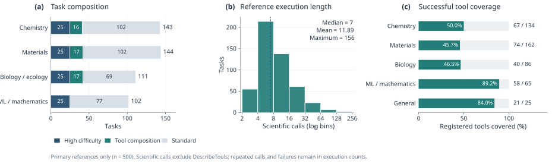

# SciToolFlow 题库分析

默认公开题库是Mini-200；Full-500保留完整源任务及更广的工具覆盖。两者使用相同工具池，但题量、参考范围和主指标不同，以下分开统计。

## Mini-200

Mini由100道独立编排题与100道Full精选题组成，四个主学科各50题。来自Full的题不属于其100道高难度题；独立编排题使用自身难度层级。[任务说明](../../tasks/mini/README.md)介绍来源、编号和统一运行入口。

两套题库的统一合图见[Full／Mini概览](full_mini_overview.svg)（上排Full、下排Mini）；下文保留每套题库的详细分项。


| 主学科 | 独立编排题 | Full精选题 | 合计 | 参考科学调用均值／中位数 | 不同成功工具均值 |
| --- | ---: | ---: | ---: | ---: | ---: |
| 化学 | 25 | 25 | 50 | 11.74／10 | 4.16 |
| 材料 | 25 | 25 | 50 | 10.52／10 | 4.26 |
| 生物／生态 | 25 | 25 | 50 | 10.74／9 | 4.14 |
| 机器学习／数理 | 25 | 25 | 50 | 11.84／9 | 4.72 |

### 参考负担与结构

| 指标 | 当前Mini值 |
| --- | ---: |
| 主参考数 | 200 |
| 科学调用总数／成功调用总数 | 2242／2173 |
| 每题科学调用：均值／中位数／范围 | 11.21／9／3–37 |
| 每题不同成功工具：均值／中位数／范围 | 4.32／4／1–11 |
| 至少4次科学调用 | 198题（99%） |
| 涉及多个工具类别 | 134题（67%） |
| 多层能力依赖图／并行证据面板 | 166题（83%）／34题（17%） |
| 评分能力图层数：中位数／范围 | 3／1–10 |

能力图层数由每题`workflow.v1`中声明的节点及`depends_on`计算，包含可选与条件节点。同层节点表示图中没有先后依赖，不保证没有共享资源或其他科学约束；34道单层面板题还可能需要模型自行完成结果汇合。结构层数不是实际并发度、最少科学步骤或SciMas加速比。

参考调用包含失败恢复，均排除DescribeTools。调用多、工具多都不能单独证明科学难度。199题的主参考成功使用至少两种不同工具；`SMAS-0073`仅使用同一NBO解析工具处理多个分支，其设计适配范围不应表述为多工具数据流。

### 工具覆盖

| 工具类别 | 注册科学工具 | 主参考成功覆盖 | 覆盖率 | 涉及任务 |
| --- | ---: | ---: | ---: | ---: |
| 化学 | 134 | 39 | 29.10% | 38 |
| 材料 | 162 | 20 | 12.35% | 37 |
| 生物／生态 | 86 | 20 | 23.26% | 29 |
| 机器学习／数理 | 65 | 58 | 89.23% | 141 |
| 通用辅助 | 25 | 17 | 68.00% | 120 |
| **合计** | **472** | **154** | **32.63%** | 多标签，不求和 |

主学科各50题不意味着各种工具被均匀调用。很多科学任务依赖共享的数理工具；Mini材料工具的覆盖率仍较低。Mini成功覆盖154个工具，Full覆盖260个工具，两者题目集合与参考范围不同，不能把覆盖率差解释为方法性能差。

### 评分与验收

全部Mini题统一报告运行完成率、工具规划准确率和答案准确率。Full来源题复用原科学规则与金标准，评分以Mini题号提交，实际规划证据与答案正确性独立判断，详见[映射评分机制](../../evaluation/README.md#mini与full的映射评分)。

2026-11-05的工程测试通过41项回归、100条源题一致性检查及全部200份Mini主参考核验。3道Mini映射题执行24次真实科学调用，另有同源Full对照；均通过统一CLI评分。测试用参考决策回放驱动生产harness，未调用生成模型，不属于baseline模型性能实验。

| 文件 | 内容 |
| --- | --- |
| [mini_statistics.json](mini_statistics.json) | 全局／分学科统计、完整直方图、统计口径与输入哈希 |
| [mini_tasks.json](mini_tasks.json) | 逐题源身份、真实调用数、成功工具与能力图结构 |
| [mini_validation.json](mini_validation.json) | 工程测试范围、退出状态、通过数、轨迹与来源哈希 |
| [mini_overview.pdf](mini_overview.pdf) | 可独立导出的矢量图，另提供SVG与PNG |

```bash
python -m scripts.benchmark.analyze_benchmark --dataset mini
```

该命令只读取当前题库、评分规则和参考，不运行工具／LLM，不改写原始轨迹。`--no-plots`仅生成JSON，重复生成不覆盖Full分析文件。

## Full-500

Full-500 包含 **500 道科学多工具任务**，采用统一 `workflow.v1` 评分。每题提供一条经过独立审核的真实主参考，另有 281 条不重复的额外参考执行，合计 781 条完整轨迹。



### 任务类别与学科

| 类别 | 数量 | 设计目标 |
| --- | ---: | --- |
| 高难度题 | 100 | 有边界的科学探究，重点考察方法选择、多阶段推理和证据整合 |
| 工具组合题 | 50 | 有科学意义的工具筛选、参数衔接与组合使用，兼顾工具覆盖 |
| 正常题 | 350 | 常规科学工作流中的计算、验证和结果整合 |

全部题号与问题摘要集中在[任务分类](../../tasks/full/CATEGORIES.md)。分类反映设计目标，不是调用次数阈值，也不是独立训练／测试划分。

| 主学科 | 题数 | 高难度题 | 工具组合题 | 正常题 |
| --- | ---: | ---: | ---: | ---: |
| 化学 | 143 | 25 | 16 | 102 |
| 材料 | 144 | 25 | 17 | 102 |
| 生物／生态 | 111 | 25 | 17 | 69 |
| 机器学习／数理 | 102 | 25 | 0 | 77 |

主学科与调用工具的学科不同：例如生物推断可使用数理计算工具。正常题同样可能包含较难推理和多步编排。

### 参考长度与工具覆盖

| 主参考指标 | 数值 |
| --- | ---: |
| 科学调用总数（含失败尝试） | 5,944 |
| 每题科学调用：均值／中位数／范围 | 11.888／7／2–156 |
| 每题成功科学调用：均值／中位数 | 11.18／6 |
| 每题不同成功工具：均值／中位数／范围 | 4.322／4／2–14 |
| 成功工具仅读 JSON 与执行代码的题数 | 42（8.4%） |
| 主参考实际成功覆盖的科学工具 | 260/472（55.08%） |
| 评分规则声明的工具 | 255/472（54.03%） |

| 工具类别 | 注册科学工具 | 主参考成功覆盖 | 评分规则声明 |
| --- | ---: | ---: | ---: |
| 化学 | 134 | 67 | 66 |
| 材料 | 162 | 74 | 67 |
| 生物／生态 | 86 | 40 | 40 |
| 机器学习／数理 | 65 | 58 | 60 |
| 通用辅助 | 25 | 21 | 22 |

成功覆盖包含真实完成过的辅助检查；声明路线包含可选节点与替代路线，不能将声明数当作实际运行覆盖。DescribeTools 不进入科学调用、路径与覆盖率。调用长度也不等于依赖深度、不同算法数量或科学难度。

### 评分与使用范围

所有题使用相同的证据与科学判据框架。未知科学方法可能需要独立复核，不能只凭正确 stdout 或答案自动通过，也不为某个模型设置特殊通过规则。运行资源默认每题 400 次生成请求、7,200 秒，所有角色共用，详见[运行资源策略](../execution_policy.md)。

固定数据、构造性控制和真实观测按题目来源说明区分。研究队列可能复用，没有独立隐藏测试集。三份 HKUST-1 输入缺少最初上游许可记录，来源限制在附件说明中保留。参考成功不保证所有远程服务始终在线，实际运行仍须配置相应账号和本地资源。

| 文件 | 用途 |
| --- | --- |
| [statistics.json](statistics.json) | 从正式主参考重算的分布、覆盖率与来源哈希 |
| [tasks.json](tasks.json) | 逐题调用、工具与答案结构统计 |
| [参考数据说明](../../evaluation/data/README.md) | 主参考、额外执行、压缩轨迹和内联审核 |

```bash
python cli.py validate
python -m scripts.references.validate_release
python -m scripts.benchmark.analyze_benchmark --dataset full
```
