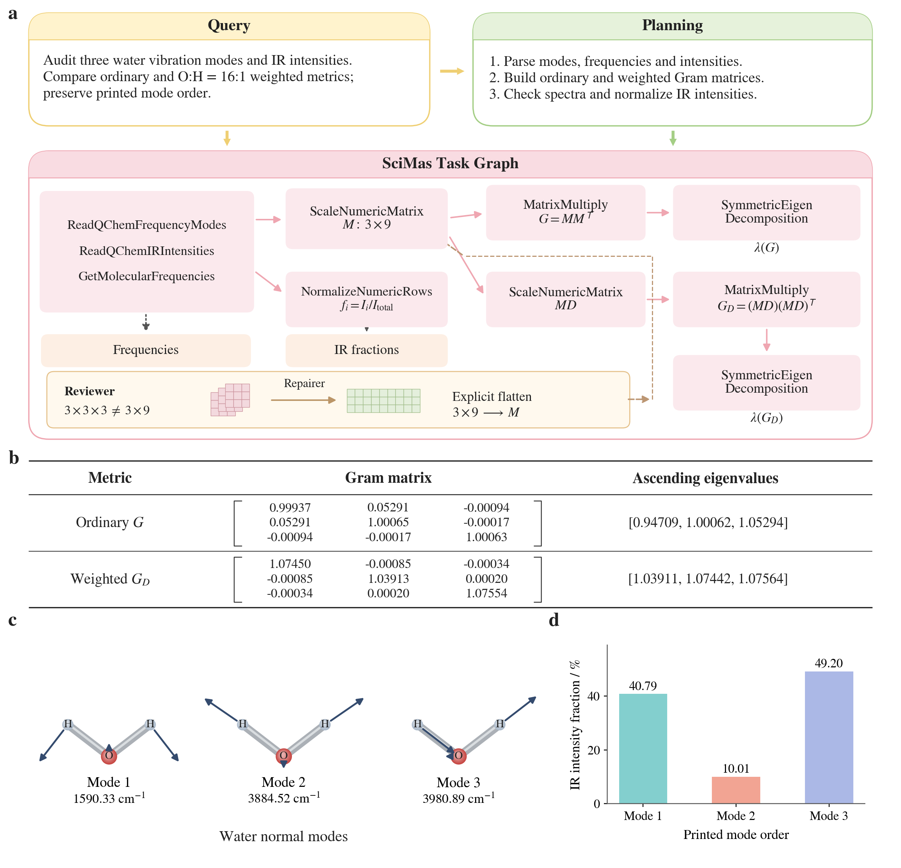

# SciMas 案例：水分子振动模式与红外强度审计

**绘图交接入口：[详细交接文档](handoff/README.md) · [完整资料包 ZIP](SMAS-0070_handoff.zip)。**资料包包含原始轨迹、源文件、参考图、精确调用与任务图、绘图 CSV 和独立校验脚本；现有图稿仅供取材，不是已批准版式。

推荐用 **Full / Mini-100 中的 SMAS-0070** 作为主案例。它把一个可视化的科学问题、存在数据依赖的任务图、实际发生的局部修复和可复核的数值结果联系起来，适合展示 SciMas 如何完成任务。

[高清 PNG](SMAS-0070.png) · [可编辑 SVG](SMAS-0070.svg) · [论文用 PDF](SMAS-0070.pdf) · [执行证据与数值核验](evidence.json) · [完整原始轨迹](../../exp/main_scimas/trajectories/SMAS-0070/trajectory.json)



## 为什么选择它

案例从正式 Full 结果中按“答案正确、科学结果容易展示、编排机制有真实执行证据”筛选。它是解释方法的目的性案例，不是随机样本，也不用于替代总体实验结论。

| 展示需求 | 本例可提供的内容 |
| --- | --- |
| 一眼理解科学对象 | 同一个水分子的三个振动模式，以及各自的频率和红外强度 |
| 展示 SciMas 的任务图 | 三类来源数据、普通与加权两条矩阵计算分支、后续特征值分析 |
| 展示实际并行执行 | 模式解析与 IR 解析时间重叠；矩阵加权与普通 Gram 计算时间重叠 |
| 展示 Reviewer 的作用 | 根据实际输出识别 `3×3×3` 张量与计划中 `3×9` 矩阵的冲突 |
| 展示 Repairer 的作用 | 修正输出检查，增加显式展平节点，重新绑定受影响的后继节点 |
| 展示可验证结果 | 两个 Gram 矩阵、两组特征值、三组频率／强度／强度占比均可从源文件复算 |

## 科学问题与结论

任务给定一份已经完成的水分子 Q-Chem 输出，要求读取三个振动模式、频率和 IR 强度，保持原始模式顺序。每个模式含三个原子，每个原子有三个位移分量。将其按原子顺序展开，得到每行一个模式的矩阵 $M\in\mathbb{R}^{3\times9}$。

需要计算：

$$
G=MM^\mathsf{T},\qquad G_D=(MD)(MD)^\mathsf{T},\qquad
D=\operatorname{diag}(4,4,4,1,1,1,1,1,1).
$$

$G$ 的每个元素是两个模式位移向量的普通内积；$G_D$ 使用题目指定的 O:H = 16:1 度量权重。对氧的三个位移分量乘以 4 后再做内积，等价于对其内积贡献乘以 16。这里使用题目约定的权重，不将它替换成源文件中的精确同位素质量。

若某个度量下这些向量是标准正交的，其 Gram 矩阵应为单位矩阵。本例直接计算源文件中打印并舍入的位移值，两个矩阵都不是单位矩阵；不能先假定标准正交，再把矩阵填成单位阵。

| 模式 | 频率 / cm⁻¹ | IR 强度 / km·mol⁻¹ | 强度占比 |
| --- | ---: | ---: | ---: |
| 1 | 1590.33 | 106.754 | 40.79% |
| 2 | 3884.52 | 26.209 | 10.01% |
| 3 | 3980.89 | 128.758 | 49.20% |

普通 Gram 矩阵的升序特征值为 `[0.94709, 1.00062, 1.05294]`；加权 Gram 矩阵为 `[1.03911, 1.07442, 1.07564]`。**这些 Gram 特征值不是振动频率**，图中分别展示，不能混用。

图中的原子坐标和位移箭头来自同一份源文件，投影至分子平面；箭头统一放大用于说明方向，不表示物理振幅。该任务是固定计算记录的审计，没有重新运行量子化学，也没有声称进行了新的实验测量。

## 执行证据如何对应到图中

图 a 将问题、规划、修复后的依赖图和局部修复合并展示，不是按横坐标排列的运行时间线。图 b 是矩阵与特征值结果，图 c 是振动模式，图 d 是 IR 强度占比。为保持可读性，图中合并了读取节点和重复的评审交互，完整记录仍保存在原轨迹中。

| 环节 | 原始证据 | 实际发生的情况 |
| --- | --- | --- |
| 工具信息查询 | `o0001` | 调用一次 `DescribeTools` |
| 第一次模式读取 | `o0002` | 工具调用成功，返回 `3×3×3`；计划却要求 `3×9`，不能直接供矩阵计算使用 |
| Reviewer 定位问题 | `reviews` 中第一次 `stage=result, node=modes` | 明确指出维度、绑定位置和修复后需要验证的形状 |
| 局部修复 | `repairs[0]`、`graphs[1]` | 新增 `mode_matrix`，修改 `modes`、`plain_gram`、`weighted_modes`，图评审通过 |
| 模式重新读取和展平 | `o0004`、`o0006` | 模式解析器重跑一次；通过显式索引构造 `3×9`，再以不缩放的 `ScaleNumericMatrix` 实体化矩阵 |
| IR 分支 | `o0003`、`o0005` | 原先已发出的 IR 读取只执行一次，随后按总强度归一化 |
| 普通／加权矩阵与谱 | `o0008`—`o0012` | 按数据依赖调用矩阵缩放、矩阵乘法和对称特征分解 |
| 最终答案 | `s000056` | 提交全部七个要求字段，正式评分的答案和编排检查通过 |

并行的判断使用工具调用的 `started_seconds` 与 `finished_seconds`，而不是仅依据图上是否有独立分支：

| 调用组合 | 实际重叠区间，距任务开始 / s |
| --- | ---: |
| 首次模式读取 `o0002` 与 IR 读取 `o0003` | 204.301–206.093 |
| 加权 `o0008` 与普通 Gram `o0009` | 406.595–407.992 |

局部修复没有重启整个任务，但需要准确区分“保留在途独立调用”和“复用已验收缓存”：本次 `repairs[0].retained` 为空，IR 调用是在途完成后于新图下验收，不能声称本例复用了多项已验收结果。完整运行还包含一次 Planner 协议错误，统计中的时间和 token 已包含这些过程。

## 本例指标

| 指标 | 结果 |
| --- | ---: |
| 运行完成／答案正确 | 是／是 |
| 编排完成程度 C | 100.00% |
| 工具选择效率 E | 72.73% |
| 综合规划分 S | 88.89% |
| 实际运行时间 | 523.78 s |
| 工具调用 | 12 次：11 次科学调用 + 1 次查询 |
| 模型请求 | 32 次 |
| 输入／输出 token | 570,176／84,957 |

评分器匹配了 11 次科学调用中的 8 次，所以 $E=8/11$，$S=3CE/(2E+C)=8/9$。不能将答案正确解释成“工具规划满分”；评分器未匹配的调用也不必然都是无意义调用。指标取自正式结果文件，未为案例修改。

这条轨迹展示了实际并行和局部修复，但**没有候选早停事件，也不能证明经验迁移或定量加速比**。如果后续需要单独展示早停，建议补充 [SMAS-0004](../../exp/main_scimas/trajectories/SMAS-0004/trajectory.json)：三种连接体中两种不满足规则，其四个后续质量／极性表面积节点被跳过。不要将另一题的早停过程拼进本例。

另一个备选是 [SMAS-0101](../../exp/main_scimas/trajectories/SMAS-0101/trajectory.json)：质量与官能团证据筛选后仍留下乙酸乙酯和丙酸甲酯，适合展示“保留科学歧义”，但不如本例能突出局部修复。

## 图注与复现

可使用以下图注：

> **SciMas 水分子振动分析案例。**（a）任务规划与工具依赖图；Reviewer 识别张量形状冲突，Repairer 通过显式展平修复局部绑定。（b）普通与加权 Gram 矩阵及其升序特征值。（c）源文件中的分子几何与三种振动模式，位移箭头按统一比例示意。（d）按原始模式顺序排列的 IR 强度占比。所有数据来自固定的已完成计算记录。

在项目根目录运行：

```bash
conda activate SciTool-Unified
python docs/case_study/build_case.py
```

脚本只读取现有轨迹和附件，不调用 LLM、不执行科学工具、不更改实验结果。它校验轨迹和源文件 SHA-256，核对源文件中的位移与轨迹一致，独立复算七个答案字段，然后生成 PNG、SVG、PDF 和 `evidence.json`。本次七个字段的最大数值差为 0（本机 NumPy 复算）；跨环境允许的复算误差为绝对和相对各 `1e-12`。
