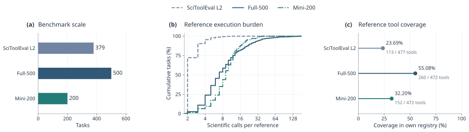

# SciToolEval Level2、Full与Mini的对比数据

[项目README](../../README.md#与-scitooleval-level2-的对比)展示三方表格，分别说明Full和Mini相对Level2的参考负担、工具使用和评分证据。Full与Mini各自使用对应的统计与任务范围，不将两套题库的重叠来源相加为独立样本。



| 文件 | 内容 |
| --- | --- |
| [current.json](current.json) | `upstream`为Level2，`scitoolflow`为Full，`mini`为Mini；包含分学科覆盖与输入哈希 |
| [current.svg](current.svg) | 三方规模、参考调用分布和各自工具池覆盖率的矢量图 |
| [current.png](current.png)／[current.pdf](current.pdf) | 320 dpi位图与可导出的PDF |
| [Full／Mini合图](../benchmark_analysis/full_mini_overview.svg) | 上排Full、下排Mini；统一展示学科、调用负担和工具覆盖 |
| [sources/upstream_metadata.json](sources/upstream_metadata.json) | 上游公开任务路径、注册名称、分类及固定提交身份 |

上游固定为SciToolAgent仓库提交`ac1cf19fcef84e69f149db6da424afe4e9b2f11f`中的SciToolEval Level2。上游按公开参考路径统计，未重新部署其工具环境；Full与Mini按各自主参考中的真实执行统计，覆盖要求成功结果。DescribeTools均不进入科学调用与覆盖。

各方使用自己的注册工具池与原生类别，名称覆盖不等于一一对齐的科学能力。调用长度包含重复使用与失败恢复，不是串行依赖深度或模型最少调用数。上游公开文件的缺项仅说明所比较的版本，不推断作者内部资产。完整口径见根README末尾的统计注释。

从项目根目录重算，不调用科学工具或LLM：

```bash
python -m scripts.benchmark.analyze_benchmark --dataset full
python -m scripts.benchmark.analyze_benchmark --dataset mini
python -m scripts.benchmark.compare_release
```

最后一条命令核对输入哈希，生成三方统计与图件，并重建Full上、Mini下的合图。Full与Mini的详细分布见[题库分析](../benchmark_analysis/README.md)。
