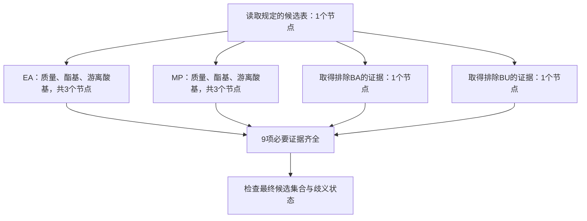
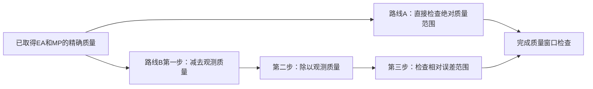

# 一条任务如何变成分数：以 FLOW-0001 为例

本文用同一道题串起任务、ground truth、工具回执、评分规则和最终指标。先看科学问题与实际执行，再解释规则如何检查它们，最后计算各项分数。文件位置和运行命令放在文末。

适用版本：`20261026`／项目 `0.4.0`／科学评分协议 `workflow.v1`／实验资源协议 `task-resources.v1`。**当前评分不调用 LLM。** Python 程序执行预先编写、审核过的规则；规则无法判断的新方法进入待审。ReAct 与 SciToolAgent 使用同一评分入口。本文使用 FLOW-0001 的真实执行，逐步说明证据、判据与指标计算。

本文有三类例子：正式 FLOW-0001 的数据与回放结果；在其副本上删除证据、修改答案等教学反例；为解释“方法组”而构造的教学配置。后两类均未写入正式题库，也不是新的模型实验。

## 1. 先读懂这道题：证据允许我们得出什么结论

FLOW-0001 是一个受控合成分析案例。输入文件给出四个候选结构，题目规定三条筛选条件：

1. 中性单同位素质量为 **88.05243 Da**，允许 **5 ppm** 偏差。
2. 必须含有题目给定图结构定义的**酯基**。
3. 必须不含题目给定图结构定义的**游离酸基**。

题目要求保留所有符合证据的候选；若多个候选仍无法区分，应报告歧义。结构检测的选择性由题目规定，不代表真实仪器能够完全实现这种检测。

候选文件只有结构与标识符；以下质量和结构检测值来自参考轨迹中的真实工具回执：

| 候选 ID | 候选名称 | 工具计算的精确质量／Da | 酯基检测 | 游离酸基检测 | 筛选结论 |
| --- | --- | ---: | --- | --- | --- |
| EA | ethyl acetate | 88.052429496 | 有 | 无 | 保留 |
| MP | methyl propionate | 88.052429496 | 有 | 无 | 保留 |
| BA | butanoic acid | 88.052429496 | 无 | 未调用；已有酯基排除证据 | 排除 |
| BU | 1-butanol | 74.07316494 | 无 | 未调用；已有排除证据 | 排除 |

EA、MP 的质量偏差均约为：

$$
\frac{88.052429496-88.05243}{88.05243}\times10^6
\approx -0.005724\ \mathrm{ppm}
$$

它们满足5 ppm条件，也都满足两项结构条件。现有证据不能在二者之间进一步选择，所以正确的两个结构化科学字段是：

```json
{
  "candidate_ids": ["EA", "MP"],
  "identification_status": "ambiguous"
}
```

两字段均为必填项。`limitation` 是允许的可选字符串，题目也允许补充说明；当前自动评分没有单独评价这段自由文字的科学语义。添加不允许的其他字段仍会触发格式错误。

这已经说明评分需要区分两件事：**结论是否正确，以及模型是否取得了支持结论的证据。** 直接猜中这两个字段，不代表完成了工具任务。

## 2. 模型实际做了什么：一条回执不等于一项能力

一次工具执行会产生一条回执，也称“观察”（observation）。回执包含工具名、实际参数、状态、输出和错误信息；`observation_id` 是其标识。下面的 `o001` 等均来自正式参考轨迹。

| 回执 | 实际工具／操作 | 获得的信息 | 当前评分如何使用 |
| --- | --- | --- | --- |
| d001 | DescribeTools | 查询若干工具的调用契约 | 工具发现，另行计数 |
| o001 | QueryScientificRecordsFile | 读取四个候选的 ID 和结构 | 必要证据：取得候选表 |
| o002 | GetExactMolceularWeight：EA | 精确质量 88.052429496 | 必要证据：EA质量 |
| o003 | SubstructureQuery：EA／酯基 | `matched=true` | 必要证据：EA含酯基 |
| o004 | GetExactMolceularWeight：MP | 精确质量 88.052429496 | 必要证据：MP质量 |
| o005 | SubstructureQuery：MP／酯基 | `matched=true` | 必要证据：MP含酯基 |
| o006 | GetExactMolceularWeight：BA | 精确质量 88.052429496 | 可选辅助证据 |
| o007 | SubstructureQuery：BA／酯基 | `matched=false` | 必要证据：排除BA |
| o008 | GetExactMolceularWeight：BU | 精确质量 74.07316494 | 必要证据：排除BU |
| o009 | SubstructureQuery：BU／酯基 | `matched=false` | 真实辅助证据；未匹配当前可选参数规则 |
| o010 | SubstructureQuery：EA／游离酸基 | `matched=false` | 必要证据：EA无游离酸基 |
| o011 | SubstructureQuery：MP／游离酸基 | `matched=false` | 必要证据：MP无游离酸基 |
| o012 | ElementwiseNumericOperations：减法 | 计算EA、MP质量与观测质量之差 | 可选辅助计算 |
| o013 | ElementwiseNumericOperations：除法 | 将差值除以观测质量 | 可选辅助计算 |
| o014 | NumericRangeMask | 检查相对偏差是否在 ±5×10⁻⁶ 内，得到 `[1,1]` | 未匹配现有可选规则，后文解释 |

这里的 `GetExactMolceularWeight` 保留工具目录中的实际注册拼写。`matched=false` 是结构检测得到的否定结论；调用本身仍然可以执行成功。对“游离酸必须不存在”的要求，否定结果恰好是所需证据。

同一个工具执行多次，可以分别证明不同事情。检测EA是否含酯基，与检测MP是否含酯基，工具名相同，但对象不同、证据要求不同。因此评分不能只统计“调用了几种工具”。

## 3. Ground truth 怎样把这些执行组织成评分规则

### 3.1 能力节点：一项可以由工具执行证明的工作要求

**能力节点（node）就是一项可检查的工作要求。** 例如“用候选表中EA的结构取得其精确质量”。它既不是工具名称，也不是模型的一轮思考。

一个节点会写清楚：允许哪些工具、检查哪个对象、参数和输出应满足什么条件，以及是否依赖先前结果。本题正式配置中的9个必要节点如下，权重均为1：

| 节点 ID | 用普通语言表达的要求 | 本次用于证明它的回执 |
| --- | --- | --- |
| `candidates` | 取得规定的候选记录及结构 | o001 |
| `mass_EA` | 取得候选EA的中性单同位素质量 | o002 |
| `feature_EA_0` | 确认EA满足规定的酯基检测 | o003 |
| `feature_EA_1` | 确认EA不满足规定的游离酸基检测 | o010 |
| `mass_MP` | 取得候选MP的中性单同位素质量 | o004 |
| `feature_MP_0` | 确认MP满足规定的酯基检测 | o005 |
| `feature_MP_1` | 确认MP不满足规定的游离酸基检测 | o011 |
| `exclude_BA` | 取得足以排除BA的规定证据 | o007 |
| `exclude_BU` | 取得足以排除BU的规定证据 | o008 |

**必要**表示该项必须满足才能通过 Planning，对应 `required=true`；节点省略该字段时也默认必要。**可选节点**对应 `required=false`：省略它不会降低必要能力的编排分，但执行后若符合规则，可以获得有效执行信用。本题另有5个可选节点。

有些题通过 `branches` 规定条件分支，只有分支条件成立时才需要检查的项目称为“适用项”。本例没有条件分支，9项必要节点全部适用。

“节点匹配成功”意味着找到了符合其规则的真实回执，不意味着程序读懂了模型的解释。以 `feature_EA_0` 为例，它要求：

| 检查 | 规则要求 | o003如何满足 |
| --- | --- | --- |
| 工具和状态 | 使用 SubstructureQuery，默认要求成功 | 执行成功 |
| 检测对象 | `smiles` 等于已读取候选表中EA的结构 | 参数为EA的 `CCOC(=O)C` |
| 检测定义 | `query` 等于题目规定的酯基SMARTS | 参数为 `[CX3](=O)[OX2H0][#6]` |
| 输出 | `/matched` 等于布尔值 true | 返回 `matched=true` |
| 前序依赖 | 候选表节点已匹配，且调用发生在其后 | o001先于o003 |

如果把o003的对象换成MP，即使工具同样返回true，也不能证明EA含酯基。`depends_on` 表示前序要求；输入规则或 `bindings` 则进一步规定哪些参数应与先前结果对应。

依赖关系可以概括为：



这是评分的证据依赖示意，不是用于检索工具的 Tool KG。EA与MP的独立检测可以换序；依赖候选表的检测不能用错误对象替代。

### 3.2 替代项：同一个工作要求，可以有不同证据

`exclude_BU` 并不强迫模型同时执行o008和o009。正式配置允许两种证明：取得BU的精确质量，或者取得其不含规定酯基的检测结果。

因此，仅删除o008、保留o009时，评分器可以改用o009匹配 `exclude_BU`，必要能力仍全部满足。这是**同一节点的替代项（alternatives）**。质量路线的节点规则检查的是对象与数值输出，最终科学结论另由结果判据检查；不能把该节点描述成独立执行了完整ppm比较。

一条观察默认只能分配给一个节点，除非配置显式允许复用。因此改用o009证明必要的 `exclude_BU` 后，不能再把同一回执重复计算为另一次可选执行。

### 3.3 科学结果与“比较谓词”：答案到底要满足什么

**科学结果（outcome）是一项需要检查的最终结论。比较谓词（predicate）就是返回“真／假”的明确检查式。** 它可以是相等、在容差内相等、集合相同、属于允许范围等。

本题有两项必要科学结果：

| 结果 ID | 检查哪个答案字段 | 比较谓词的实际含义 |
| --- | --- | --- |
| `candidate_set` | `candidate_ids` | 与集合 `{EA, MP}` 相同，即 `set_equal` |
| `ambiguity` | `identification_status` | 字符串等于 `ambiguous`，即 `eq` |

第一项的规则摘录如下，只省略了具体证据列表：

```json
{
  "id": "candidate_set",
  "left": {"source": "answer", "path": "/candidate_ids"},
  "op": "set_equal",
  "value": ["EA", "MP"]
}
```

`left` 告诉程序去哪里取待检查值，`op` 是比较方式，`value` 是比较目标。于是 `["MP","EA"]` 可以通过，`["EA"]` 或 `["EA","BA"]` 不通过。第二项则直接检查状态是否为 `ambiguous`。程序不需要调用LLM来理解“歧义”这个词，因为允许值和比较关系已写入规则。

数值相等谓词可以声明容差，公式为 `abs(预测值−参考值) <= atol + rtol×abs(参考值)`。本题的“5 ppm”是科学输入条件；它和评分器比较浮点数时使用的 `atol`、`rtol` 是两个概念，不能混用。

### 3.4 证据齐全：结论正确之外，还要有支撑

每项科学结果还声明它需要哪些节点。本题的两项结果都要求上述9个必要节点，因此每项结果有三个判定字段：

| 字段 | 具体问题 | 本题正常参考 |
| --- | --- | --- |
| `correct` | 提交的集合／状态是否满足对应比较式？ | 两项均为true |
| `grounded` | 这项结论要求的9个证据节点是否全部匹配？ | 两项均为true |
| `passed` | 是否同时正确且证据齐全？ | 两项均为true |

这里“证据齐全”不检查回答里有没有写“根据工具结果”，而是检查真实回执与节点规则。若缺少排除BU的证据，程序不能确认模型是否完整考察了候选集合；两项结果的 `grounded` 都会为false，即使最终字段猜对了。

在磁盘上，上述内容一起保存在 `evaluation/data/references.jsonl.gz`：`expected_answer` 保存已审核答案，`answer_contract` 保存提交格式，`evaluation.nodes` 保存工作要求，`evaluation.outcomes` 保存结论检查式与证据要求。这些共同构成评分所用的 **ground truth**。参考答案本身还须与真实轨迹的最终答案一致，并绑定生成来源和独立审核记录。

## 4. 用这份执行，逐项算出分数

### 4.1 三种部分分，分别在数什么

本题所有权重为1，可以直接数项数：

| 指标 | 分子 | 分母 | 正常参考的计算 |
| --- | --- | --- | --- |
| 编排部分分 `orchestration_credit` | 匹配到的必要能力数 | 必要能力总数 | 9÷9＝100% |
| 科学部分分 `scientific_credit` | `passed=true` 的科学结果数 | 适用科学结果总数 | 2÷2＝100% |
| 证据覆盖 `evidence_coverage` | `grounded=true` 的科学结果数 | 适用科学结果总数 | 2÷2＝100% |

若某项权重为2，它在分母占2；通过时对分子贡献2，未通过则贡献0。一般情况下，编排部分分统计“适用的必要节点＋必要方法组”；科学部分分和证据覆盖统计适用的科学结果，包括配置中的可选科学结果。什么是方法组，下一节仍用这道题解释。

三项分数的区别，用同一份执行的反例最容易看清。以下是在内存副本上构造并计算的教学情况，没有修改正式轨迹：

| 情况 | 编排部分分 | 科学部分分 | 证据覆盖 | Joint |
| --- | ---: | ---: | ---: | --- |
| 正常参考 | 100% | 100% | 100% | 通过 |
| 工具执行不变，只把状态写成 `unique` | 100% | 50% | 100% | 不通过 |
| 删除o008和o009，保留正确答案 | 8/9≈88.89% | 0% | 0% | 不通过 |
| 不调用科学工具，直接提交正确答案 | 0% | 0% | 0% | 不通过 |
| 正常执行和科学字段不变，但增加不允许的 `extra_field` | 100% | 100% | 100% | 不通过 |

第二行中，候选集合比较通过、状态比较失败，所以科学部分分为1÷2；证据仍然齐全。

第三行中，BU的两条排除路线都被删除，只剩8个必要节点成立。两项科学结果都要求全部9个节点，故两项证据均不完整；部分能力完成，不代表每项最终结论已有完整支撑。

第四行中，格式合法并正常提交可以获得Completion，但没有科学执行证据，Planning和Answer都失败。第五行则说明，科学结果和证据满足要求，也不能抵消公开提交格式错误。

### 4.2 四个整题判定：何时算整题通过

| 判定 | 这道题怎样通过 | 上表中的失败示例 |
| --- | --- | --- |
| Completion：正常完成 | 实验与轨迹检查合规，正常提交答案，格式正确、满足统一实验资源策略，无终止失败 | 不允许的额外字段导致失败 |
| Planning：编排通过 | 9个必要节点全部匹配，且没有未决分支／匹配搜索 | 删除BU的两条排除证据导致失败 |
| Answer：科学答案通过 | 两项必要结果都 `passed=true`，且公开答案格式正确，没有相关未决分支／搜索 | `unique` 状态错误，或者必要证据缺失，均失败 |
| Joint：联合通过 | Completion、Planning、Answer同时通过 | 任一条件不成立就失败 |

四个逐题布尔字段依次为 `runtime_pass`、`planning_pass`、`answer_pass`、`joint_pass`。

Joint不是三项部分分的平均值。编排分88.89%没有达到“必要项全部成立”；科学分100%也不能覆盖格式错误。

底层Completion还要求 `completed=true`、有非null答案且无失败原因或失败状态；对象、数组和字符串答案须非空。数值0等标量并不因其布尔意义为假而被排除。格式约束仍由具体题目决定。Planning和Answer保留独立诊断：例如耗尽实验资源使Completion和Joint失败，但已有的科学证据仍可显示为满足。

### 4.3 效率：哪些执行获得信用，哪些仍然要付成本

本题实际发生14次科学调用，另有1次DescribeTools。14次调用中，9次证明必要节点，3次证明可选节点，合计12次不同执行获得匹配信用。

另外两次执行未获当前可选规则的匹配信用。o009 使用 SubstructureQuery 的默认参数，而可选节点 `useful_o009` 要求 `query_format`、`use_chirality` 和 `max_matches` 在调用实参中显式出现，因此没有匹配。o014 的范围检查有科学意义，但现有 `useful_o014` 识别的是“将相对误差乘以10⁶”的另一种写法，没有接受 NumericRangeMask 这条执行。两者都不影响本次参考的必要条件通过。

这既解释了分子，也说明这个指标的边界：“未匹配”不能直接翻译成“科研上无用”。本文没有为改善示例分数而修改这条正式判据。

定义三个计数：

- **总科学调用数 T**：所有科学调用，包含失败和重复。本题为14。
- **不同有效执行数 U**：匹配到必要或可选节点的执行，重复身份只计一次。本题为12。
- **豁免调用数 E**：符合统一探索／恢复政策、未获匹配信用的调用。本题为0。

$$
\text{原始效率}=\frac{U}{T},\qquad
\text{调整后效率}=\frac{U}{T-E}
$$

所以本题两种效率均为12÷14≈85.71%。有效执行不是不同工具名；同一个工具为EA和MP分别取得结果可以分别计数。这个效率按调用次数计成本，不将耗时、模型tokens或API价格加权到比值中。

继续只改变这份执行副本：

| 情况 | T | U | E | 原始效率 | 调整后效率 |
| --- | ---: | ---: | ---: | ---: | ---: |
| 正常参考 | 14 | 12 | 0 | 85.71% | 85.71% |
| 再执行一次与o002参数、输出和状态相同的质量查询 | 15 | 12 | 0 | 80.00% | 80.00% |
| 额外经历一次符合恢复额度的失败结构查询，其他执行不变 | 15 | 12 | 1 | 80.00% | 85.71% |

重复执行增加成本，但没有增加不同有效结果。改变回执ID或耗时不创造新信用；工具、实参、状态、输出和错误反馈参与重复身份判断。数值执行器的随机产物目录本身不算新科学结果。一次观察即使获准支持多个节点，也只计一次有效执行。

当前500题最多豁免2次相关失败调用、2次指定元数据探索调用。失败调用须属于该题候选路线工具或显式恢复工具；探索调用须属于指定元数据工具、成功且未匹配。重复执行不能重复获得豁免，已获得匹配信用的执行也不能再申请豁免。恢复额度不要求程序额外证明该失败后来促成成功。

指定探索工具为 InspectScientificFile、QueryScientificRecordsFile、ParseJSONDocument、DescribeNumericData、GetJSONPointer。**豁免只改变效率分母，不改变实际资源消耗。** DescribeTools 始终另计发现成本，不进入科学调用数；它仍消耗时间及生成请求。当前无独立发现次数或科学调用次数上限，每题统一最多 400 次生成请求、7,200 秒，所有角色共用。资源耗尽使 Completion／Joint 失败，且任务保留在分母；科学判据及部分分继续独立报告。核验依据是经过哈希认证的轨迹资源账本，详见[运行资源策略](execution_policy.md)。

## 5. 必要方法组是什么：把“允许多条完整路线”写清楚

**方法组（capability group）是一项工作目标与若干条可选实现路线的组合。** “必要”表示必须完成其中至少一条完整路线。每条路线内部的所有节点都要完成，多条路线之间选择其一即可。

FLOW-0001正式配置没有方法组。为了说明这一结构，设我们把本题后面的“质量误差是否在5 ppm内”另定义成一个必要工作目标。下面是同一科学问题的教学配置，不改变前文任何正式分数。

同样的质量筛选可以有两种计算路线：



| 路线 | 完整步骤 | 本题数值 |
| --- | --- | --- |
| A | 一次NumericRangeMask，检查质量是否落在绝对上下限内 | 约88.05198973785至88.05287026215 Da |
| B | 减法 → 除法 → 一次NumericRangeMask | 检查相对偏差是否在−5×10⁻⁶至5×10⁻⁶内 |

路线A直接将5 ppm转换为质量范围；路线B先计算相对偏差。两者在这个规定下表达相同筛选条件，但分别需要1个、3个工作节点。

方法组可以这样声明，节点的工具及参数规则另由对应节点定义：

```json
{
  "id": "mass_window",
  "required": true,
  "weight": 1,
  "alternatives": [
    ["absolute_mask"],
    ["subtract_mass", "relative_error", "relative_mask"]
  ]
}
```

其中四个路线节点均设为 `required=false`；通过这个必要方法组表达“选一条完整路线”。否则若把它们都设为必要，就会错误地强制执行两种方法。

| 实际完成的节点 | 方法组是否满足 | 理由 |
| --- | --- | --- |
| `absolute_mask` | 是 | 路线A完整 |
| `subtract_mass`、`relative_error`、`relative_mask` | 是 | 路线B完整 |
| 只有 `subtract_mass`、`relative_error` | 否 | 路线B缺最后的判断 |

若该教学组权重为1，原有9个必要节点不变，则编排分分母为9＋1＝10。原有9项完成后，只完成路线A可得10/10，完整完成路线B也可得10/10；只做路线B前两步则为9/10。不会因为路线B步骤更多，就把“选用路线A”当作漏做另外三项。

上述两条完整路线已用教学配置在内存中核对，都可满足该方法组。它们说明了组的计分方式，不是正式FLOW-0001新增的认可路线或新参考执行。

## 6. 规则不认识一种解法时，为什么会出现待审

现在设另一份运行采用了新的工具组合，完成同一候选筛选，真实轨迹与最终答案都已提交，但评分器未能把其执行匹配到现有工作要求。程序不能只凭正确字符串就批准方法；同时，缺少“已认识的证据”也不足以证明该方法科学上错误。

满足程序分流条件时，这类情况会标记为 **pending（待审）**。例如：正常完成、现有检查没有证明必要答案错误、出现未列出的工具路线；或者完整成功的计算尚未被已有判据识别。工作流匹配搜索达到上限或部分分支无法确定，也可能待审。

待审不自动调用LLM。需要独立检查完整方法、来源、计算和适用条件，确认后修改所有baseline共用的版本化判据，再统一重评分。对本例而言，直接写错 `unique`，或只是遗漏BU的必要取证，并不会因为失败本身就成为待审。新的路线也不是一出现就必然待审，是否分流仍由实际证据和检查条件决定。

**待审既没有获得Joint通过，也不能作为已经证实的科学失败来解释。** 它仍留在总体分母；主指标暂不定案。

## 7. 单题怎样汇总为500题成绩

每题先分别产生Completion、Planning、Answer、Joint四个布尔判定，真为1、假为0，再除以本次选定题数N；默认N＝500。

| 总体字段 | 实际计算 | 读数时应理解为 |
| --- | --- | --- |
| `pass_rate` | Completion通过题数÷N | 正常完成比例，不代表科学成功 |
| `tool_planning_accuracy` | Planning通过题数÷N | 必要能力与编排通过比例 |
| `final_answer_accuracy` | Answer通过题数÷N | 必要科学结果、证据与公开答案格式同时通过的比例 |
| `joint_pass_rate` | 已确认Joint通过题数÷N | 当前已证实的联合通过比例；存在待审时是下界 |
| `mean_orchestration_credit` | 每题编排部分分相加÷N | 必要能力／必要方法组的平均完成程度 |
| `mean_scientific_credit` | 每题科学部分分相加÷N | 适用科学结果正确且有证据的平均完成程度 |
| `mean_evidence_coverage` | 每题证据覆盖相加÷N | 科学结果所需证据的平均齐全程度 |
| `mean_raw_selection_efficiency` | 每题原始效率相加÷N | 含全部科学调用成本的平均有效匹配比例 |
| `mean_selection_efficiency` | 每题调整后效率相加÷N | 按统一豁免政策调整后的平均有效匹配比例 |

总体部分分是**先在题内按声明权重计算，再对题等权平均**，不是把500题的所有节点混在一起计数。节点多的题不会自动占据更大权重。缺交、失败不从分母删除。若某一比例的分母为0，当前实现将其记为0。

同一题中，科学结果若配置了可选项，科学部分分及证据覆盖仍包含适用的可选结果；整题Answer的科学通过条件只要求必要结果。编排部分分则只计必要节点和必要方法组。本例所有科学结果都为必要项，因此没有这个差别。

### 最终主指标能否报告

假设一次500题评测中，300题已确认Joint通过，另有20题采用尚需核查的新方法、正常完成但待审。那么：

| 字段 | 该例结果 | 如何得到 |
| --- | --- | --- |
| `pending_reviews` | 20 | 待审题数；一题多个原因仍只计一题 |
| `joint_accuracy_lower_bound` | 60% | 300÷500，只计已证实通过 |
| `joint_accuracy_upper_bound` | 64% | 假设正常完成且待审的20题全部通过，(300＋20)÷500 |
| `joint_pass_rate` | 60% | 保留已证实比例供诊断 |
| `final_metric_available` | false | 待审题数不为0 |
| `joint_success_rate` | null | 最终主指标尚未定案 |

上界是乐观界限，不是统计置信区间。准确的上界计算为“已通过，或正常完成且待审”的题目并集占比；未正常完成的待审项不会仅因待审标志进入这个上界。

当待审数量降为0时，`final_metric_available=true`，`joint_success_rate` 才等于当时的已确认联合通过率。它表示评分是否已定案，模型成绩很低也可以定案。`formal_benchmark_accuracy` 是同一条件的布尔标志；`pending_semantic_review` 当前只是待审数量的兼容字段名，不表示调用了LLM语义评分。

## 8. 去哪里查看 ground truth、执行和评分结果

理解前面的例子后，可以沿下列路径核对。原始轨迹里的节点／回执历史名称不一定相同，当前结果的 `observation_id` 才说明选用了哪次执行。

| 要核对的内容 | 文件或字段 |
| --- | --- |
| 题目、公开输入和答案格式 | `tasks/questions.jsonl` 中的FLOW-0001；候选文件 `tasks/assets/study_FLOW-0001.json` |
| 已审核参考答案 | `evaluation/data/references.jsonl.gz` 中的 `expected_answer` |
| 必要节点、允许路线、科学检查式与权重 | 同一条参考的 `evaluation` |
| 真实参考执行 | `evaluation/data/trajectories/FLOW-0001/primary.json.gz` |
| 参考的生成身份与独立审核 | 参考中内联的 `native_provenance`、`review.record` |
| 某次被测运行的执行过程 | `results/<experiment>/trajectories/.../trajectory.json` |
| 某次运行的分数 | `results/<experiment>/scores.json` |
| 该次运行的待审证据 | 默认 `scores_review_requests.json`，名称随评分输出文件名变化 |

评分器先校验发布文件、题库、参考来源和工具契约，再核对被测运行的指纹、轨迹哈希、调用、答案和状态是否一致。发布或指纹不一致会拒绝评分；单题执行证据不完整通常记为该题失败。不能只提交一个答案或手写工具名列表冒充完整执行。哈希能核对记录身份，不能独立证明外部实验真理，也不能防止记录控制者同时改写内容和哈希。

在项目根目录、激活 `SciTool-Unified` 后执行：

```bash
# 作者查看本例真实判据、参考答案和轨迹；这些内容不能加入被测模型上下文。
python -m evaluation.authoring.inspect --task FLOW-0001 --section evaluation
python -m evaluation.authoring.inspect --task FLOW-0001 --section expected_answer
python -m evaluation.authoring.inspect --task FLOW-0001 --section trace

# 正式全量评分，无需生成模型或embedding API。
python cli.py score \
  --predictions results/demo/predictions.json \
  --output results/demo/scores.json

# 单题评分；输入预测文件也应只包含这个任务。
python cli.py score --tasks FLOW-0001 \
  --predictions results/one_task/predictions.json \
  --output results/one_task/scores.json
```

`predictions.json` 应为baseline运行框架生成的带运行设置和指纹的实验文件，并引用真实轨迹。抽查只改变评分题目范围，仍需完整、可校验的发布。工具、代码或题库发生变化时，不能通过改写旧指纹强行续跑。

读取 `scores.json` 时，先看总体 `summary` 的分母、待审数量和主指标可报告状态，再按ID找到 `results` 中的单题记录：

| 逐题字段 | 对照本文时看什么 |
| --- | --- |
| `nodes[].matched`、`observation_id` | 哪项工作要求被哪次回执证明，哪项没有证明 |
| `capability_groups[].matched`、`matched_routes` | 必要方法组完成了哪条完整路线 |
| `outcomes[].correct`、`grounded`、`passed` | 答案错，还是证据不齐，或两者都成立 |
| `answer_contract_errors` | 为什么科学部分分为1但Answer仍失败，例如额外字段 |
| `scientific_fields_pass` | 收紧公开格式检查前，必要科学结果是否已通过 |
| `answer_only_credit` | 仅按比较式算的诊断部分分，不要求证据齐全，不作为通过依据 |
| `scientific_calls`、`matched_scientific_calls` | 效率的总成本T与不同有效执行数U |
| `exempt_observations`、`charged_scientific_calls` | 哪些执行被豁免，以及调整后分母T−E |
| `redundant_calls`、`discovery_calls` | 重复执行数量与DescribeTools数量 |
| `evidence_integrity`、`pending_review` | 执行记录是否可信，是否尚有待审问题 |

`coverage_diagnostics` 另外统计实际成功工具覆盖，排除DescribeTools；它不进入科学得分，不把声明的备选工具当作实际调用。原始 `trajectory.json` 保存执行过程，完整评分结论写在 `scores.json` 中。

## 实现与阅读范围

正式入口是 [evaluation/runner.py](../evaluation/runner.py)；节点分配及指标在 [workflow/engine.py](../evaluation/workflow/engine.py)，回执匹配及重复身份在 [workflow/matching.py](../evaluation/workflow/matching.py)，比较式在 [workflow/expressions.py](../evaluation/workflow/expressions.py)，待审方法分流在 [review/methods.py](../evaluation/review/methods.py)。格式定义与目录职责见[评分模块说明](../evaluation/README.md)。

本文的正式参考数字和教学反例已按当前引擎核对；格式反例另外应用了正式入口相同的答案schema检查。反例只说明规则行为，不是新生成的真实工具轨迹。必要方法组配置只用于解释同一问题的替代路线，未加入正式题库。没有更改题文、参考、工具或评分规则。

评分器衡量的是当前判据能够识别的能力、科学结果和执行价值。FLOW-0001中o014的例子说明，计算过程有意义与获得规则匹配信用并不等价。参考通过自身判据支持内部一致性，但不能替代科学审核，或证明规则已覆盖所有正确方法。当前题库覆盖与限制见[500题分析](benchmark_analysis/README.md)。
