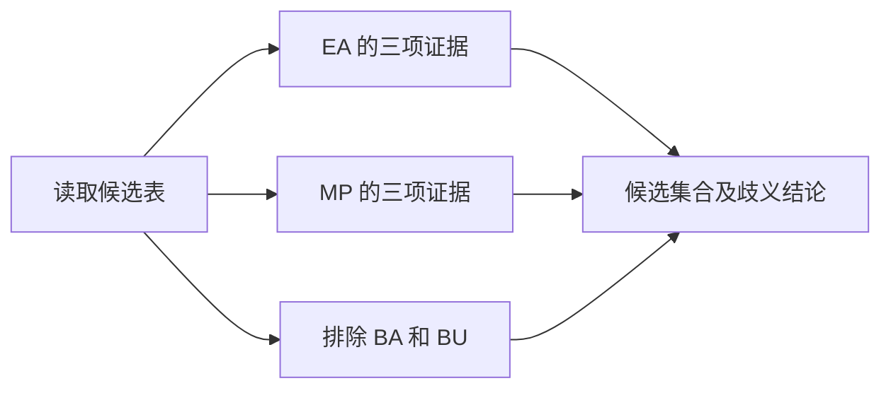

# 评分细则

SciToolFlow 同时检查 **任务是否完成、科学工作是否做对、结论是否有证据支持**。当前 500 题统一采用 `workflow.v1`；ReAct、SciToolAgent 和接入同一预测格式的其他 baseline 使用相同规则。

评分由预先编写并审核的 Python 规则离线执行，**不调用 LLM，不重跑科学工具，不执行预测中提交的程序**。无法直接判定的新方法会产生待审记录。

[如何测评](#如何测评) · [评分依据](#评分依据ground-truth) · [术语与完整案例](#用-flow-0001-理解术语和判分) · [指标计算](#指标如何计算) · [如何读分数](#如何读取结果)

## 先理解四个整题判定

| 判定 | 检查的问题 | 通过条件 |
| --- | --- | --- |
| **Completion** | 任务有没有正常交付？ | 记录可信，正常提交非空答案，公开格式合法，实验资源符合要求，无终止失败 |
| **Planning** | 科学工作有没有完整做对？ | 适用的必要能力、必要方法路线、参数来源与依赖全部成立，没有阻止判定的未决分支／搜索 |
| **Answer** | 科学结论是否正确且有依据？ | 必要科学结果的比较式与证据要求全部通过，公开答案格式合法 |
| **Joint** | 是否整体成功？ | Completion、Planning、Answer **同时通过** |

**Joint 是整题通过判定，不是几个部分分的平均值。** 正常运行不保证科学正确；答案数值碰巧正确，也不能替代要求的实际证据。Planning 和 Answer 还会独立报告，便于定位失败环节。

## 如何测评

### 1. 生成预测与真实轨迹

配置好工具和生成模型后，从项目根目录运行。下面使用 API；换成 `--backend vllm --model "<served-model-name>"` 即可使用本地服务：

```bash
conda activate SciTool-Unified
python cli.py run --baseline react --backend api --tasks FLOW-0001 \
  --output results/demo/predictions.json
```

`predictions.json` 由 harness 保存，包含运行设置、指纹、答案、真实调用和轨迹位置。评分需要这份实验文件及其轨迹；单独提交答案或工具名列表不能通过执行证据核验。

### 2. 使用同一任务范围评分

```bash
# 单题示例；与上面的预测范围对应
python cli.py score --tasks FLOW-0001 \
  --predictions results/demo/predictions.json \
  --output results/demo/scores.json

# 正式全量测评，默认以全部 500 题为分母
python cli.py score --predictions results/full/predictions.json \
  --output results/full/scores.json
```

所选题库的全量评分中，缺交、执行失败、格式错误、资源耗尽均保留在分母。抽测须显式传 `--tasks`；否则单题预测也会按所选题库的全部题目计算（full 为 500，mini 为 200）。预测中的未知或重复题号会被拒绝。

代码、题库、工具和运行指纹须匹配，不能修改旧指纹强行评分。使用其他 baseline 时，应生成同样可认证的预测与轨迹，并保持可比较的模型、采样和资源设置。

Mini 使用相同评分入口，以所选题库的全部 200 题为分母：

```bash
python cli.py score --dataset mini --predictions results/mini/predictions.json \
  --output results/mini/scores.json
```

查询、运行和评分均支持 `--dataset full|mini`，默认 full。`--tasks` 进一步限制所选题库；Mini 题号通过映射关联原金标准，结果同时报告 `id` 和全集 `source_id`。题库进入运行指纹，选择与预测不一致时会拒绝评分。

### 3. 读取两个输出文件

- `scores.json`：`summary` 保存总体指标，`results` 保存逐题判定和诊断。
- `scores_review_requests.json`：保存未决方法／证据的复核请求；文件名跟随评分输出名变化。

运行生成可使用 API 或本地模型；**上述评分步骤不需要生成模型、embedding 服务或额外 judge API**。

## 评分依据：Ground truth

每题的 ground truth 是一组相互关联的参考资料，不只是一个答案字符串：

| 内容 | 保存位置 | 作用 |
| --- | --- | --- |
| 公开题文、输入、附件、提交格式 | `tasks/questions.jsonl`、`tasks/assets/`、`answer_schema` | 明确问题、可用信息及模型应提交的结构 |
| 已审核参考答案 | 主参考的 `expected_answer` | 记录一份由实际执行支持的完整答案 |
| 能力与工作流规则 | `evaluation.nodes`、`capability_groups`、依赖与参数绑定 | 定义哪些科学工作必须完成，允许哪些完整路线 |
| 科学结果与比较规则 | `evaluation.outcomes`、科学边界、容差与集合语义 | 判断结论正确性及其证据是否齐全 |
| 真实执行和独立审核 | `reference_trace`、`native_provenance`、`review.record` | 核验参考确由执行产生，且经过不同审核者批准 |

主参考统一在 `data/references.jsonl.gz`，281 条不重复的额外执行在 `data/reference_runs.jsonl.gz`。额外执行继承同题科学判据，不另设一套评分标准。**模型可以采用已认可的等价路线，不必复制某一条参考的逐步顺序。** 独立分支可以换序，规定的数据依赖仍须成立。

## 用 FLOW-0001 理解术语和判分

这是正式题库中的一个受控合成分析问题：从四个候选结构中筛选同时满足 **质量窗口、含酯基、不含游离酸基** 的结构，并判断能否唯一识别。

实际工具计算表明 EA 和 MP 均满足条件；BA、BU 被排除。规定的证据不能进一步区分 EA 和 MP，所以必要答案字段为：

```json
{
  "candidate_ids": ["EA", "MP"],
  "identification_status": "ambiguous"
}
```

这些检测的选择性由题目规定，不代表真实仪器能完全实现相同的理想检测。允许的可选 `limitation` 文本当前没有单独的自由语义评分项。

### 真实回执、能力节点和数据依赖

**回执**是一次工具调用的实际参数、状态和输出，带有 `observation_id`。**能力节点**是一项可核查的工作要求，例如“取得 EA 的精确质量”；同一个工具处理不同对象可以对应不同节点。

本题有 9 个必要节点：

| 工作要求 | 数量 | 主参考的证明回执 |
| --- | ---: | --- |
| 读取规定的候选记录及其结构 | 1 | o001 |
| EA：取得质量、确认含酯基、确认无游离酸基 | 3 | o002、o003、o010 |
| MP：取得质量、确认含酯基、确认无游离酸基 | 3 | o004、o005、o011 |
| 取得足以排除 BA 和 BU 的证据 | 2 | o007、o008 |



**必要节点**必须满足才能通过 Planning；可选节点省略不降低必要能力分。**依赖与参数绑定**规定后续调用如何使用前序结果：例如检测 EA 时，`smiles` 必须对应候选表中的 EA，查询模式须与题目要求一致。换成 MP 的结构，即使也返回 true，仍不能证明 EA 的性质。

**节点替代项**允许用不同的合格证据完成同一要求。例如主参考用 BU 的质量回执 o008 支持排除；符合规定的结构检测也可构成已声明的替代证据。能力节点不是固定工具名列表的打卡。

### 科学比较式与证据支撑

**科学比较谓词**就是明确返回真或假的检查式。本题有两项必要科学结果：

| 科学结果 | 比较式的含义 | 证据要求 |
| --- | --- | --- |
| 候选集合正确 | 与集合 `{EA, MP}` 相同；两者共同换序可接受，缺项或多项失败 | 9 个必要节点均成立 |
| 歧义判断正确 | `identification_status` 等于 `ambiguous` | 9 个必要节点均成立 |

每项结果分别记录 `correct`（比较式是否通过）、`grounded`（所需实际证据是否齐全）、`passed`（两者均成立）。**证据支撑检查的是回执与规则，不是回答中有没有写“根据工具结果”。**

数值比较使用 `abs(pred-ref) <= atol + rtol*abs(ref)`，并遵守相应科学边界；例如概率不能因容差而超出 `[0,1]`。题目中的 5 ppm 测量窗口与评分器的数值容差是不同概念。字段类型、成员身份、单位、数组配对与规定顺序同样属于判据。

### 必要方法组：允许选一条完整路线

**方法组**表示“必须完成一个工作目标，但可以选用其中一条完整方法”。组内多条路线是 **OR**；每条路线内部的步骤是 **AND**。

FLOW-0001 正式规则没有方法组。仅为解释概念，若将质量窗口计算表达成一个方法组，可允许“直接检查质量上下限”，或“减去观测质量 → 计算相对误差 → 检查范围”。完成任一整条路线才满足该组；只做后者的前两步不满足。两条路线都满足时也只获得该方法组的一份权重，不强制做完所有路线。

这是同一科学问题的教学配置，**没有新增正式任务要求或修改正式认可路线**。具体声明方式见[完整案例的方法组部分](../docs/scoring.md#5-必要方法组是什么把允许多条完整路线写清楚)。

### 同一题怎样区分不同错误

以下是在同一份已审核执行的副本上更改答案或删除回执的教学对照，不是新的模型实验。各项必要权重均为 1：

| 情况 | Completion | Planning | Answer | 编排部分分 | 科学部分分 | 证据覆盖 | Joint |
| --- | :---: | :---: | :---: | ---: | ---: | ---: | :---: |
| 合格参考 | ✓ | ✓ | ✓ | 9/9 | 2/2 | 2/2 | ✓ |
| 证据不变，把状态写成 `unique` | ✓ | ✓ | ✗ | 9/9 | 1/2 | 2/2 | ✗ |
| 删去 o008、o009，答案仍正确 | ✓ | ✗ | ✗ | 8/9 | 0/2 | 0/2 | ✗ |
| 没有科学调用，直接猜中答案 | ✓ | ✗ | ✗ | 0/9 | 0/2 | 0/2 | ✗ |
| 科学字段正确，但增加不允许的字段 | ✗ | ✓ | ✗ | 9/9 | 2/2 | 2/2 | ✗ |

第三行缺少排除 BU 的完整证据，而两项结论都要求全部 9 个节点，所以结论的证据覆盖为零。最后一行说明科学部分分和整题 Answer 是不同层次：科学字段已经满足，不会抵消公开提交格式错误。

## 指标如何计算

### 四个整题比例

设评分范围有 N 道题，每题的 C、P、A 分别是 Completion、Planning、Answer 的 0/1 判定，则：

- Completion = `sum(C)/N` → `pass_rate`
- Planning = `sum(P)/N` → `tool_planning_accuracy`
- Answer = `sum(A)/N` → `final_answer_accuracy`
- 已证实 Joint = `sum(C*P*A)/N` → `joint_pass_rate`

全量 N=500。失败和缺交不从 N 中移除；三个任务类别使用相同定义。`joint_success_rate` 在没有待审时才给出最终值，见后文。

### 诊断部分分与效率

| 逐题指标 | 分子／分母 | 总体字段 |
| --- | --- | --- |
| 编排部分分 | 已匹配的适用必要节点／必要方法组权重 ÷ 全部适用必要项权重 | `mean_orchestration_credit` |
| 科学部分分 | 同时正确且证据齐全的适用科学结果权重 ÷ 全部适用科学结果权重 | `mean_scientific_credit` |
| 证据覆盖 | 证据齐全的适用科学结果权重 ÷ 全部适用科学结果权重 | `mean_evidence_coverage` |
| 原始选择效率 | 不同有效匹配执行数 U ÷ 实际科学调用数 T | `mean_raw_selection_efficiency` |
| 调整后选择效率 | U ÷（T−符合规则的豁免数 E） | `mean_selection_efficiency` |

各总体值先算每题，再对 N 道题取均值；不是把所有题的节点混成一个大分母。分母为零时该诊断值记为 0。科学部分分与证据覆盖包含适用的可选科学结果；整题 Answer 的科学通过条件只要求必要结果。编排部分分只计必要节点和必要方法组。

“适用”指该题分支条件下需要检查的项目。未知分支不会自动忽略；缺少模型应取得的前序证据通常属于普通证据失败，不因“无法判断”自动变成待审。

FLOW-0001 的主参考有 14 次科学调用、1 次 DescribeTools。当前规则匹配到 9 次必要执行与 3 次可选执行，U=12、E=0，所以两种效率均为 **12/14≈85.71%**。o009 使用默认参数，但当前可选规则要求若干参数显式出现；o014 也不满足现有可选路线。因此它们未获匹配信用，不能据此断言科学上没有价值。效率是对已声明证据的诊断，不是运行耗时、费用或科研价值评分。

重复执行始终增加 T，同一有效结果不会重复增加 U。最多 2 次相关失败恢复、2 次指定元数据探索可从效率分母中豁免，须符合该题规则；重复结果和已获匹配信用的执行不再豁免。**这些豁免不减少真实生成请求、时间或 token 成本，也不改变 Joint。**

DescribeTools 的调用另外计发现成本，不进入科学路径、科学调用数或覆盖率；它仍消耗生成请求与时间。SciToolAgent 自动读取契约也计入发现成本。

## 未知方法与最终主指标

已声明工具路线、已审核的完整数值实现可以按规则匹配。对于有可信实际执行、但尚未被规则识别的新算法、来源或未决搜索，评分器可生成独立复核请求；它既不会只凭正确 stdout 自动通过，也不会将已经明确的科学错误改成待审通过。

例如 500 题中已证实 300 题 Joint 通过，另有 20 题正常完成但方法待审：

| 字段 | 值 | 含义 |
| --- | ---: | --- |
| `joint_pass_rate`／`joint_accuracy_lower_bound` | 60% | 已证实的 300/500 |
| `joint_accuracy_upper_bound` | 64% | 假设正常完成且待审者全部通过的乐观上界 |
| `pending_reviews` | 20 | 待审核题数 |
| `final_metric_available` | false | 最终主指标尚不能报告 |
| `joint_success_rate` | null | 尚未定案 |

上下界不是统计置信区间。上界只包含已通过或正常完成且待审的题，未完成的待审项不会仅因待审标志进入上界。

复核须检查完整算法、源数据、科学边界与执行记录，结论落实为**所有 baseline 共用、具有版本的判据**，再统一重评分。当前入口不接受对单个模型、单个预测的通过覆盖，也不会自动调用 LLM 代替独立复核。当所有待审解决后，`final_metric_available=true`，`joint_success_rate` 才给出最终联合通过率。

## 资源与执行完整性

当前资源策略为 `task-resources.v1`：每题默认所有角色合计 400 次生成请求、7,200 秒。第 400 次合法完成可接受，不发送第 401 次；截止时间处及之后的完成被拒绝。科学工具、发现和 think 无独立次数上限，连续同工具同实参十步终止。完整定义见[运行资源策略](../docs/execution_policy.md)。

评分从通过哈希与一致性校验的轨迹中读取资源账本。发布或实验指纹不匹配会拒绝评分；单题证据／资源账本不一致会使该题失败。资源耗尽不从分母中删除，不抵消已取得的编排诊断，也不能获得 Joint。

`resource_exhausted_tasks`、`resource_integrity_failures` 分别统计资源耗尽与资源核验失败。`known_prompt_tokens`、`known_completion_tokens` 是已知用量小计；缺失项为未知，不按零成本解释。使用 `tasks_with_complete_token_usage` 判断有多少题的用量完整。

## 如何读取结果

先看 `summary.total_reference_tasks`、`missing_predictions`、`pending_reviews`、`final_metric_available`，再读取最终主指标与其他整题比例。定位具体失败时，在 `results` 中按题号查看：

| 字段 | 能帮助判断什么 |
| --- | --- |
| `runtime_failure`、`answer_contract_errors` | 执行／资源为何终止，答案格式哪里不合规 |
| `nodes[].matched`、`observation_id` | 哪项工作缺少合格回执，当前用哪次执行作证 |
| `capability_groups[].matched_routes` | 哪条完整方法路线已经完成 |
| `outcomes[].correct / grounded / passed` | 科学值错误、证据缺失，还是两者均满足 |
| `scientific_fields_pass` | 应用公开格式检查前，必要科学结果是否满足 |
| `evidence_integrity`、`resource_usage` | 记录与资源账本是否通过核验 |
| `pending_review`、待审请求文件 | 哪些问题需独立科学方法复核 |

查看本例的真实判据、答案与轨迹：

```bash
python -m evaluation.authoring.inspect --task FLOW-0001 --section evaluation
python -m evaluation.authoring.inspect --task FLOW-0001 --section expected_answer
python -m evaluation.authoring.inspect --task FLOW-0001 --section trace
```

这些是面向 benchmark 使用者和作者的检查入口，不应把参考答案或判据加入被测模型上下文。更详细的逐回执分析、规则摘录、方法组声明与效率对照见[完整案例指南](../docs/scoring.md)；数据布局见[参考数据说明](data/README.md)，实现入口为 [runner.py](runner.py) 和 [workflow/](workflow/README.md)。
