# RXN-Sandbox

A lightweight, local instance of RXN for running forward reaction and retrosynthesis predictions.

> [!NOTE]
> This repository is cross-listed on **[GitHub](https://github.com/rxn4chemistry/rxn-sandbox)** and **[Hugging Face](https://huggingface.co/rxn4chemistry/rxn-sandbox)**.

## Table of Contents
- [Overview](#overview)
- [Prerequisites](#prerequisites)
- [Quick Start](#quick-start)
- [Usage](#usage)
  - [Jupyter Notebook](#jupyter-notebook)
  - [MCP Integration with OpenWebUI](#mcp-integration-with-openwebui)
  - [Python Scripts](#python-scripts)
- [Container Management](#container-management)

## Overview

This repository enables offline chemical reaction prediction using transformer models.  The available tasks are RXN's most used prediction functionality: forward reaction, single-step retrosynthesis, and retrosynthesis tree generation.  These tasks are performed locally via Jupyter notebook, via dedicated Python scripts, or via LLM (using OpenWeb UI and MCP).  The transformer models were trained using 2025Q2 Pistachio data.

| Forward Reaction | Retrosynthesis (Single Step) | Retrosynthesis (Tree) |
|:---:|:---:|:---:|
| 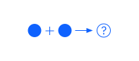<br>Predict products from reactants | 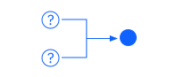<br>Predict reactants for one step | 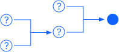<br>Generate multi-step routes |


## Prerequisites

**Software**:

- [Docker](https://docs.docker.com/get-docker/) and [Docker Compose](https://docs.docker.com/compose/install) OR
[Podman](https://podman.io/getting-started/installation) and [Podman Compose](https://podman-desktop.io/docs/compose/setting-up-compose)
- [Git LFS](https://git-lfs.com/)

> [!NOTE]
> If using Podman, replace `docker` commands with `podman` throughout this guide.
>
> This repository uses Git LFS for `.ckpt` model files. Install Git LFS, then run `git lfs install` once on your machine before cloning or pulling the repository.

**Hardware**:

- **8GB RAM** (16GB recommended for retrosynthesis tree predictions)
- **10GB free disk space** for container images and models
- **Supported platforms:** macOS, Linux, Windows
- **Supported architectures:** Intel/AMD (x86_64) and ARM64 (Apple Silicon)
- **NVIDIA GPU** (optional) — required only when using `compose-cuda.yaml`

## Quick Start

Two Compose files are provided:

| File | Description |
|------|-------------|
| [`compose.yaml`](compose.yaml) | Default — CPU-only inference |
| [`compose-cuda.yaml`](compose-cuda.yaml) | GPU-accelerated inference via NVIDIA CUDA (requires an NVIDIA GPU and the [NVIDIA Container Toolkit](https://docs.nvidia.com/datacenter/cloud-native/container-toolkit/install-guide.html)) |

Clone this repository, and from the root directory run the following commands.  Replace `compose.yaml` with `compose-cuda.yaml` in each command to enable GPU acceleration.

#### 1. Build the Docker Images

```bash
docker compose -f compose.yaml build
```

####  2. Start the Services

```bash
docker compose -f compose.yaml up -d
```

####  3. Verify Running Containers

You should see all containers running:

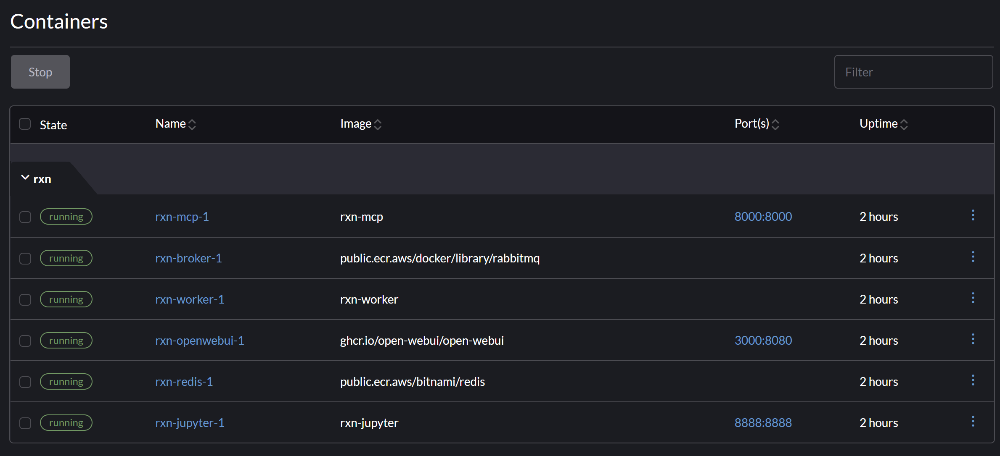

#### 4. Access the Interface(s)

- **Jupyter Notebook**: http://localhost:8888/
- **OpenWeb UI**: http://localhost:3000/


## Usage

<details id="jupyter-notebook">

<summary>Jupyter Notebook (click to expand)</summary>

### Jupyter Notebook

Access Jupyter at http://localhost:8888/ to use the interactive notebook environment.

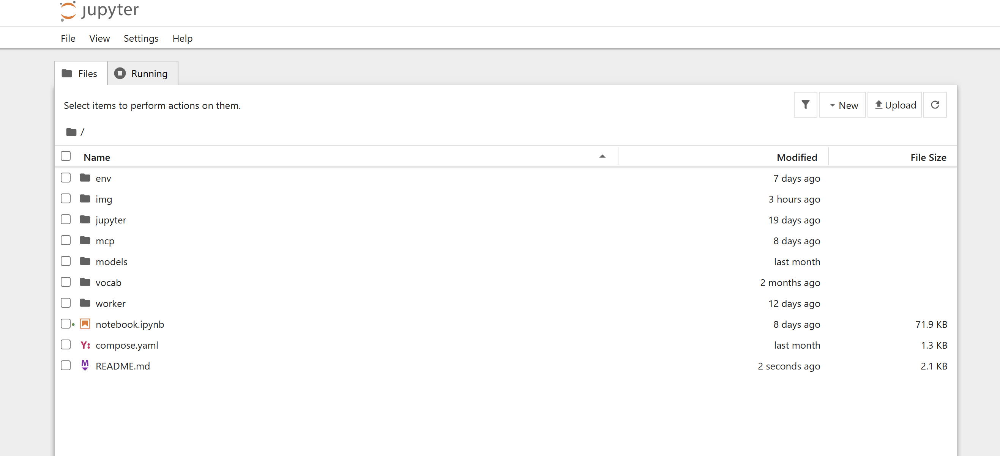

Use the provided [notebook.ipynb](http://localhost:8888/notebooks/notebook.ipynb) to explore examples and interact with the models.

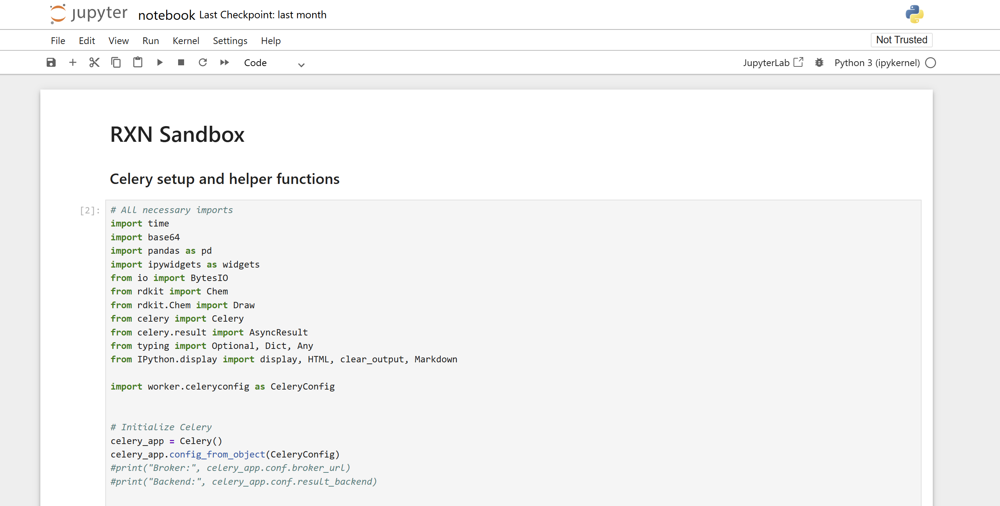

### Initial Setup

Run the **Celery setup and helper functions** section first to:
- Import required libraries
- Configure the Celery application
- Define helper functions for visualizing results

### Product Prediction

Two examples are provided for product prediction (batch and single reaction). Customize the reactants list:

```python
# Set up a list of reactants to make predictions
reactants_list = ["CCI.O=Cc1ccc([N+](=O)[O-])c(O)c1"]
```

Configure prediction parameters:

```python
# Setup task kwargs
kwargs = {
    "topn": 3,        # Number of results per reactant
    "num_beams": 5,   # Number of beams used for prediction. Must be >= topn
}
```
After running the prediction, the results will be displayed in a table:

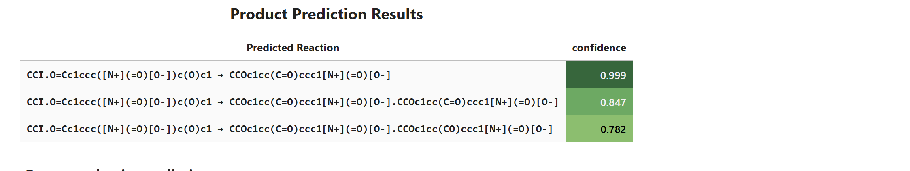

### Retrosynthesis Prediction

Retrosynthesis predictions process one product at a time. Set the target product:

```python
# Choose product for retrosynthesis prediction
product = "C=CC(=C)C[Si](C)(C)C"
```
Configure retrosynthesis-specific parameters:

```python
# Setup task kwargs
kwargs = {
    "topn": 10,       # Number of results per reactant
    "num_beams": 10,  # Number of beams used for prediction. Must be >= topn
    "fap": 0.6,       # Forward likelihood acceptance probability (not length averaged)
    "fld": 0.2,       # Forward likelihood delta required between the top2 forward prediction results
}
```

Results are displayed in a similar table format:

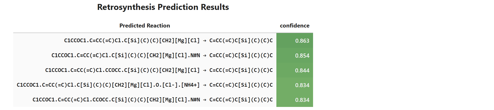

### Retrosynthesis Tree Prediction

Start by selecting a target product SMILES:

```python
# Choose product for retrosynthesis tree prediction
product = "C1C(C[Si](C)(C)C)=CCC2C(=O)OC(=O)C12"
```

Configure prediction and tree-specific parameters:

```python
# Setup task kwargs
kwargs = {
    "topn": 15,       # Number of results per reactant
    "num_beams": 15,  # Number of beams used for prediction. Must be >= topn
    "fap": 0.6,       # Forward likelihood acceptance probability (not length averaged)
    "fld": 0.2,       # Forward likelihood delta required between the top2 forward prediction results
    "max_depth": 4,   # Max depth of the retrosynthesis tree
    "beam_width": 6,  # Max amount of nodes being expanded in each step
}

```

> **⚠️ Performance Note**: Retrosynthesis tree predictions are computationally intensive and may take significant time to complete.

### Result Visualization

Two visualization options are available:

**1. Text Representation** - Complete textual view of predicted routes and steps:

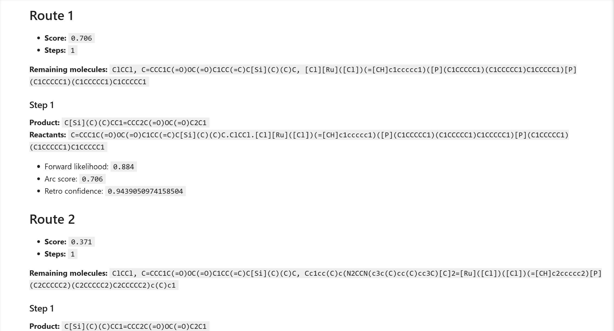

**2. Graph Representation** - Visual tree structure with molecule expansion paths. Use the selector to switch between different prediction results:

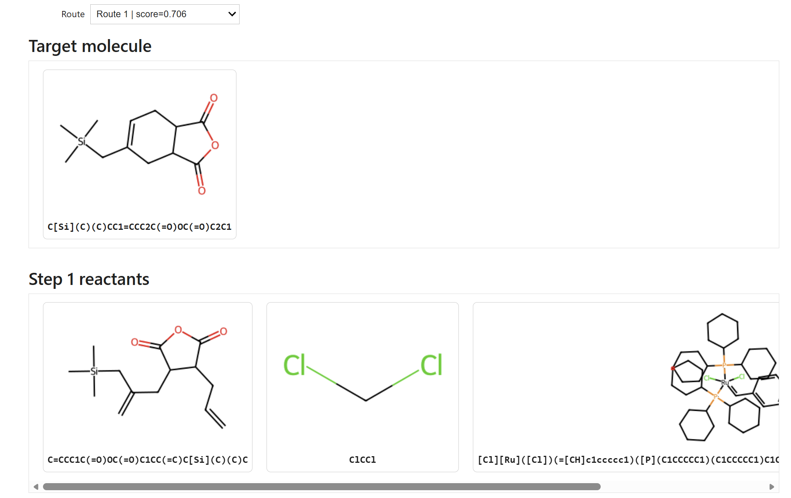

</details>

<details id="mcp-integration-with-openwebui">
<summary>LLM (click to expand)</summary>

### MCP Integration with OpenWebUI

Access OpenWeb UI at http://localhost:3000/ to interact with RXN models using natural language through AI assistants.

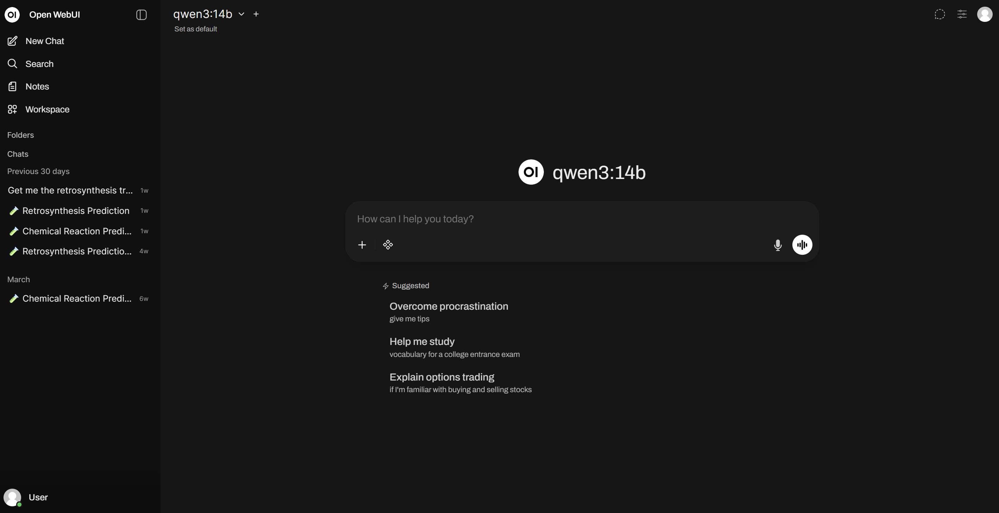

#### Setup MCP Server Connection

1. Navigate to **Settings → Integrations**
2. Under **Manage Tool Servers**, click the `+` icon
3. Set URL to `http://localhost:8000`
4. Click **Verify Connection** and **Save**

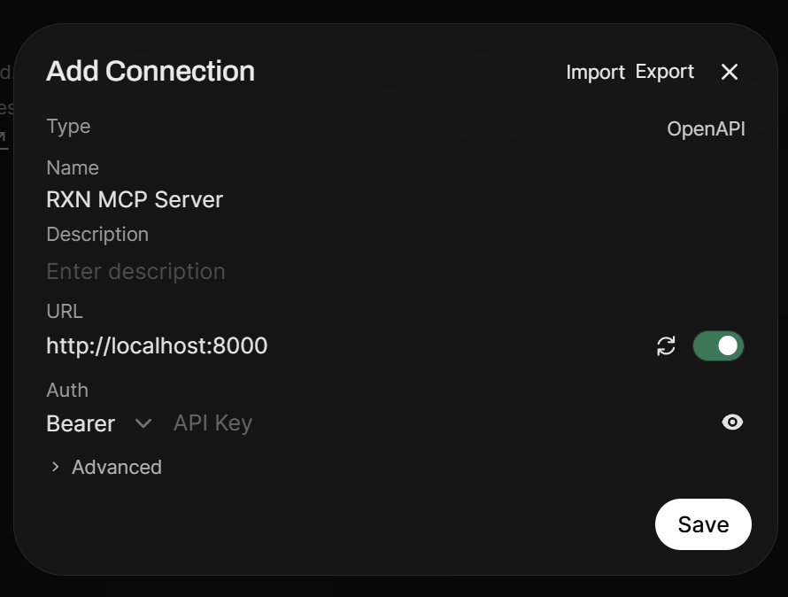

#### Configure External Models (Optional)

To use external AI models:
1. Go to **Admin Settings → Connections**
2. Add your API key for the desired model provider

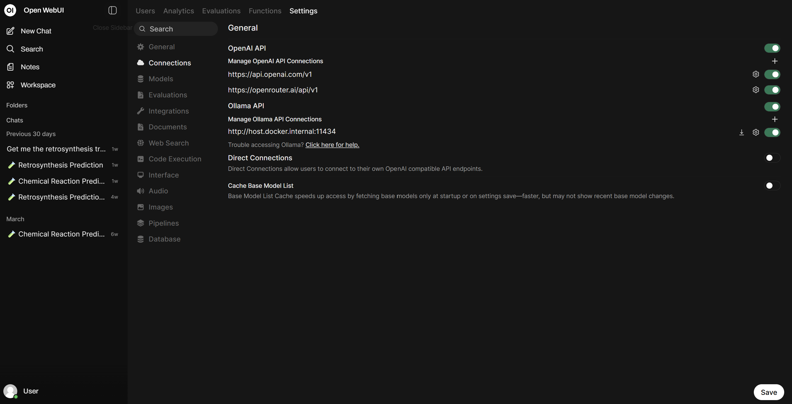

#### Enable RXN Tools

1. Select your preferred AI model
2. Click the **Integrations** button below the prompt input
3. Select **Tools** and toggle on `rxn-mcp-server`

> **Note**: You must re-enable the tool when switching models.

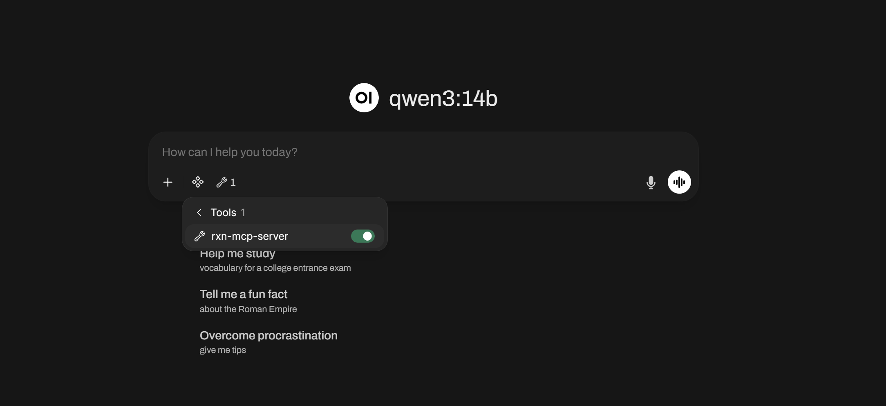

#### Using Natural Language

Interact with RXN functions using conversational prompts:

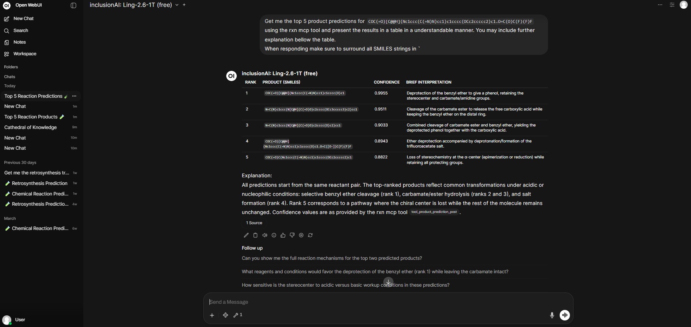

</details>

<details id="python-scripts">

<summary>Python Scripts (click to expand)</summary>

### Running via Scripts

If you prefer a command-line workflow, you can run predictions directly from the provided Python scripts without using Jupyter or OpenWebUI.  This method may be useful for 
running analyses on remote machines (which often lack GUIs).

#### Open a Shell in the Worker Container

The scripts are executed inside the `worker` container, where the models and Celery configuration are already available:

```bash
docker exec -it rxn-worker-1 bash
```

#### Available Example Scripts

- `python scripts/predict_product.py` — run forward reaction prediction examples
- `python scripts/predict_retrosynthesis.py` — run single-step retrosynthesis examples
- `python scripts/predict_retrosynthesis_tree.py` — run retrosynthesis tree examples
- `python scripts/run_notebook_examples.py` — run the same examples shown in the notebook in sequence (this is effectively a combination of the three prior scripts)

#### Customize Inputs and Parameters

Each script is intended to be edited before execution. The `scripts/` directory is mounted into the worker container, so local changes are immediately available without rebuilding the image. Update the input SMILES and prediction parameters directly in the file:

- `reactants_list` for forward reaction prediction
- `product` for retrosynthesis and retrosynthesis tree prediction
- `topn`, `num_beams`, `fap`, `fld`, `max_depth`, and `beam_width` as needed

Then run the script you want:

```bash
python scripts/predict_product.py
```

#### Exit the Container

When you are finished, leave the container shell with:

```bash
exit
```
</details>

## Container Management

### Container Architecture

The system consists of six containers:

- **redis** - Results backend for Celery tasks
- **broker** - RabbitMQ message queue for task distribution
- **worker** - Celery worker running the transformer models
- **jupyter** - Interactive notebook environment
- **mcp** - Model Context Protocol server for LLM integration
- **openwebui** - Web interface for AI assistant interaction

### Useful Commands

```bash
# Stopping services
docker compose -f compose.yaml stop

# Restarting services
docker compose -f compose.yaml restart

# Viewing logs (all services)
docker compose -f compose.yaml logs -f

# Viewing logs (specific service)
docker compose -f compose.yaml logs -f worker

# Removing everything (containers, networks, and volumes)
docker compose -f compose.yaml down -v
```

> [!TIP]
> Replace `-f compose.yaml` with `-f compose-cuda.yaml` in any of the commands above to manage the GPU-accelerated stack instead.

### Performance Notes

- **Forward Predictions**: Fast (seconds)
- **Single-Step Retrosynthesis**: Moderate (seconds to minutes)
- **Tree Retrosynthesis**: Slow (minutes to hours depending on depth/width)

**Optimization Tips**:

- Start with smaller `topn` and `num_beams` values
- Limit `max_depth` to 3-4 for tree predictions
- Use `beam_width` of 5-10 for reasonable performance
- Allocate 16GB RAM for complex tree predictions

**Benchmarking**:

GPU acceleration provides significant speedup, especially for complex retrosynthesis tree predictions.  These results are from the Python scripts in the `scripts/` folder.  Analysis 
times can vary substantially depending on the query molecule(s) and parameters.

| Script | T4 GPU (AWS g4dn.xlarge) | M1 Mac CPU | GPU Speedup |
|--------|---------------------|------------|-------------|
| `predict_product.py` | **1.7 s** | 3.4 s | 2.0x |
| `predict_retrosynthesis.py` | **2.5 s** | 8.5 s | 3.4x |
| `predict_retrosynthesis_tree.py` | **87 s (1.5 min)** | 763 s (12.7 min) | 8.8x |
