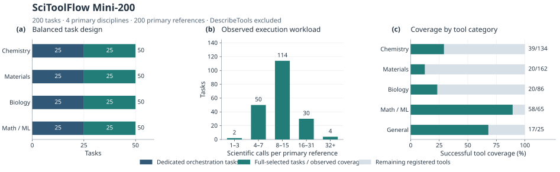

# SciToolFlow Mini-200

**200 道面向科学子任务拆分、工具选择与证据编排的任务，四个学科各 50 道。** 100 道独立编排题与 100 道 Full 精选题共用运行和评分接口。串行 ReAct／SciToolAgent 与并行 SciMas 使用相同科学要求。

| 学科 | 独立编排题 | Full 精选题 | 合计 |
| --- | ---: | ---: | ---: |
| 化学 | 25 | 25 | 50 |
| 材料 | 25 | 25 | 50 |
| 生物／生态 | 25 | 25 | 50 |
| 机器学习／数理 | 25 | 25 | 50 |
| **合计** | **100** | **100** | **200** |

## 题库画像

| 主参考统计 | 数值 |
| --- | ---: |
| 参考数／科学调用总数 | 200／2057 |
| 每题科学调用：均值／中位数／范围 | 10.285／9／1–37 |
| 每题成功科学调用：均值／总数 | 9.975／1995 |
| 每题不同成功工具：均值／中位数／范围 | 4.15／4／1–11 |
| 至少4次科学调用的题数 | 187（93.5%） |
| 涉及两个及以上工具类别的题数 | 138（69%） |
| 多层评分能力图／并行证据面板 | 177／23 |
| 主参考成功覆盖的科学工具 | 152／472（32.20%） |



| 工具类别 | 注册科学工具 | 主参考成功覆盖 | 覆盖率 | 涉及题数 |
| --- | ---: | ---: | ---: | ---: |
| 化学 | 134 | 39 | 29.10% | 38 |
| 材料 | 162 | 20 | 12.35% | 37 |
| 生物／生态 | 86 | 20 | 23.26% | 28 |
| 机器学习／数理 | 65 | 56 | 86.15% | 131 |
| 通用辅助 | 25 | 17 | 68.00% | 137 |

主学科每题只计一次，工具类别为多标签统计。科学调用包含失败尝试，成功覆盖只计真实成功调用，均排除 DescribeTools。能力图含可选／条件节点，其结构不是实际并发度或最少调用数。

199题的主参考成功使用至少两种工具；SMAS-0082 的公开计数允许一个经过科学复核的有界数值程序完成，不将其描述为多种工具之间的数据流。参考选择反映一种有效解法，不能用增加冗余调用来提高统计。材料工具覆盖仍较低。详细数据见[Mini统计](../../docs/benchmark_analysis/mini_statistics.json)与[逐题记录](../../docs/benchmark_analysis/mini_tasks.json)。

## 选题与质量边界

新增题优先考察有科学意义的独立分支、共享前提、数据身份或方法资格，以及必须汇合的结果。选题核查题文、附件、评分能力图和真实参考，兼顾学科与问题类型；不以某个模型能否通过作为质量标准，不按调用次数机械排序。从 Full 选入的100题均不属于其100道高难度题。

典型新增工作流包括竞争动力学模型的观测设计、多温度吸附曲线的共同支持范围、带内部松弛的周期框架力学、完整 NMR 系综的代表构象选择、嵌套模型评估，以及共享校准误差下的协方差感知证据合并。与已有题使用相同方法族时，审查科学目标和判据是否有实质区别，而不只看名称不同。

独立编排题中较弱的多阶段适配说明继续保留。设计适配不等于已测量的baseline优势；相对成功率、耗时和实际并发收益需要独立实验。

[selection.json](selection.json) 记录每题来源、科学目标、选题理由、可并行子任务、汇合要求、参考工作量和适配限制。这些作者说明、评分器与参考答案不进入模型输入。公开题文和附件已检查答案键、具体工具路径等泄露；科学定义、已观测标签、研究协议和输出格式仍作为必要输入。

## 编号与参考

- `SMAS-0001..SMAS-0100` 保留现有 Special-100 的编号和科学内容。
- `SMAS-0101..SMAS-0200` 来自 Full 的固定科学源任务。Mini 的 C/E 评分已逐题独立审核；必要的公开格式／语义澄清记在 `selection.json`，科学输入、附件与研究目标保持不变。
- [ids.tsv](ids.tsv) 保存 `mini_id / origin / source_id` 映射。新增题按化学、材料、生物、机器学习各 25 道排列。

全部 200 题都有已复核的真实参考，本轮 124 题使用新的受限 Terra 执行，76 题复用合格参考。复用参考时，原始轨迹、生成清单和科学审查记录保留其源题号；评分时建立新题号的内存视图，**不改写轨迹、生成身份，也不把旧参考称为重新生成的参考**。例如，`SMAS-0103` 直接映射到 Full 的 `FLOW-0029`，不经过旧 Mini 编号。前100题保留自身来源，未人为补造 Full 对应题。

公开附件和参考副本均包含在本目录，运行和评分不需要读取原 Special-100 的作者目录。Full-500 科学内容保存在 `../full/`；原 Special-100 的作者材料仅用于来源追溯。Mini-200 的运行使用下面的统一 CLI；旧 Special-100 的独立脚本只服务于原版本。

## 加载与运行

统一 CLI 默认选择 `mini`；也可显式指定 `--dataset mini`。完整500题位于 `tasks/full/`，使用 `--dataset full`。旧 Mini 题集及 `special` 接口已删除；原 Special-100 作者材料保存在 `evaluation/authoring/special100/`，不作为另一套运行接口。

从仓库根目录执行，先按[安装与部署](../../docs/setup.md)配置 Conda、工具资源及生成模型。API、本地 vLLM 服务和本地权重均可使用；模型由实验者选择。三个 baseline 使用相同的 `--dataset mini`，支持任务并发、断点续跑和相同资源配置。

```bash
conda activate SciTool-Unified

# 查看一题；不传题号可列出200题
python cli.py task SMAS-0103 --dataset mini

# API：运行全部200题
python cli.py run --dataset mini --baseline react --backend api \
  --model YOUR_MODEL --tasks all --concurrency 2 \
  --output results/react_mini/predictions.json

# 本地vLLM服务；使用服务实际公布的模型名
python cli.py run --dataset mini --baseline scimas --backend vllm \
  --model YOUR_SERVED_MODEL --tasks all --concurrency 2 \
  --output results/scimas_mini/predictions.json

# 直接加载本地权重；local后端使用单任务并发
python cli.py run --dataset mini --baseline scitoolagent --backend local \
  --model /path/to/model --tasks all --concurrency 1 \
  --output results/scitoolagent_mini/predictions.json
```

`--baseline` 可选 `react / scitoolagent / scimas`；`--backend` 可选 `api / vllm / local`。配置生成接口、权重和检索 embedding 的方式见部署说明；SciMas 与 SciToolAgent 使用各自的工具图谱。

单题抽测时，将运行和评分的 `--tasks` 都设为相同的 Mini 题号。例如 `--tasks SMAS-0103,SMAS-0180`。恢复同一实验时，在原运行命令末尾加 `--resume`；需重试失败题可再加 `--retry-failed`。题库、代码、模型或设置身份改变后应使用新输出目录。

默认每题最多 400 次生成请求、7,200 秒；科学调用数和决策步数没有默认固定上限，仍有连续同参数重复循环保护。可用统一 CLI 的资源选项为各方法设置相同限制。

自定义 Agent 只加载公开题目及经哈希校验的附件：

```python
from tasks.datasets import load_dataset
from tasks.assets import load_agent_input

dataset = load_dataset("mini")
public = load_agent_input(dataset.select("SMAS-0103")[0], dataset.asset_root)
# 仅向Agent提供question、inputs、files和answer_schema。
```

也可单独检查 SciMas 规划阶段：

```bash
python cli.py plan --dataset mini --tasks SMAS-0103 \
  --backend vllm --model YOUR_SERVED_MODEL --output results/mini_plan
```

## 评分

Full来源题的评分依据已随Mini保存，不在评分时转去运行Full题。例如，`SMAS-0103 → FLOW-0029`：加载对应的科学判据、必要能力与金标准，核验还原源题号后的题目身份，并只在内存中建立Mini题号视图。原始参考轨迹和生成清单保留Full身份，不改写为新的Mini轨迹。

规划指标检查模型本次实际调用和观测；答案指标将模型答案放入可信参考观测上下文，按已审核的科学判据独立判断。因此答案正确可以与规划失败同时出现，参考调用不会替模型获得规划分。Full题文或规则以后发生变化时，需要同步更新并重新验收Mini的固定副本，不会自动跟随变化。完整解释见[映射评分机制](../../evaluation/README.md#mini与full的映射评分)。

每题 C 为必要能力的加权完成比例，E 为有用科学工作相对实际计费调用的效率；主规划分为 `S=3CE/(2E+C)`，逐题计算后宏平均。严格规划通过率作为辅助指标保留。经过证据核验的批量／拆分、合法串行／并行与等价方法可同分；必要检查、恢复和格式探索受逐题证书与额度限制。完整定义与算分例子见[评分细则](../../evaluation/README.md)。

所有 baseline 的预测均使用同一命令，评分不调用 LLM：

```bash
python cli.py score --dataset mini \
  --predictions results/react_mini/predictions.json \
  --output results/react_mini/scores.json
```

只报告三项主指标，分母为所选题数。默认分母为全部 200 题；未提交预测或证据身份无效的题记失败。使用 `--tasks` 可以显式评分一个子集，完整 checkpoint 也可以取子集评分。

| 指标 | 逐题含义 | 总体统计 |
| --- | --- | --- |
| `runtime_completion_rate` | 经真实轨迹核验，运行正常结束；独立于答案格式、正确性和工具路径 | 完成题数／选定题数 |
| `tool_planning_accuracy` | 必要能力完成程度 C 与有效选择效率 E 的综合分 S | 对每题 S 求平均，不比较参考串行顺序 |
| `answer_accuracy` | 按可信参考观测独立判断所有必要科学结论 | 科学答案正确题数／选定题数 |

`DescribeTools` 不计科学工具规划。数值容差、合法并列、集合／分区等价、方法资格和空值规则沿用每题公开契约及共享判据。未列入当前规则的等价科学路径需要统一更新判据，不能用模型自评或单条预测豁免代替审查。计分依据和证据身份分别核验；参考自检通过不等于 baseline 的模型成绩。

评分首先校验题库／工具／执行代码指纹、预测题号、轨迹字节与实际观测，并检查实验资源账目。作者说明或参考不能由通用文件读取工具当作任务附件读取。

## 参考与接口验收

200 题已逐题复核能力、科学结果、来源、等价方法及有用工作边界。每题检查合法串行、合法并行和反序收集结果的一致性，并检验重复成本与缺失证据。所有真实参考均正常完成、必要能力完整且科学答案通过；参考中的真实冗余或执行错误仍降低 E，不要求参考综合分一律为 1。

[本版逐题验收](evaluation/orchestration_review.json)保留来源与评价身份，[参考自检](evaluation/acceptance.json)报告实际 C/E/S。修订前真实证据和细致控制保存在作者目录；这些材料不进入 Agent 输入。新的参考由无历史上下文、信息／工具受限的 `gpt-6.1-terra` 子智能体通过生产 ReAct 协议执行，不调用生成 API；此处不声称操作系统账户级隔离。主审另行审核科学计算与评分边界。

统一入口还用参考决策回放重新执行工具，检查公开输入、生产轨迹、资源账目与 CLI 评分。这是接口验证，不是 baseline 模型性能实验。范围与结果见[验收摘要](../../docs/benchmark_analysis/mini_validation.json)。

```bash
python -m pytest tests/integration/test_mini_dataset.py \
  tests/integration/test_dataset_interfaces.py tests/integration/test_mini_selection.py \
  tests/evaluation/test_public_asset_paths.py -q
python -m scripts.benchmark.mini check
python cli.py validate
```

## 文件与验收

| 文件 | 用途 |
| --- | --- |
| `questions.jsonl`、`assets/`、`asset_manifest.json`、`schema.json` | 公开任务、固定科学输入与内容身份 |
| `ids.tsv`、`metadata.json` | 连续编号、来源映射与题库统计 |
| `selection.json` | 作者使用的逐题选题和适配审查，不进入Agent输入 |
| `evaluation/references.jsonl.gz`、`evaluation/trajectories/` | 原始源题参考、审查记录及未改写的真实轨迹 |
| `evaluation/acceptance.json` | 全部200题的来源、参考与三指标自检 |

```bash
# 项目完整验收，包括Mini-200；不调用生成模型
python cli.py validate

# 单独核查Mini-200，不运行baseline实验
python -m scripts.benchmark.mini check
```

运行复用 `baselines/`；评分实现位于 `evaluation/suites/mini.py`，底层科学判据使用共享的 `evaluation/workflow/`。题库目录只存任务数据、参考和说明，不再增加另一套运行器。
