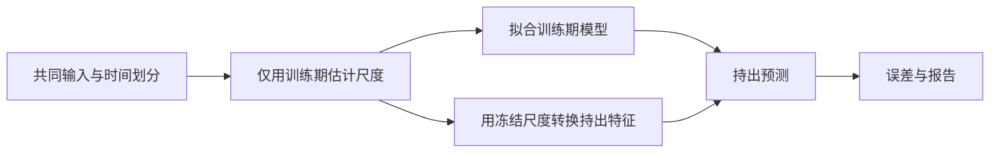

# SciToolFlow Mini-200

从正式 500 题中选出的 **200 道学科均衡任务**，用于评估科学子任务拆分、依赖感知的工具编排和并行调度。排除全部 100 道 `high_difficulty` 题，Mini 独立编号为 **FLOW-0001～FLOW-0200**；题文、输入、附件引用、答案格式和 `workflow.v1` 评分规则与对应全集题目一致。编号的含义由 `--dataset full|mini` 确定。

| 学科 | 正常题 | 工具组合题 | 合计 |
| --- | ---: | ---: | ---: |
| 化学 | 42 | 8 | **50** |
| 材料 | 40 | 10 | **50** |
| 生物／生态 | 42 | 8 | **50** |
| 机器学习／数理 | 50 | 0 | **50** |
| **合计** | **174** | **26** | **200** |

## 选题依据

依据 `SciMAS/科学工具编排-v2.docx` 第 2.2 节，重点保留可以组织为“共享前处理 → 独立科学子任务 → 结果汇合”的任务，包括多候选比较、多个性质的联合核验、竞争方法比较、同一约束集的上下界求解，以及固定模型后的独立评估。

选题同时检查题文、科学约束、原评分依赖及实际主参考。并行分支必须承担原题要求的科学工作，有明确的输入与输出；读取 JSON、格式展示、互斥的替代路线或不同纠错迭代不单独构成并行证据。调用次数、工具种类或历史模型成功率不作为替代标准。

181 题的独立计算可由当前必要能力图直接识别；另外 19 题按题文要求和已审核参考细分到预处理、后处理或独立参照分析。例如，固定主特征值后的左右向量求解、共同 SVD 后的行列贡献分析，以及冻结训练尺度后的模型拟合与持出变换。评分能力图用于判分，不要求它与最细粒度的执行任务图一一对应。

完整逐题说明见 [selection.json](selection.json)：每题记录科学目标、共享前提、两个可并行子任务和结果汇合要求。这些说明用于题库审查，**不作为 Agent 的输入或额外提示**。

| Mini ID | 全集 ID | 科学工作流 | 并行位置 |
| --- | --- | --- | --- |
| FLOW-0001 | FLOW-0001 | 候选结构的多证据筛选 | 各候选的质量与结构检验，最后合并全部相容证据 |
| FLOW-0026 | FLOW-0064 | 竞争动力学模型的观测设计 | 两个模型的平稳与时间响应分别计算，再比较计划 |
| FLOW-0004 | FLOW-0006 | 介电弛豫与导电竞争模型 | 各候选模型独立拟合，最后统一比较 |
| FLOW-0083 | FLOW-0216 | 有限模拟协议下的压力筛选 | 公共条件确定后，各压力状态独立模拟，再构造库存差与守卫量 |
| FLOW-0090 | FLOW-0239 | 有限质量通道的混合物辨识 | 同一可行约束集上的多个极值问题独立求解 |
| FLOW-0116 | FLOW-0288 | 阶段种群的局部敏感性 | 共同主特征值确定后，左右向量分别求解 |
| FLOW-0152 | FLOW-0389 | 包含参数选择的外层验证 | 各外层划分分别完成内部选择及评估，不能共享持出信息 |
| FLOW-0159 | FLOW-0410 | 时间禁区下的预测评估 | 训练尺度冻结后，模型拟合与持出特征变换独立执行 |



上图以 Mini FLOW-0159（全集 FLOW-0410）说明依赖关系。任务仍保留全部科学检查；后续调用必须满足数据和控制前提。完整属性报告与指定的对照比较不能因某个候选已不合格而省略。失败、字段缺失或单位不明也不能直接作为科学淘汰依据。共享写入或独占资源需要隔离或互斥调度。

## 文件与编号映射

| 文件 | 用途 |
| --- | --- |
| [questions.jsonl](questions.jsonl) | Mini 编号的 200 条公开题目，仅顶层 `id` 与对应全集记录不同 |
| [ids.tsv](ids.tsv) | 两列映射表：`mini_id`、`full_id`，共 200 条映射 |
| [selection.json](selection.json) | Mini `id`、全集 `source_id`、选题依据及逐题拆分说明 |
| [metadata.json](metadata.json) | 题库名称、编号范围、学科数、共享资源位置与文件哈希 |

映射示例：

```text
mini_id     full_id
FLOW-0001   FLOW-0001
FLOW-0002   FLOW-0002
FLOW-0003   FLOW-0003
FLOW-0004   FLOW-0006
```

**同一个 ID 在不同题库中可能表示不同题目。** Mini 的 FLOW-0004 对应全集 FLOW-0006；查询、运行和评分必须使用同一个题库选择。题文中的科学对象标识、附件文件名和历史来源编号保留原义，不做全局字符串替换。

## 统一加载与查询

所有命令从 **SciToolFlow 仓库根目录**执行，环境和服务按[安装与部署](../../docs/setup.md)配置。

```bash
conda activate SciTool-Unified

# 查看 Mini 题目及其对应的全集题目。
python cli.py task --dataset mini FLOW-0004
python cli.py task --dataset full FLOW-0006

# 查看 Mini 中的生物／生态任务列表。
python cli.py task --dataset mini --domain Biology
```

Python 也通过同一个公开接口选择题库：

```python
from tasks.datasets import load_dataset
from tasks.assets import load_agent_input

dataset = load_dataset("mini")  # 改为 "full" 即加载全集。
questions = dataset.select("all")
assert len(questions) == 200

# 每次处理一题；可对 questions 循环。
agent_task = load_agent_input(questions[0], dataset.asset_root)
print(dataset.name, agent_task["id"], agent_task["domain"])
# 将 question、inputs、files、answer_schema 交给 Agent。
```

两套题库共用 `tasks/assets/` 与 `tasks/asset_manifest.json`，加载器会校验附件哈希并解析 `asset://` 路径。`selection.json` 的拆分说明与 `evaluation/data/` 的答案、参考不进入 Agent 输入。

## 统一运行接口

`task`、`run`、`score` 均支持 `--dataset full|mini`，默认是 **full**。`--tasks all` 表示所选题库的全部任务，省略 `--tasks` 具有相同含义：

| 参数组合 | 任务范围 |
| --- | --- |
| `--dataset full` | 全集 500 题 |
| `--dataset mini` | Mini 200 题 |
| `--dataset mini --tasks FLOW-0001,FLOW-0004` | Mini 中这两道题 |

### ReAct：生成 API

在 `.local/credentials/services.env` 中配置生成 API 的地址、密钥和模型名后运行：

```bash
python cli.py run --dataset mini --baseline react --backend api \
  --output results/mini_react_api/predictions.json
```

运行全集时改为 `--dataset full`，并使用独立的实验输出目录。

### ReAct：本地 vLLM

按[生成模型配置](../../docs/setup.md#配置生成模型)启动本地服务，将占位符替换为实际 `served-model-name`：

```bash
python cli.py run --dataset mini --baseline react --backend vllm \
  --model "<served-model-name>" --concurrency 2 \
  --output results/mini_react_vllm/predictions.json
```

### SciToolAgent

只需切换 baseline，题库选择方式相同。生成支持 API 或本地模型；此外需要[同源检索 embedding](../../docs/setup.md#scitoolagent-检索配置)：

```bash
python cli.py run --dataset mini --baseline scitoolagent --backend vllm \
  --model "<served-model-name>" --concurrency 2 \
  --output results/mini_scitoolagent_vllm/predictions.json
```

`--concurrency 2` 表示两道任务并行，不是单题内工具并行。其他资源设置沿用[统一执行策略](../../docs/execution_policy.md)。中断后向原命令追加 `--resume`；续跑要求题库、编号映射、代码和模型设置一致。不同题库使用不同实验目录。

首次接入可加 `--tasks FLOW-0001` 抽测一题；对应评分也需要相同的 `--dataset mini --tasks FLOW-0001`。

## 统一测评接口

使用运行时选择的同一个题库，对实际实验目录评分。下面对应上面的 API ReAct 示例：

```bash
python cli.py score --dataset mini \
  --predictions results/mini_react_api/predictions.json \
  --output results/mini_react_api/scores.json
```

这个命令以 **200 题**为分母；`--dataset full` 则以 **500 题**为分母。`--tasks` 可进一步限定当前题库的抽测范围。缺交、失败和资源耗尽保留在所选范围的分母中，评分器会拒绝与预测文件不一致的题库选择。

评分器自动按映射取得原金标准和科学判据，不需要手工改回全集 ID，也不复制或改写原始参考轨迹。评分仍是离线 `workflow.v1` 规则计算，不需要启动生成模型、embedding 服务或 LLM judge。

### 结果位置与指标

| 路径／字段 | 内容 |
| --- | --- |
| `predictions.json` | 运行设置、题库指纹、提交答案与轨迹位置 |
| `trajectories/<task-run>/trajectory.json` | 记录所选题库与该题编号的完整真实轨迹 |
| `progress.json` | 题库名称、已记录数、已完成数和活动任务 |
| `scores.json` 的 `summary` | 总体指标；`dataset` 应为 mini，`total_reference_tasks` 应为 200 |
| `scores.json` 的 `results` | 逐题判定；`id` 为 Mini ID，`source_id` 为对应全集 ID |
| `scores_review_requests.json` | 尚需独立复核的方法或证据 |

评分结束时终端也会打印 `summary`。`pass_rate`、`tool_planning_accuracy`、`final_answer_accuracy` 分别表示正常完成、必要科学编排和有证据支持的科学答案通过率。`joint_pass_rate` 是已确认的联合通过比例；无待审题时 `joint_success_rate` 给出可定案的主指标，有待审题时该字段为 null。完整定义见[评分细则](../../evaluation/README.md)。

### 一次完成运行与评分

现有实验流水线同样使用这个题库参数：

```bash
python -m scripts.benchmark.run_benchmark --dataset mini \
  --baseline react --backend api --output-dir results/mini_pipeline
```

改为 `--dataset full` 可运行全集；无需另一个 Mini 专用运行器或评分器。

### 接入自己的方法

自定义方法使用 `load_dataset("mini")` 或 `load_dataset("full")` 加载公开任务，并复用工具执行器与 harness 的轨迹、预测保存接口。在运行设置、预测行和轨迹中一致记录 `dataset`，保留题库公共文件及编号映射的指纹；不能只提交最终答案数组。接入后用同一个 `score --dataset ...` 入口评分。接口说明见[baseline 文档](../../baselines/README.md)与[评分依据](../../evaluation/README.md#评分依据ground-truth)。

## 核验与适用范围

```bash
# 检查题数、学科配额、高难度排除、编号映射、科学内容与来源身份。
python -m scripts.benchmark.mini check

# 进一步离线核验全部 200 条主参考、输入资源和原科学评分。
python -m scripts.benchmark.mini check --references

# 按已审查的 selection.json 重新导出题目、编号映射与元数据。
python -m scripts.benchmark.mini build
```

主参考共记录 **1,941 次科学工具调用**，中位数 **8 次**，成功覆盖 **196 个规范工具**；没有主要仅靠读取 JSON 与执行代码完成的参考。调用长度是原参考的实际调用数，包含恢复调用，不是任务的最少调用数、串行深度或预计加速倍数。

Mini-200 是针对可拆分工作流筛选的均衡子集，不是新采集的独立测试集，也不代表完整 500 题的自然分布。并行机会不等于实测加速，轻量分支可能受调度开销影响。局部修复与异常恢复应另做受控实验，不以某次真实网络故障证明方法能力。
